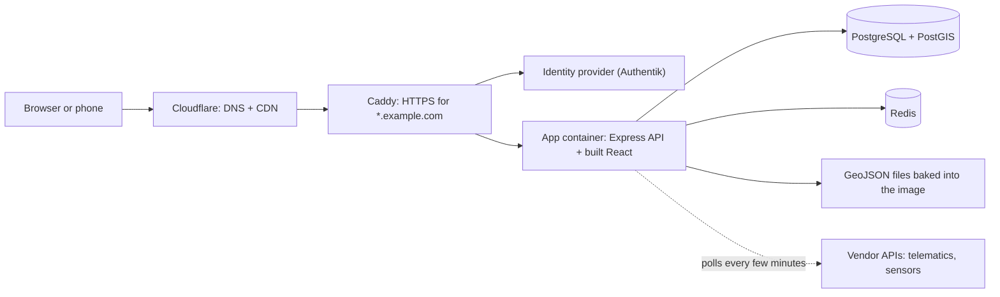

# 01 · Architecture: how the pieces fit

## The one-minute version

Each of our map apps is made of four parts:

1. **A React single-page app.** One HTML page whose JavaScript draws every screen, using Leaflet for the map.
2. **An API server,** either Express (Node + TypeScript) or FastAPI (Python). It reads the database and answers with JSON.
3. **A database.** This is PostgreSQL, plus PostGIS (a Postgres add-on that understands shapes) when there are field boundaries, or TimescaleDB (a Postgres add-on for time-series) when there are sensor readings. Redis, a fast in-memory store, holds short-lived things like login state.
4. **Static GeoJSON files.** This is map data that doesn't change minute to minute. Small Python tools build it from downloaded files, and it ships inside the Docker image.

All four go into Docker images. GitHub Actions builds the images and stores them in GitHub's container registry (GHCR). Portainer runs them on a server, behind a Caddy reverse proxy and Cloudflare.

That server can be your own machine or a rented DigitalOcean droplet ([docs/11](11-where-to-run-it.md)). Caddy and Cloudflare are in [docs/13](13-https-with-caddy.md), and the optional login through Authentik is in [docs/14](14-login-with-authentik.md). The keys all of this needs never go through a chat: [docs/12](12-keys-and-scripts.md) and [`scripts/`](../scripts/README.md).



## The platform: one edge, one identity provider, many small stacks

We don't run one big app. We run many small ones that share two services:

- **One edge proxy (Caddy).** It's the only thing listening on ports 80 and 443. It holds one wildcard HTTPS certificate for `*.example.com` and forwards each hostname to the right app. Setup and mistakes: [docs/13](13-https-with-caddy.md). Files: [`infra/caddy/`](../infra/caddy/README.md).
- **One identity provider (Authentik).** Every app that needs a login signs people in through it with OIDC, so a person has one login for everything and their role in each app comes from groups. Public maps (a visitor map, a share link) need no login at all. Setup: [docs/14](14-login-with-authentik.md). Files: [`infra/authentik/`](../infra/authentik/README.md).

Everything else belongs to the app:

- Each app has its **own Git repo** and its **own Docker Compose stack**. A stack is the app plus its database and cache, started together.
- Each app has its **own database.** Never share one database between two of your apps. If app B needs app A's data, give app A a small API.
- Only the app's front container publishes a port on the host. The database and Redis stay on the stack's private Docker network.
- Every app answers **`/health`** (for an uptime monitor) and **`/api/about`** (which version is running) without sign-in.
- Recurring jobs (a nightly sync, an ETL) run as a **second container from the same image** with a different command, not as cron on the host.
- Naming: the stack name is the repo name in lowercase, a container is `<stack>-<service>`, and an image is `ghcr.io/<owner>/<app>:latest` (or `ghcr.io/<owner>/<app>/<component>:latest` when a stack has several images).
- Keep a small **table of host ports** in your ops notes, and check it against `docker ps` before you claim a new port. Port tables go stale.

## Two shapes of app

**Shape A: one image.** The Node server serves both the API and the built React files. This is the simplest option and what our field-operations map uses. One container, one port.

**Shape B: two or three images.** nginx serves the built React files and forwards `/api` and `/ws` to a separate backend container (FastAPI in our irrigation app). Use this when the backend is Python, or when the frontend and backend ship on different schedules. With its own database image, a stack can have three images.

| | Shape A (one image) | Shape B (split images) |
|---|---|---|
| Frontend served by | Express `express.static` | nginx |
| Backend | Express + TypeScript | FastAPI (or anything) |
| SPA fallback (every unknown path returns `index.html`) | `app.get('/{*splat}')` (Express 5) | `try_files $uri $uri/ /index.html` |
| Good for | Map-heavy apps with a Node backend | Python backends, WebSockets, sensor data |

## Repo layout (shape A)

```
your-map-app/
├── client/                      React + Vite + TypeScript + Tailwind
│   ├── index.html               the SPA
│   ├── share.html               the lightweight share viewer (a second Vite entry, see docs/05)
│   ├── public/                  manifest, icons, sw.js, .well-known/
│   └── src/
│       ├── App.tsx              tiny router + error boundary
│       ├── components/          MapView, overlays, drawers, UserMenu, HomePage
│       ├── lib/                 nav.ts, api.ts, auth.ts, hardReset.ts, esc.ts
│       └── share/               the share viewer's map modes
├── server/
│   └── src/
│       ├── index.ts             route mount order, static files, error handler
│       ├── routes/              auth, health, about, share, maps, fields…
│       ├── db/migrations/       001-init.sql, 002-….sql
│       └── version.ts
├── data/
│   ├── maps/                    GeoJSON for signed-in maps
│   └── shares/                  GeoJSON for public share links
├── tools/<source>/              Python data tools: README.md, FORMAT.md, build_*.py
├── inbox/                       downloaded source files (gitignored)
├── outbox/                      things the agent made for you to look at
├── scripts/                     key-safe helper scripts: deploy, health checks, scan-before-push (docs/12)
├── secrets/                     the keys those scripts read: gitignored as /secrets/, chmod 700 (docs/12)
├── Dockerfile
├── docker-compose.yml           production: image only, no build:
├── docker-compose.dev.yml       development: just the database and Redis
└── .github/workflows/build.yml
```

## The app shell

The SPA has two places: **`/`**, the Home catalog of every map, and **`/map`**, the full-screen map. Share and internal viewer pages (`/s/<token>`, `/m/<id>`) are a separate, smaller page, covered in docs/05.

### A tiny router instead of a router library

With two routes, a router library buys little and hides the one thing we care about: exactly what goes into the browser history, so that Android's Back button behaves. So we wrote about 20 lines:

```ts
// client/src/lib/nav.ts
import { useSyncExternalStore } from 'react';

const here = () => location.pathname + location.search;

export function navigate(href: string) {
  if (href !== here()) history.pushState({ from: here() }, '', href);
  window.dispatchEvent(new Event('app:navigate'));
}

// If we came to the map from Home, step back instead of pushing another entry,
// so Back doesn't replay every Home → map trip.
export function goHome() {
  if (history.state?.from === '/') history.back();
  else navigate('/');
}

function subscribe(cb: () => void) {
  window.addEventListener('popstate', cb);
  window.addEventListener('app:navigate', cb);
  return () => {
    window.removeEventListener('popstate', cb);
    window.removeEventListener('app:navigate', cb);
  };
}
export const useLocation = () => useSyncExternalStore(subscribe, here);
```

Keep the access token in memory and move between pages with `pushState`. A full page load would lose the signed-in session (see docs/07).

### The map stays mounted under Home

Leaflet is expensive to rebuild, and people hate losing their place. After the first visit to `/map`, we keep the map in the page and draw Home over it as a fixed full-screen layer:

```tsx
// App.tsx
const loc = useLocation();
const onHome = !loc.startsWith('/map');
const [mapMounted, setMapMounted] = useState(!onHome);
if (!onHome && !mapMounted) setMapMounted(true);

return (
  <Crash>
    {mapMounted && (
      // inert: no focus, no clicks, hidden from screen readers while Home is up.
      // React 19 accepts a boolean; on React 18 use inert={onHome ? '' : undefined}.
      <div className="relative h-full w-full" inert={onHome} aria-hidden={onHome || undefined}>
        <MapPage />
      </div>
    )}
    {onHome && <HomePage />}   {/* fixed inset-0 z-[1500] */}
  </Crash>
);
```

The trap: if you write `return onHome ? <HomePage/> : <MapPage/>`, Leaflet unmounts and the map resets to its starting view on every trip to Home.

**State that isn't in the URL leaks across Home.** Open drawers, list views and edit mode would still be open when you come back. Reset them when the map is left, so the next tile opens clean. If the user leaves mid-drawing, ask first ("Discard this boundary?").

### Layers live in the URL

Which layers are switched on goes into the query string, so Back, refresh and a shared link all reopen the same view: `/map?layers=fields,equipment`.

```tsx
const loc = useLocation();
const [lastLoc, setLastLoc] = useState(loc);
const [layers, setLayers] = useState(() => readLayers(loc));

// Read during render, not in an effect: the first paint after Back already
// shows the right layers, with no flash of the old ones.
if (loc !== lastLoc) {
  setLastLoc(loc);
  setLayers(readLayers(loc));
}

// Write back with replaceState: toggling a layer must not add a history entry.
useEffect(() => {
  if (location.pathname !== '/map') return;
  const u = new URL(location.href);
  u.searchParams.set('layers', [...layers].join(','));
  history.replaceState(history.state, '', u);
}, [layers]);
```

Also set `document.title` per view, so the browser history and the app switcher show which map is which.

### An error boundary, or a blank screen

An installed PWA has no address bar and no Back button. If a render throws, the user sees a white screen with no way out. A class error boundary at the top gives them a way out:

```tsx
class Crash extends React.Component<{ children: React.ReactNode }, { err: Error | null }> {
  state = { err: null as Error | null };
  static getDerivedStateFromError(err: Error) { return { err }; }
  render() {
    if (!this.state.err) return this.props.children;
    return (
      <div className="fixed inset-0 z-[2000] grid place-items-center bg-gray-900 p-6 text-white">
        <div className="max-w-sm text-center">
          <h1 className="text-lg font-semibold">Something went wrong</h1>
          <button className="mt-4 min-h-11 rounded-lg bg-white px-4 text-gray-900"
                  onClick={() => location.reload()}>Reload</button>
        </div>
      </div>
    );
  }
}
```

## The Home catalog

After sign-in, Home lists every map as a tile with an icon, colour, title and description. Tiles are grouped into folders and filtered by a single search box. A tile opens the in-app map, a public share link, or a signed-in internal viewer.

**The server owns the list.** A `MAPS` array in server code describes every tile, and a `SECTIONS` list gives the default folders:

```ts
type MapTile = {
  id: string;
  section: string;            // default folder
  title: string;
  description: string;
  icon: string;               // key into the client's icon set (docs/04)
  color: string;
  href: string;               // '/map?layers=…', '/s/<token>' or '/m/<id>'
  keywords?: string;          // extra words for search
  visibility?: 'everyone' | 'admins';
  links?: { label: string; href: string }[];   // public-link chips
};
```

`GET /api/maps` returns `{ maps, layout, canArrange }`. On the way out, the server:

- drops a tile whose share link no longer exists
- filters by each tile's visibility
- includes the public-link chips only for admins and operators

**Arranging.** Admins get an "Arrange" mode, built on `@dnd-kit/sortable` for drag and drop. Each row also has a "Move up / Move down / Move to folder" menu, which is the dependable option on a phone. The result is one shared layout, saved with `PUT /api/maps/layout` as a single-row upsert. A reconcile step adds new maps to their default folder and keeps entries for maps that are missing for now.

**Search that forgives typing.** Normalize both sides: strip accents, turn punctuation into spaces, and make "A.B." match "ab". Then every word must match. Enter opens the result when exactly one is left.

```ts
const norm = (s: string) => s.normalize('NFD').replace(/\p{M}/gu, '').toLowerCase()
  .replace(/(\p{L})\.(?=\p{L})/gu, '$1')     // "A.B." -> "AB"
  .replace(/[^\p{L}\p{N}]+/gu, ' ').trim();

const words = norm(q).split(' ').filter(Boolean);
const shown = maps.filter(m =>
  words.every(w => norm(`${m.title} ${m.description} ${m.keywords ?? ''}`).includes(w)));
```

**Small things that make Home feel solid:**

- Cache the catalog, the search text and the scroll position in module scope (a plain variable outside the component). Coming back from a map then doesn't flash a loader.
- Which folders are collapsed is a per-device preference, so it goes in `localStorage` wrapped in `try/catch`. Private windows can throw on access.
- A tile is a card whose title link is stretched over the whole card (`after:absolute after:inset-0`). The chips on the card sit at `relative z-10`, so a near miss on a chip doesn't open the map.
- A "share" chip uses `navigator.share` (the phone's share sheet) on touch devices (`matchMedia('(pointer: coarse)')`). Elsewhere it copies to the clipboard, and if that fails it falls back to `window.prompt('Copy this link', url)`.
- Measure the sticky header with a `ResizeObserver` and publish its height as a `--header-h` CSS variable. A second sticky bar under it can then use `top: var(--header-h)` and still be right when the user has large text turned on.
- Before opening a signed-in viewer page, set a "came from Home" flag in `sessionStorage`, so that page can show a way back. An installed iOS PWA has no Back button.

## The server

Express 5 with TypeScript, and raw SQL through `pg`, with no ORM. Each route is a short function, and the SQL is right there to read. Install it as `express@5` (what a fresh `npm install express` gives you now). Express 4 examples you find online differ in two places, marked below.

**Geometry out of PostGIS:**

```ts
const { rows } = await pool.query(`
  SELECT id, name, crop,
         ST_AsGeoJSON(boundary)::json AS geometry,
         ST_Area(ST_Transform(boundary, $1)) / 4046.856 AS acres  -- area in a metre-based projection
  FROM fields WHERE season = $2`, [LOCAL_UTM_EPSG, season]);

res.json({
  type: 'FeatureCollection',
  features: rows.map(({ geometry, ...properties }) => ({ type: 'Feature', geometry, properties })),
});
```

Compute areas in a projected coordinate system for your region, such as your local UTM zone, not in raw latitude and longitude.

**Migrations on boot.** Numbered SQL files (`001-init.sql`, `002-add-equipment.sql`, …) are applied in name order at startup and recorded in a `migrations` table. Seed data from bundled files only when the table is empty.

```ts
async function migrate() {
  await pool.query('CREATE TABLE IF NOT EXISTS migrations (name text PRIMARY KEY, applied_at timestamptz DEFAULT now())');
  const done = new Set((await pool.query('SELECT name FROM migrations')).rows.map(r => r.name));
  for (const f of fs.readdirSync(MIGRATIONS_DIR).filter(f => f.endsWith('.sql')).sort()) {
    if (done.has(f)) continue;
    const c = await pool.connect();
    try {
      await c.query('BEGIN');
      await c.query(fs.readFileSync(path.join(MIGRATIONS_DIR, f), 'utf8'));
      await c.query('INSERT INTO migrations(name) VALUES ($1)', [f]);
      await c.query('COMMIT');
      console.log('migrated', f);
    } catch (e) { await c.query('ROLLBACK'); throw e; } finally { c.release(); }
  }
}
```

**Mount order matters.** Public routes go first, then everything behind sign-in:

```ts
const app = express();
app.set('trust proxy', 1);                      // behind Caddy/Cloudflare; needed for secure cookies
app.use(express.json());

app.use('/api/auth', authRouter);               // public: login, callback, exchange, refresh
app.use('/api/about', aboutRouter);             // public: version info
app.use('/health', healthRouter);               // public: uptime monitor
app.use('/api/share', shareRouter);             // public: reads static share files only

app.use('/api/maps', mapsRouter);               // its data route takes a bearer token OR a view cookie (docs/05)
app.use('/api/fields', authenticate, fieldsRouter);
// inside routers: requireRole('admin', 'operator') on writes, requireRole('admin') on deletes

if (prod) {
  app.use(express.static(dist));
  app.get(['/s/:token', '/m/:id'], (_req, res) =>
    res.set('X-Robots-Tag', 'noindex, nofollow').sendFile(path.join(dist, 'share.html')));
  // Express 5 syntax. The Express 4 form, app.get('*', ...), throws at startup on Express 5:
  // "Missing parameter name at index 1: *". A final app.use((_req, res) => res.sendFile(...)) works on both.
  app.get('/{*splat}', (_req, res) => res.sendFile(path.join(dist, 'index.html')));
}

// Last: answer errors as JSON, keeping 4xx codes, instead of Express's HTML error page.
app.use((err: any, _req: express.Request, res: express.Response, _next: express.NextFunction) => {
  const status = err.status >= 400 && err.status < 500 ? err.status : 500;
  res.status(status).json({ error: status === 500 ? 'Server error' : err.message });
});

// Express 5 passes a rejected async route handler to the error handler above (Express 4 didn't).
// Pollers and timers aren't routes, so still log any rejection nobody caught. Don't crash.
process.on('unhandledRejection', e => console.error('unhandledRejection', e));
```

**Background pollers.** A vendor sync every few hours, or equipment locations every few minutes, run with `setInterval` after `listen()`. Each one skips its run when the vendor isn't connected and catches its own errors, so one bad response can't take the server down. The client never calls the vendor. It only reads what the poller stored.

**Health and version.** `/health` always returns HTTP 200 with the overall status in the body. `/api/about` returns the version, commit and build time. Details are in docs/08.

## Which database for what

| Need | Use |
|---|---|
| Ordinary app records (users, feedback, settings) | PostgreSQL |
| Field boundaries, areas, "which field is this point in" | PostgreSQL + PostGIS (`postgis/postgis:16-3.4`) |
| Sensor readings every second or minute | PostgreSQL + TimescaleDB |
| Login state, one-time keys, short caches, pub/sub | Redis (`redis:7-alpine`) |
| Map data that changes by season, not by minute | Static GeoJSON files in the image (docs/06) |

## Deep links: what goes where in the URL

| Where | Example | Holds |
|---|---|---|
| Path | `/map`, `/s/<token>`, `/m/<id>` | Which page |
| Query | `?layers=fields,equipment`, `?design=final` | State the server or the page needs at load |
| Hash | `#p=moisture&f=12` | Client-only state: the colour-by property, the open item |

Write query and hash changes with `history.replaceState`, so they don't pile up history entries, and read them on boot to reopen the same view. Home tiles can link straight to `/map?layers=x,y`.

## Where it runs, and what's in front of it

| Question | Doc | Files |
|---|---|---|
| Laptop, own server or DigitalOcean? | [docs/11](11-where-to-run-it.md) | [`scripts/do/`](../scripts/README.md) |
| How do scripts and agents use keys without seeing them? | [docs/12](12-keys-and-scripts.md) | [`scripts/lib/`, `scripts/secrets/`](../scripts/README.md) |
| How does the image get built and deployed? | [docs/08](08-deploy.md) | [`scripts/ci/`, `scripts/portainer/`](../scripts/README.md) |
| How does HTTPS work? | [docs/13](13-https-with-caddy.md) | [`infra/caddy/`](../infra/caddy/README.md) |
| Who may sign in, and what if the settings go missing? | [docs/14](14-login-with-authentik.md), then [docs/07](07-auth.md) | [`infra/authentik/`](../infra/authentik/README.md), [`example/server/`](../example/server/) |
