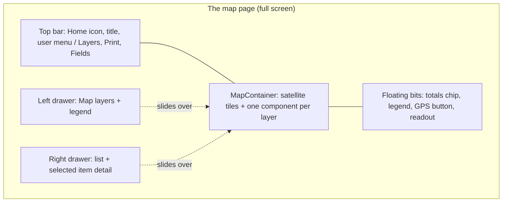

# 02 · The map page

This doc covers the screen people actually use: a full-screen satellite map with a top bar, switchable layers, slide-out drawers, legends, popups, labels, a list beside the map, totals, and a "My location" button. It runs from the outside in.



## 1. The layout: a full-bleed map with things floating on it

The map is the whole page. Toolbars, legends, toasts and badges float over it, rather than sitting in cards on a gray page. Five of our apps ended up here independently.

```tsx
<div className="relative h-full overflow-hidden">
  <MapContainer className="absolute inset-0" center={START} zoom={14} zoomControl={false}>
    <TileLayer {...SATELLITE} />
    <ZoomControl position="bottomleft" />
    {/* one component per layer, below */}
  </MapContainer>

  {/* Overlays are SIBLINGS of MapContainer, not children */}
  <div className="pointer-events-none absolute inset-x-3 top-3 z-[500]">
    <div className="pointer-events-auto inline-flex gap-1 rounded-lg bg-white/90 p-1 shadow-lg backdrop-blur">
      <button>Layers</button>
      <button>Labels</button>
    </div>
  </div>
  <Legend className="absolute bottom-8 right-3 z-[500]" />
</div>
```

Why it's built this way:

- **Overlays are siblings of the map.** Anything inside `MapContainer` is inside Leaflet's container and gets its drag and click handling.
- **The `pointer-events-none` wrapper** lets the gaps between buttons still drag the map. Each real button turns events back on with `pointer-events-auto`.
- **`zoomControl={false}`,** plus a `<ZoomControl position="bottomleft"/>` if you want one, keeps the top edge free for app controls. On phones we hide zoom buttons altogether, because pinch is enough.
- **The map needs a real height.** If the map sits inside a page with a header, its parent needs an explicit height (`flex-1 min-h-0` in a flex column), or Leaflet renders 0 px tall.
- One app uses separate toolbars for phone and desktop (`flex md:hidden` and `hidden md:flex`). A phone wants one big select plus icon buttons, while a desktop has room for labelled buttons.

## 2. The top bar

Every map has the same two-line header:

- **Line 1:** the app icon as a Home button (with the word "Maps" beside it from the `sm` breakpoint up), then the map's name, truncated, then the user menu.
- **Line 2:** this map's own buttons, with Layers on the left and Print and Fields on the right.

```tsx
const side = 'pl-[max(0.75rem,env(safe-area-inset-left))] pr-[max(0.75rem,env(safe-area-inset-right))]';

<div className="absolute inset-x-0 top-0 z-[1000] bg-gray-900/90 backdrop-blur-sm">
  <div className={`flex min-h-12 items-center gap-2 pt-[env(safe-area-inset-top)] ${side}`}>
    <button onClick={goHome} aria-label="Home — all maps"
            className="flex min-h-11 min-w-11 items-center gap-2 touch-manipulation">
      
      <span className="hidden sm:inline">Maps</span>
    </button>
    <h1 className="min-w-0 flex-1 truncate">{title}</h1>
    <UserMenu />  {/* portaled, see docs/03 */}
  </div>
  <div className={`flex items-center gap-2 py-1.5 ${side}`}>…this map's buttons…</div>
</div>
```

- **Side padding uses `env(safe-area-inset-left/right)` at every width.** A notched phone held sideways has its notch on the side.
- **Buttons are at least 44 px** (`min-h-11 min-w-11`) with `touch-manipulation`, which removes the double-tap-zoom delay on the button.
- **The title is an `h1` on its own,** not inside a button.
- The share viewer (docs/05) draws the same first line in plain HTML. A public visitor sees the icon alone, not a link. Staff see the Home button.

## 3. The basemap

All our apps use **Esri World Imagery** satellite tiles. They're free, need no key, and on a farm the aerial view (blocks, rows, pivots) matters more than street names.

```ts
export const BASES = [
  { id: 'sat',  label: 'Satellite', url: 'https://server.arcgisonline.com/ArcGIS/rest/services/World_Imagery/MapServer/tile/{z}/{y}/{x}',  attribution: 'Tiles © Esri', maxZoom: 19 },
  { id: 'topo', label: 'Topo',      url: 'https://server.arcgisonline.com/ArcGIS/rest/services/World_Topo_Map/MapServer/tile/{z}/{y}/{x}', attribution: 'Tiles © Esri', maxZoom: 19 },
];

<TileLayer key={base.id} url={base.url} attribution={base.attribution}
  maxNativeZoom={19} maxZoom={21} keepBuffer={4}
  errorTileUrl="data:image/gif;base64,R0lGODlhAQABAIAAAAAAAP///yH5BAEAAAAALAAAAAABAAEAAAIBRAA7" />

{/* Optional: place and road names on top of the imagery, but under nothing you'd tap */}
<Pane name="ref" style={{ zIndex: 450, pointerEvents: 'none' }}>
  <TileLayer url="https://server.arcgisonline.com/ArcGIS/rest/services/Reference/World_Boundaries_and_Places/MapServer/tile/{z}/{y}/{x}" />
</Pane>
```

- **`maxNativeZoom={19} maxZoom={21}`:** in many areas Esri has no imagery above zoom 19 and returns gray "no data" tiles. This setting lets Leaflet stretch the zoom-19 tiles instead.
- **`errorTileUrl`** points at a 1×1 transparent GIF. Also give `.leaflet-container` a background in a ground colour, so a missing tile reads as ground, not a white square.
- **`key={base.id}`** on the `TileLayer` makes switching basemaps a clean swap.
- **Dimming old imagery.** To make vector layers stand out, filter only the tile pane: `map.getPane('tilePane')!.style.filter = 'saturate(.45) brightness(.72)'`.
- **Attribution is required** by Esri's terms. You can hide Leaflet's attribution bar (`attributionControl={false}`) only if the credit moves somewhere people can reach, such as a help panel. On phones, truncate it to one line (docs/09) so it doesn't cover a bottom-corner button.
- **Imagery can be a year or more old.** Don't let people mistake an old picture for what's in the field today.

## 4. One component per layer

Each overlay is a small component inside `MapContainer`. It uses plain Leaflet calls on its own `LayerGroup`, redraws when its data or the zoom changes, and cleans up when it's removed.

```tsx
function LabelsLayer({ data }: { data: GeoJSON.FeatureCollection }) {
  const map = useMap();
  const group = useRef(L.layerGroup());
  const [zoom, setZoom] = useState(map.getZoom());

  useEffect(() => {
    const onZoom = () => setZoom(map.getZoom());
    map.on('zoomend', onZoom);
    return () => { map.off('zoomend', onZoom); };
  }, [map]);

  useEffect(() => {
    const g = group.current;
    g.clearLayers();
    if (zoom < 14) return;                            // labels only when zoomed in
    for (const f of data.features) {
      g.addLayer(L.marker(labelPointOf(f), {
        interactive: false,                           // taps go through to the shape
        icon: L.divIcon({ className: 'map-label', html: `<span>${esc(f.properties?.name)}</span>`, iconSize: [0, 0] }),
      }));
    }
    g.addTo(map);
    return () => { g.remove(); };
  }, [data, zoom, map]);

  return null;
}
```

```css
.map-label span {
  position: absolute; transform: translate(-50%, -50%);
  white-space: nowrap; pointer-events: none;
  color: #fff; font: 600 12px/1.2 system-ui, sans-serif;
  /* 8-direction 1px halo: readable on any imagery */
  text-shadow: 1px 0 #000, -1px 0 #000, 0 1px #000, 0 -1px #000,
               1px 1px #000, -1px -1px #000, 1px -1px #000, -1px 1px #000;
}
```

For the shapes themselves, react-leaflet's `<GeoJSON>` is fine:

```tsx
<GeoJSON
  key={`${season}|${mode}|${dataVersion}`}             // see "Restyle in place" below
  data={fields}
  style={f => styleFor(f, mode)}
  onEachFeature={(f, layer) => {
    layer.bindTooltip(esc(f.properties.name), { sticky: true });  // a string here is set as innerHTML: escape it
    layer.on('click', () => openDetail(f.properties.id));
  }}
/>
```

Rules we follow:

- **Reference layers are outline-only** (`fill: false`). They sit over other layers without hiding them or swallowing taps inside the outline.
- **Tooltips are `sticky: true`,** so they follow the finger or cursor instead of jumping to the shape's centre.
- **Escape every string that becomes HTML.** That includes `divIcon` `html`, and `bindTooltip` / `bindPopup` with a string. react-leaflet's `<Tooltip>` and `<Popup>` JSX children are escaped by React and are safe.

```ts
export const esc = (t: unknown) =>
  String(t ?? '').replace(/[&<>"']/g, c => ({ '&': '&amp;', '<': '&lt;', '>': '&gt;', '"': '&quot;', "'": '&#39;' }[c]!));
```

### Small invisible helpers ("headless" components)

Imperative map behaviour lives in tiny children of `MapContainer` that render nothing (`return null`). That keeps the map component itself declarative.

| Helper | Does |
|---|---|
| `FitOnce` | Fits the view to the data once, guarded by a ref, or once per entity |
| `FlyToOnNonce` | Flies to a target each time a counter changes |
| `MapStateTracker` | Reports centre and zoom on `moveend`, so a print preview opens at the same view (store it in a ref, not state) |
| `InvalidateOnResize` | Re-measures the map when its box changes size (docs/09) |
| `PlacementCatcher` | Takes map clicks only while a "placing" flag is on |
| `FollowMe` | Pans to each GPS fix until the user drags |

```tsx
function FitOnce({ data }: { data: GeoJSON.FeatureCollection }) {
  const map = useMap();
  const done = useRef(false);
  useEffect(() => {
    if (done.current || !data.features.length) return;
    const b = L.geoJSON(data).getBounds();
    if (!b.isValid()) return;
    map.fitBounds(b, { paddingTopLeft: [16, topInset()], paddingBottomRight: [16, 80], animate: false });
    done.current = true;
  }, [data, map]);
  return null;
}

// Re-trigger with the same target: pass a counter, because an unchanged prop won't re-run an effect.
function FlyToOnNonce({ pos, nonce }: { pos: L.LatLngExpression | null; nonce: number }) {
  const map = useMap();
  const prev = useRef(nonce);
  useEffect(() => {
    if (pos && nonce !== prev.current) {
      prev.current = nonce;
      map.flyTo(pos, Math.max(map.getZoom(), 16), { duration: 0.6 });
    }
  }, [nonce, pos, map]);
  return null;
}
// parent: <button onClick={() => setNonce(n => n + 1)}>Recenter</button>
```

A `FitBounds` that re-runs on every data refresh fights the user. They pan away, and the next poll drags the map back. Fit once, and refit only on an explicit "Home" button (a nonce) or when the entity or day changes. `animate: false` on the first fit makes the first label placement match the view people actually get.

## 5. Where the map opens

Where the map opens matters more than it seems.

- **Fit to this user's own features** if they have any.
- **Otherwise use a fallback chain:** a geocoded headquarters address, then a postcode centroid, then a regional view. Show one line of text saying where the map opened and why.
- **For fleets, open on a fixed home area,** or on a user-drawn "Home" area, rather than fitting all assets. When we fit to every vehicle, the map zoomed out to state level the moment one truck drove to a supplier.
- **In a multi-tenant app,** never hard-code a default centre. We did, and every tenant's draw tool opened on the first tenant's farm.

## 6. Layer switches, overlay modes and legends

Each data layer gets its own switch. In our field map those are the fields we manage, fields from an equipment-telematics feed, live equipment, and two reference boundary layers. A separate colour-mode list (Default / Planted / Sprayed / Harvested / Tillage) recolours the base layer, and the legend for the active mode sits right under it in the drawer.

```tsx
function LayerToggle({ on, toggle, color, title, hint }: Props) {
  return (
    <button role="switch" aria-checked={on} onClick={toggle}
            className="flex w-full items-center gap-3 rounded-xl border px-3 py-2.5 text-left">
      {/* accent bar = the same colour as this layer's outline on the map */}
      <span className="h-7 w-1.5 rounded-full" style={{ background: color, opacity: on ? 1 : 0.35 }} />
      <span className="flex-1"><b className="block">{title}</b><small className="opacity-70">{hint}</small></span>
      <span className="relative h-6 w-10 rounded-full" style={{ background: on ? color : '#374151' }}>
        <span className="absolute top-0.5 h-5 w-5 rounded-full bg-white transition-all"
              style={{ left: on ? '1.125rem' : '0.125rem' }} />
      </span>
    </button>
  );
}
```

- **The switch's accent bar matches the layer's colour on the map,** so people learn the colours without reading the legend.
- **Overlay modes are full-width buttons** with a label and a hint. When the base layer is off, they're disabled with a note: "Turn on My Fields to use overlays."
- **One legend table, shared by server and client.** The server colours the features and the client draws the legend, so both import the same `OVERLAY_LEGENDS` (`{ label, color }[]` per mode) and can't drift apart.
- **Heavy layers load on first use.** Fetch a big optional layer the first time its switch is turned on, not at page load. Start heavy overlays off.
- **Zoom-gated layers explain themselves.** If a switch is on but the zoom is too low for it to draw, show "Zoom in to show them." A count ("18 pivots") helps too.
- **In the share viewer,** the legend is a `<details>` element that starts open only on screens 700 px or wider. Optional feature groups are checkboxes inside it, under a "Show" heading.

**Remembering toggles.** Pick one approach on purpose:

- **In the URL** (`?layers=…`, docs/01) when Back, refresh and a shared link should keep them.
- **In `localStorage`** when they're personal preferences. Use a versioned key, and bump the version when the defaults change, or old "all on" states carry forward:

```ts
const KEY = 'app.layers.v2';
const [layers, setLayers] = useState(() => {
  try { return { ...DEFAULTS, ...JSON.parse(localStorage.getItem(KEY) || '{}') }; } catch { return DEFAULTS; }
});
useEffect(() => { try { localStorage.setItem(KEY, JSON.stringify(layers)); } catch {} }, [layers]);
```

If a tenant has no data yet, show the layers panel greyed out and inert (`pointer-events-none opacity-60 grayscale`), with a card explaining how to get data loaded.

## 7. Slide-out drawers

The map has no permanent sidebar. A **left "Map layers" drawer** holds the season picker, layer switches, overlay modes and the legend. A **right drawer** holds search, a grouped list, and the selected item's detail. Tapping a shape on the map opens the right drawer to that item.

Each drawer is two fixed elements that are always in the DOM:

```tsx
{/* backdrop: click to close */}
<div onClick={onClose}
     className={`fixed inset-0 z-[1390] bg-black/40 transition-opacity
                 ${open ? 'opacity-100' : 'pointer-events-none opacity-0'}`} />

<aside role="dialog" aria-label="Map layers"
       className={`fixed inset-y-0 left-0 z-[1400] flex w-80 max-w-[85vw] flex-col bg-gray-900/95
                   transition-transform duration-200 ${open ? 'translate-x-0' : '-translate-x-full'}`}>
  <header className="flex items-center justify-between p-2 pt-[env(safe-area-inset-top)]">
    <h2>Map layers</h2>
    <button onClick={onClose} aria-label="Close" className="min-h-11 min-w-11">✕</button>
  </header>
  <div className="flex-1 overflow-y-auto overscroll-contain">…</div>
</aside>
```

The right drawer is the same, with `right-0`, `translate-x-full`, and `w-96 max-w-[90vw]`.

- **One behaviour at every screen size.** An inline sidebar on desktop made the hamburger button do nothing on desktop, and two behaviours meant twice the bugs. **The rule: a drawer is always a slide-out drawer.** It never docks as a desktop sidebar, and it never turns into a bottom sheet on a phone. The only bottom sheet on a map page is a *list sheet* (section 10), a different component for views whose main job is a list: the light viewer's lists, or a list-first map mode. The demo's Fields list is one, which is why `example/` has a bottom sheet next to its Layers drawer.
- **The z-index is above Leaflet's controls (1000).** A drawer at 900 clears Leaflet's panes but not its zoom and attribution controls, which then show through. The full ladder is in docs/03.
- **Close with a delay before clearing the selection.** Clear the selected item about 300 ms after closing, so the panel slides out still showing its content instead of going blank first.
- **Close with Escape** too, and give the close button 44 px.
- **Fit around the drawer.** When the right drawer covers part of the map, fit with lopsided padding, or the thing you fitted lands under the drawer:

```ts
map.fitBounds(bounds, {
  paddingTopLeft: [40, 80],                              // the top bar
  paddingBottomRight: [isDesktop ? 450 : 30, 40],        // the right drawer
  maxZoom: 18,
});
```

- **Put leaflet-draw's toolbar at `bottomleft`.** Top left is under the app bar.

## 8. Popups that don't hide under the bar

The bar, chips, totals pill, GPS readout, legend and GPS button are all fixed on top of the map. Popups, `fitBounds` and "follow me" all need to know about them.

**Publish the bar's height as a CSS variable,** and keep Leaflet's popup padding in sync:

```ts
function topInset() {
  return Math.round(Math.max(0, ...['.bar', '.chips', '.totals']
    .map(s => document.querySelector(s)?.getBoundingClientRect().bottom ?? 0))) + 10;
}

new ResizeObserver(() => {
  document.documentElement.style.setProperty('--bar-h', `${Math.round(bar.getBoundingClientRect().bottom)}px`);
  L.Popup.mergeOptions({ autoPanPaddingTopLeft: L.point(10, topInset()) });
}).observe(bar);
```

Anything under the bar then uses `top: calc(var(--bar-h) + 6px)` instead of a hard-coded pixel offset, and stays right when the bar wraps or the text size grows.

**Build each popup when it opens,** sized to the room that's actually left:

```ts
const size = map.getSize();
const top = topInset(), bottom = 80, right = sheetOpen ? sheetWidth + 10 : 10;
const short = innerHeight < 500;                          // landscape phone
L.popup({
  maxWidth: short ? Math.min(460, size.x - right - 20) : 260,   // wide and short on a sideways phone
  maxHeight: Math.max(120, size.y - top - bottom - 30),
  autoPanPaddingTopLeft: L.point(10, top),
  autoPanPaddingBottomRight: L.point(right, bottom),
});
```

- **Place the popup beside an open legend** if there's room, otherwise above it. If neither fits, fold the legend away.
- **Make Leaflet's popup close button 44×44** with CSS. The default is tiny.

## 9. Labels

Field and asset names make a farm map readable, and they're also what clutters it most. Here are the levels, from simplest to best.

1. **Zoom-gated.** Don't draw labels below a zoom (14 or 15 works for fields). Add an "Aa" toggle, because labels bury the imagery.
2. **Zoom tiers.** Show a group's name at low zoom, sub-group names at mid zoom, and item numbers at high zoom.
3. **Collision-aware.** Labels never overlap each other, a pin, or any piece of UI.

### A label point inside the shape

The average of a polygon's corners can fall outside the shape for an L-shaped or curved field, and the label lands on the neighbour. Instead:

1. Work in a local flat projection (metres).
2. Compute the area-weighted centroid.
3. Find where a horizontal line through the centroid crosses the edges. Sorted, those crossings give "inside" stretches.
4. If the centroid is inside one of those stretches, use it. Otherwise use the middle of the widest stretch.
5. Keep that stretch's width as **room**. Later, a label fits at a given zoom only if `room / metresPerPixel >= labelWidth + 6`.

```ts
type P = [number, number];   // x, y in metres; ring is closed (last = first)

function areaCentroid(r: P[]): P {
  let a = 0, cx = 0, cy = 0;
  for (let i = 0; i < r.length - 1; i++) {
    const [x1, y1] = r[i], [x2, y2] = r[i + 1], k = x1 * y2 - x2 * y1;
    a += k; cx += (x1 + x2) * k; cy += (y1 + y2) * k;
  }
  return [cx / (3 * a), cy / (3 * a)];
}

function labelPoint(ring: P[]) {
  const c = areaCentroid(ring);
  const xs: number[] = [];
  for (let i = 0; i < ring.length - 1; i++) {
    const [x1, y1] = ring[i], [x2, y2] = ring[i + 1];
    if ((y1 <= c[1]) !== (y2 <= c[1])) xs.push(x1 + (c[1] - y1) * (x2 - x1) / (y2 - y1));
  }
  xs.sort((a, b) => a - b);
  let best = { x: c[0], room: 0 };
  for (let i = 0; i + 1 < xs.length; i += 2) {
    const a = xs[i], b = xs[i + 1];
    if (c[0] >= a && c[0] <= b) return { x: c[0], y: c[1], room: b - a };   // centroid is inside
    if (b - a > best.room) best = { x: (a + b) / 2, room: b - a };
  }
  return { x: best.x, y: c[1], room: best.room };
}
```

Better still, have your data tool (docs/06) precompute label points as `label` Point features, so the viewer never has to guess.

### Greedy placement in screen space

Run this on `moveend` and `resize`, once the GPS readout first appears, and when the phone rotates.

1. Clear the label layer.
2. Seed a list of "taken" rectangles with every visible piece of fixed UI (bar, chips, legend, GPS button, readout, open sheet), converted to map-container pixels and padded 4 px.
3. Add pins next. Pins always win.
4. Sort the labels by importance, heaviest first. For each label, try a few spots near its anchor in a few forms: the full one-liner, then name plus parts on two lines, then the name only.
5. Accept a spot only when the whole box is on screen with a 4 px margin and doesn't touch anything already placed. **A cut-off label is worse than none.**

```ts
const placed: number[][] = [];
const box = map.getContainer().getBoundingClientRect(), size = map.getSize();

document.querySelectorAll('.bar, .chips, .legend, .gps-btn, .readout, .sheet.open').forEach(e => {
  const b = e.getBoundingClientRect();
  if (b.width) placed.push([b.left - box.left - 4, b.top - box.top - 4, b.right - box.left + 4, b.bottom - box.top + 4]);
});

const hits = (r: number[]) => placed.some(q => r[0] < q[2] && r[2] > q[0] && r[1] < q[3] && r[3] > q[1]);
const fits = (x: number, y: number, w: number, h: number) => {
  const r = [x - w / 2, y - h / 2, x + w / 2, y + h / 2];
  if (r[0] < 4 || r[1] < 4 || r[2] > size.x - 4 || r[3] > size.y - 4 || hits(r)) return false;
  placed.push(r);
  return true;
};

const NEAR = [[0, 0], [0, -1], [0, 1], [-0.4, 0], [0.4, 0]];       // in label widths / heights
for (const t of [...labels].sort((a, b) => b.weight - a.weight)) {
  const pt = map.latLngToContainerPoint(t.at);
  for (const form of t.forms) {                                      // full, two-line, name only
    const w = form.longestLine * form.px * 0.6 + 10;                 // estimate from character count, no measuring
    const h = form.lines * form.px * 1.3 + 4;
    const spot = NEAR.find(([dx, dy]) => fits(pt.x + dx * w, pt.y + dy * h, w, h));
    if (spot) {
      layer.addLayer(makeLabel(map.containerPointToLatLng([pt.x + spot[0] * w, pt.y + spot[1] * h]), form));
      break;
    }
  }
}
```

Refinements we found worth it:

- **Near spots must still cover the anchor point** (`|x - pt.x| <= w/2 - 8`). A second ring of farther spots may move up to 60 px away, but only to a place at least 25% nearer its own anchor than any other label's anchor. Otherwise it reads as the neighbour's label.
- **Short screens get more slack.** Under 500 px tall, boxes may overlap by 3 px a side and labels drop one font size.
- **Values over patches** (a rate per zone) show only where the patch's widest horizontal stretch fits the text with room to spare. The same number within about 110 px is skipped, because a run of same-rate cells needs it only once.
- **Pin tags** try the right side, then the left, then hide.
- **Print views** show labels at every zoom and let people scale them (an 8–18 px slider).

For hundreds of labels, build them in plain Leaflet inside one `L.layerGroup()` per effect, not as hundreds of React `<Marker>`s. Compute outlines and label points once per dataset in `useMemo`, not on every zoom.

## 10. A list beside the map, and a totals chip

**The totals chip** is a pill under the bar that always shows the headline number ("12 to do of 40"). Tapping it opens the list.

```css
.totals {
  position: fixed; top: calc(var(--bar-h) + 6px); left: calc(env(safe-area-inset-left) + 10px);
  border-radius: 999px; white-space: nowrap; overflow: hidden; text-overflow: ellipsis;
  font-variant-numeric: tabular-nums;          /* digits don't jiggle as numbers change */
}
.totals[data-fit="1"] .opt-1 { display: none; }
.totals[data-fit="2"] .opt-1, .totals[data-fit="2"] .opt-2 { display: none; }
```

```ts
// Hide less important phrases until it fits
for (let k = 0; k <= 2; k++) { chip.dataset.fit = String(k); if (chip.scrollWidth <= chip.clientWidth) break; }
```

Put the chip's full meaning in its `aria-label`.

**The list sheet** is fixed on the right, from `top: var(--bar-h)` to the bottom. It shows totals, groups sorted by what's left, and rows you can tap to zoom to the item. It isn't a drawer (section 7): use it where the list *is* the view, in the light viewer (docs/05) or a list-first map mode like the demo's Fields list. A full-SPA list with a detail view belongs in the right drawer.

- Its width is `var(--sheet-w)`: `min(460px, 100vw)` on a phone (full width), and `min(340px, 42vw)` on a landscape phone so the map keeps more than half the screen.
- From 700 px wide it stays open beside the map, and the GPS button moves left of it: `.sheet.open ~ .gps-btn { right: calc(var(--sheet-w) + 12px) }`.
- Rows have `data-go`, `tabIndex=0`, and Enter/Space handlers. On a phone, tapping a row closes the sheet before zooming.
- A list sheet can be a **bottom sheet on a phone** (`max-height: min(62dvh, …)`) and a **side panel** from 768 px, or on a landscape phone. One of our map modes does this, and so does the demo. One `matchMedia` query is shared with the CSS so the two never disagree:

```ts
const PANEL = matchMedia('(min-width: 768px), (orientation: landscape) and (max-height: 500px)');
```

Wide tables inside a sheet scroll sideways with a sticky first column, and the sheet itself gets `overflow-x: hidden`.

## 11. My location

A "◎ My location" button starts GPS, and the map follows you until you drag it. A readout card under the bar tells you where you are relative to the plan: the nearest stake and its direction, your distance off the nearest line and how far along it you are, or "You're in Block 4: 32 units/acre".

```ts
let watchId: number | null = null, following = false, last: GeolocationPosition | null = null;

gpsBtn.onclick = () => {
  following = true; gpsBtn.textContent = '◎ Following you';
  if (last) follow(last);
  if (watchId === null) watchId = navigator.geolocation.watchPosition(onFix, onErr,
    { enableHighAccuracy: true, maximumAge: 2000, timeout: 30000 });
};
map.on('dragstart', () => { following = false; gpsBtn.textContent = '◎ My location'; });

function onFix(p: GeolocationPosition) {
  if (p.coords.latitude == null || (p.coords.latitude === 0 && p.coords.longitude === 0)) return;  // no fix ≠ (0,0)
  last = p; drawDot(p); updateReadout(p);
  if (following) follow(p);
}

function onErr(e: GeolocationPositionError) {
  if (e.code === e.PERMISSION_DENIED) {                 // the only error that stops the watch
    navigator.geolocation.clearWatch(watchId!); watchId = null;
    showHelp('Location is blocked. Allow it for this site in your browser settings.');
  } else if (last) {
    note('GPS signal weak — showing your last fix.');   // keep the last fix and keep watching
  }
}

// Centre the dot in the part of the map NOT covered by panels.
function follow(p: GeolocationPosition) {
  const ll = L.latLng(p.coords.latitude, p.coords.longitude);
  const z = Math.max(map.getZoom(), 18);
  const inset = coveredEdges();                         // { top, right, bottom } in px
  map.setView(map.unproject(map.project(ll, z).add([inset.right / 2, (inset.bottom - inset.top) / 2]), z), z);
}
```

**The readout's maths.** Project to local feet: 1° of latitude is about 364,000 ft, and 1° of longitude is about 364,000 × cos(latitude) ft. Then find the closest point on each line segment:

```ts
// a = segment start, b = segment end, me = you, all in local feet
const len = Math.hypot(bx - ax, by - ay);
const t = len ? Math.max(0, Math.min(1, ((me[0] - ax) * (bx - ax) + (me[1] - ay) * (by - ay)) / len ** 2)) : 0;
const off = Math.hypot(ax + t * (bx - ax) - me[0], ay + t * (by - ay) - me[1]);   // distance off the line
const along = runBefore + t * len;                                                 // distance along it
```

Report the offset, the distance along the line (in station notation if your crew uses it), and an 8-point compass direction. Each map mode can supply its own readout. For areas, that's "which area am I in", using point-in-polygon.

- **Put the GPS dot in its own pane with `pointerEvents: 'none'`** (section 13). On the map's shared canvas it would sit over the layers and swallow every tap.
- **Draw an accuracy circle** (`radius = coords.accuracy`, fill about 0.1) under a solid dot with a white 3 px stroke. For uncertain fixes, use a dashed, smaller, translucent dot.
- **Geolocation needs HTTPS.** Testing over plain http on your LAN needs a browser flag.
- **Guard missing coordinates.** `L.latLng(null, null)` is accepted as (0, 0) and draws a confident dot in the ocean off West Africa.

## 12. Live data: polling, and WebSockets that survive a phone

Most of our maps refresh by **polling** a REST endpoint: fleets every 5–30 s, sensors every 60 s. Do it politely:

```ts
useEffect(() => {
  if (!enabled) return;                               // poll an overlay only while its switch is on
  let stop = false, t: number | undefined, delay = POLL_MS;
  const tick = async () => {
    if (stop) return;
    if (document.visibilityState !== 'visible') { t = window.setTimeout(tick, HIDDEN_MS); return; }
    try {
      setData(await (await fetch('/api/live', { cache: 'no-store' })).json());
      delay = POLL_MS;
    } catch {
      delay = Math.min(delay * 2, 60_000);            // back off on errors, never give up
    }
    t = window.setTimeout(tick, delay);
  };
  tick();
  const wake = () => { if (document.visibilityState === 'visible') { clearTimeout(t); tick(); } };
  document.addEventListener('visibilitychange', wake);
  return () => { stop = true; clearTimeout(t); document.removeEventListener('visibilitychange', wake); };
}, [enabled]);
```

- **Tracks:** load the whole day once, then poll with `?after=<last timestamp>` and append, only while the day being viewed is today.
- **Key fetched data by what it belongs to** (`{ key: id + '|' + day, points }`) and render only when the key matches the current selection. Otherwise the previous asset's track flashes, or the map refits to it.
- On a context switch (another tenant, another season), clear the old data at once. Seed from a cache endpoint so nobody sees a mix of both.

**WebSockets** stream 1 Hz readings in our irrigation dashboard. The naive hook froze in an installed PWA, for two reasons. Phones suspend background timers, so a reconnect scheduled in `onclose` never runs. And a Wi-Fi to cellular handoff leaves a half-open socket that still says `OPEN` and never fires `onclose`. Recovery needs three independent mechanisms:

```ts
// 1. Resume events: reconnect if the socket is dead or has gone quiet
const onResume = () => {
  if (document.visibilityState === 'hidden') return;
  const s = ws.current, dead = !s || s.readyState >= WebSocket.CLOSING;
  if (dead || Date.now() - lastRx.current > STALE_MS) reconnectNow();
};
['focus', 'online', 'pageshow'].forEach(e => window.addEventListener(e, onResume));
document.addEventListener('visibilitychange', onResume);

// 2. Heartbeat every 25 s: sending on a dead socket throws
const beat = setInterval(() => { try { ws.current?.send('ping'); } catch { reconnectNow(); } }, 25_000);

// 3. Watchdog every 5 s: "OPEN" but silent for 20 s means it's dead
const watchdog = setInterval(() => {
  if (ws.current?.readyState === WebSocket.OPEN && Date.now() - lastRx.current > STALE_MS) reconnectNow();
}, 5000);

const isLive = connected && Date.now() - lastRx.current < STALE_MS;   // drive the Live dot from THIS
```

Add capped backoff (1, 2, 5, 10, 15 s) and a guard against two sockets at once. Show "Live" from `isLive` (data is actually arriving), not from `isConnected` (the socket claims to be open). Browsers can't set headers on WebSockets, so a viewer token travels as a query parameter. nginx settings for `/ws` are in docs/08.

## 13. Lots of shapes: canvas, panes and draw order

**Canvas vs SVG.** Leaflet draws vectors as SVG by default. For thousands of shapes or long tracks, use a canvas renderer:

- `L.canvas({ tolerance: 10 })` on the share map, which makes thin lines tappable with a finger.
- A separate `L.canvas({ padding: 0.3, tolerance: 2 })` for dense zone grids.
- `preferCanvas` on the map for tracks with thousands of points.

**Panes decide depth.** Leaflet's own panes are tiles 200, vectors 400, shadows 500, markers 600, tooltips 650 and popups 700. Your own panes slot between them:

| Pane | z | Why |
|---|---|---|
| Terrain shading + contour lines | 350 | Under the vector layers (400), non-interactive |
| Group outlines | 430 | Over the fields, under labels |
| Reference place-name tiles | 450 | Over the fields, `pointer-events: none` |
| GPS dot + accuracy ring | 450 | Own canvas, `pointer-events: none` |
| Recorded trail | 500 | Over the fields, under the markers |

```ts
const pane = map.getPane('gps') || map.createPane('gps');   // never createPane twice
pane.style.zIndex = '450';
pane.style.pointerEvents = 'none';
const gpsRenderer = L.canvas({ pane: 'gps' });
L.circleMarker(ll, { pane: 'gps', renderer: gpsRenderer, interactive: false,
  radius: 8, color: '#fff', weight: 3, fillColor: '#2563eb', fillOpacity: 1 }).addTo(map);
```

- **Use `getPane() || createPane()`.** Calling `createPane` again with an existing name makes a new div and orphans the old one, every time the layer is toggled.
- **A full-cover pane without `pointer-events: none` swallows every tap** meant for the map.
- **Keep a fixed draw order.** A `restack()` function re-applies `bringToFront()` in order after any change: fills → hatching → coverage → outlines → selection → status edges.
- **Show status as edge style,** so it doesn't fight the fill colour: solid green for done, dashed green for partial, dashed amber for "check this".
- **Hatched fills** (for mixed or uncertain areas) are canvas patterns, or an SVG `<pattern>` referenced from a CSS class.
- **Contour labels appear from zoom 16,** through a class on the container that's toggled on `zoomend`.
- **A custom canvas layer** (fog, a heat layer) is `L.Layer.extend({ onAdd, onRemove })` that appends a canvas to its pane. Give it the `leaflet-zoom-animated` class so it moves with zoom animations.

### Restyle in place; remount only on purpose

react-leaflet's `<GeoJSON data>` is read once, when the layer is created. Passing new `data` without changing the `key` leaves the old shapes on screen. So:

- **When only the look changes** (selection, colour mode), restyle the existing layer:

```tsx
<GeoJSON key={`${tenantId}|${season}`} data={fields} style={styleOf} onEachFeature={bindClick} ref={geoRef} />
useEffect(() => { geoRef.current?.eachLayer((l: any) => l.setStyle(styleOf(l.feature))); }, [selectedId, paintKey]);
```

- **When the data really changes,** change the `key` so it remounts.
- **Keep thin features visible when zoomed out** by adding a stroke in the fill colour: weight = max(1, 4 px − true width in px), where metres per pixel = 156543.03392 × cos(latitude) / 2^zoom.

## 14. Markers: status dots and badges

There are no default PNG pins in any of our apps. Two marker types cover everything: `CircleMarker` dots for status, and `L.divIcon` for anything with text, emoji or custom art. Details and the equipment clip art are in docs/04.

## 15. Tap vs double-tap

Tapping a shape opens a form, and double-tapping should zoom. Those two fought each other.

```ts
const timer = useRef<number | null>(null);
const onFieldClick = useCallback((f: Feature) => {
  if (timer.current) { clearTimeout(timer.current); timer.current = null; return; }   // second tap: let Leaflet zoom
  timer.current = window.setTimeout(() => { timer.current = null; openForm(f); }, 300);
}, []);
```

- Set `.leaflet-container { touch-action: none; }`, so a global `touch-action: manipulation` doesn't break map gestures.
- On a dot that sits on top of a polygon, call `L.DomEvent.stopPropagation(e)` so the polygon's handler doesn't also fire.
- Disable the Save button while saving, so rapid taps don't create duplicates.

## 16. Drawing and editing shapes

There are four ways to draw, from heaviest to lightest:

1. **leaflet-draw's toolbar.** Polygon only (`allowIntersection: false, showArea: true`), at `bottomleft`, mounted only while an admin "Draw mode" switch is on. Listen for `L.Draw.Event.CREATED` and save the GeoJSON geometry through the API.
2. **leaflet-draw with no toolbar.** Your own "+ Area" button calls `new L.Draw.Polygon(map, …).enable()` and shows a hint bubble: "Tap to add points; tap the first point to close."
3. **A hand-rolled tool** for circles and arcs, such as centre-pivot irrigation. It owns an `L.layerGroup()`, listens to `click` and `mousemove`, shows a crosshair cursor, takes the radius from `map.distance(centre, cursor)`, draws a live dashed preview with `interactive: false`, and pauses map handlers while a confirm panel is open.
4. **Point placement.** Use `useMapEvents({ click })` while placing. To move a point, use `<Marker draggable eventHandlers={{ dragend }}>`, save `e.target.getLatLng()` straight away, and refetch if the save fails.

```tsx
function DrawPolygon({ active, onDone }: { active: boolean; onDone: (ring: [number, number][]) => void }) {
  const map = useMap();
  useEffect(() => {
    if (!active) return;
    const h = new (L as any).Draw.Polygon(map, { allowIntersection: false, shapeOptions: { color: '#10b981' } });
    h.enable();
    const done = (e: any) => {
      const ring = e.layer.getLatLngs()[0].map((ll: L.LatLng) => [ll.lng, ll.lat]);   // Leaflet [lat,lng] → GeoJSON [lng,lat]
      ring.push(ring[0]);                                                              // close the ring
      map.removeLayer(e.layer);
      onDone(ring);
    };
    map.on('draw:created', done);
    return () => { map.off('draw:created', done); try { h.disable(); } catch {} };
  }, [active, map, onDone]);
  return null;
}
```

- **Coordinate order:** GeoJSON and KML use `[lng, lat]`, and Leaflet uses `[lat, lng]`. Swap on read, swap back on save, and close GeoJSON rings by repeating the first point.
- **Preview shapes must be `interactive: false`,** or the next click lands on the preview instead of the map.
- **After a save, reload from the server** rather than keeping the drawn layer.
- **Disable drawing when the scope is "all tenants".** A shape needs one owner.
- **Uploads:** a shapefile or KML is parsed on the server into a GeoJSON preview, then imported. That's for operators and up, on desktop only.
- **TypeScript and leaflet-draw:** put `import 'leaflet'` before your `declare module 'leaflet' { … }` block. Without it, your declaration replaces Leaflet's types instead of extending them.
- Leaflet interactions are hard to unit test. Smoke-test them on the running map.

## 17. Tracks and breadcrumbs

A track is a vehicle's history drawn as polylines: one asset's last 24 hours, or a sprayer's day coloured by what it was doing.

```ts
function runs(pts: Pt[], gapS = 180) {
  const out: { state: string; line: [number, number][] }[] = [];
  let cur: (typeof out)[number] | null = null;
  for (let i = 1; i < pts.length; i++) {
    const a = pts[i - 1], b = pts[i];
    if ((b.ms - a.ms) / 1000 > gapS) { cur = null; continue; }          // gap in the data: break the line
    if (!cur || cur.state !== a.state) { cur = { state: a.state, line: [[a.lat, a.lon]] }; out.push(cur); }
    cur.line.push([b.lat, b.lon]);
  }
  return out;
}
// {runs(track).map((r, i) => <Polyline key={i} positions={r.line} pathOptions={{ color: COLOR[r.state], weight: 4 }} />)}
```

- **Group consecutive points with the same state into one line** (run-length). **Break the line at time gaps,** so a data hole doesn't draw a straight line across the field.
- **Mark state flips** (spray on, spray off) with small dots.
- **A replay slider** indexes into the points and draws a cursor dot with a permanent tooltip showing time, state and speed.
- **A line that must read on any background** is two polylines: a wide dark casing, then a narrow bright core on top.
- **Recorded walks** are an array of segments, not one flat list. Otherwise separate stretches get joined by invented straight lines.
- **Store timestamps with a time zone.** Naive timestamps parsed as UTC shifted every point by the UTC offset and emptied a live 15-minute window.

## 18. Print

Paper maps go into field binders, and onto the wall during harvest or spray events.

- **A full-screen preview modal** (z 3000) holds a second `MapContainer` at the paper's aspect ratio (8.5×11 at 96 dpi). It opens at the live map's centre and zoom, taken from a ref.
- **Controls:** portrait or landscape (`key={orientation}` on the map, then `invalidateSize`), label size, fill opacity, border weight, label and value toggles, and a date stamp.
- **Fine framing:** `zoomSnap={0.25} zoomDelta={0.5} wheelPxPerZoomLevel={120}`.
- **Output path 1:** `window.print()` with a `body.map-printing` class, plus `@media print` rules that hide everything with `visibility: hidden` and show the print container with `visibility: visible`. Add `print-color-adjust: exact`. Don't use `display: none` on ancestors; we got a blank page because the print target is deeply nested.
- **Output path 2:** html2canvas at scale 2, loaded on demand with a dynamic `import()`. Open the PNG in a new window, or download it if popups are blocked. html2canvas misplaces Leaflet's `translate3d` pane transforms, so rewrite them to `top`/`left` before the capture and restore them after:

```ts
const saved = [...map.getContainer().querySelectorAll<HTMLElement>('.leaflet-pane')].map(el => {
  const m = el.style.transform.match(/translate3d\((-?[\d.]+)px,\s*(-?[\d.]+)px/);
  if (!m) return null;
  const s = { el, t: el.style.transform, l: el.style.left, tp: el.style.top };
  el.style.transform = 'translate3d(0,0,0)'; el.style.left = `${m[1]}px`; el.style.top = `${m[2]}px`;
  return s;
}).filter(Boolean);
// …capture…, then for each s: s.el.style.transform = s.t; s.el.style.left = s.l; s.el.style.top = s.tp;
```

Esri tiles send CORS headers, so they show up in the capture.

## 19. Kiosk / TV map

A public display with no keyboard or mouse that shows the same shapes and live dots.

```tsx
<MapContainer dragging={false} touchZoom={false} doubleClickZoom={false} scrollWheelZoom={false}
  boxZoom={false} keyboard={false} zoomControl={false} attributionControl={false}
  zoomSnap={0} zoomAnimation={false} fadeAnimation={false} preferCanvas>
  <FitOnce … />          {/* refit on a ResizeObserver */}
  <GeoJSON data={paths} style={() => STATIC_STYLE} />
  <PeopleCanvas people={people} />   {/* one canvas + requestAnimationFrame, reading the latest props from a ref */}
</MapContainer>
```

- **Turn off every interaction.** A display nudged by a stray mouse or a remote's arrow keys stays broken until someone notices.
- **`zoomSnap={0}`** lets `fitBounds` use a fractional zoom that exactly fills a 16:9 screen.
- **`preferCanvas`** rasterizes a shape with thousands of points once, rather than keeping a huge SVG path.
- **Prevent burn-in** with a slow drift of the whole picture, and enough fit padding that no edge ever shows.
- **Fade old positions by age.** In our app a dot is solid for about 25 s, fades to about 40% by 3 minutes, and is dropped at 5 minutes. Keep that policy in one shared config read by both the server and the screen. When the two encoded it separately, dots vanished instead of fading.
- **Old Android TV sticks** lack the CSS `inset` shorthand, so use top/left/width/height. Emoji support varies too: draw the glyph to an offscreen canvas and check its pixels, because measuring its width can't tell a missing glyph from a real one.

## 20. Small maps inside cards and dialogs

Examples are a location picker in a form, a map card on a detail page, or a "where is this field?" dialog opened from a table row.

```tsx
function FitTo({ data }: { data: GeoJSON.GeoJsonObject }) {
  const map = useMap();
  useEffect(() => {
    const t = setTimeout(() => {          // wait until the dialog has finished laying out
      map.invalidateSize();
      const b = L.geoJSON(data).getBounds();
      if (b.isValid()) map.fitBounds(b, { padding: [48, 48], maxZoom: 17 });
    }, 60);
    return () => clearTimeout(t);
  }, [data, map]);
  return null;
}
```

- **A map mounted while its dialog is still animating in measures 0 px,** and shows one tile in a corner until something resizes it. `invalidateSize()` after layout fixes it.
- **`scrollWheelZoom={false}` on maps inside scrolling pages,** so the page scrolls instead of the map zooming. Turn it on in full-screen dialogs.
- **Highlight the item asked about** (a thick yellow outline) and dim the rest (thin white).
- **Size the dialog per device:** full screen on phones, a large window on desktop (`sm:h-[85vh] sm:max-w-5xl sm:rounded-xl`). Escape closes it, and body scroll is locked while it's open.
- **A "?" trigger inside a clickable row** must be a `<span role="button">`, because a button inside a button is invalid HTML.
- **A map inside a normal page needs a cage** (`relative isolate z-0`) so it doesn't cover the page's own menus. That's in docs/03.
