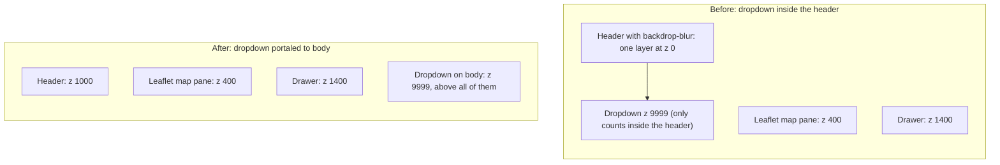

# 03 · Menus that stay on top

The bug we hit most often across all our apps was simple: **the account menu in the top-right corner opened behind the map.** Three separate apps shipped it. Each time, someone "fixed" it by raising the z-index, and it broke again. This doc explains why, and gives the fix that has held up every time.

## The short rule

> Every dropdown, menu or popover that belongs to the app's chrome (the header, toolbars) is rendered with `createPortal(…, document.body)`, at `position: fixed`, with a click-trap backdrop at `z-[9998]` and the menu at `z-[9999]`.

Use both halves. The portal gets the menu out of whatever box was trapping it, and the high z-index puts it above everything else sitting on `<body>`.

## Why the menu hides behind the map

### Leaflet brings its own z-indexes

Leaflet's CSS gives its panes these z-index values (we checked them against `leaflet.css`):

| Leaflet piece | z-index |
|---|---|
| Tile pane (the imagery) | 200 |
| Overlay pane (vector shapes) | 400 |
| Shadow pane | 500 |
| Marker pane | 600 |
| Tooltip pane | 650 |
| Popup pane | 700 |
| Individual controls | 800 |
| Control corners (`.leaflet-top`, `.leaflet-bottom`) | 1000 |

Those panes all live inside Leaflet's map pane, which has a `translate3d` transform and z-index 400. So, seen from the rest of the page, **all the map content behaves like one layer at about 400.** The control corners are different: `.leaflet-container` sets no z-index of its own, so the 1000 on the control corners competes directly with your app's numbers.

That's why Tailwind's `z-50` is below everything Leaflet draws.

### Stacking contexts trap z-index

A **stacking context** is a box whose children are only ordered against each other. To the outside, the whole box is one layer at its own z-index. Inside a stacking context, `z-index: 9999` only means "on top of my siblings in this box". It can never climb above the box itself.

Lots of everyday CSS creates a stacking context:

- `position: relative` or `absolute` **with** a z-index other than `auto`
- `position: fixed` or `sticky` (always)
- `transform`, `translate`, `scale` or `rotate` other than none
- `filter` or `backdrop-filter` (Tailwind's `backdrop-blur`!)
- `opacity` below 1
- `will-change` naming any of the above, `contain: layout` / `paint`, `isolation: isolate`, `mix-blend-mode`, `clip-path`, `mask`
- a flex or grid child with a z-index

A frosted-glass header (`backdrop-blur`) that is `sticky` is a stacking context twice over. Put a dropdown inside it, and the dropdown can only ever be as high as the header.



On the left, the dropdown loses to the map at 400 and to the drawer at 1400, whatever number you give it. On the right, it's a direct child of `<body>`, so its 9999 is compared with everything.

### What we tried that didn't work

- **Raising the dropdown to `z-50`, then `z-[2500]`.** It was still trapped by the header's stacking context.
- **Removing the header's z-index and setting the dropdown to 2500.** That worked on a laptop, then broke in production the same day, because a different ancestor also created a stacking context. We switched to the portal.
- **A "simpler" local dropdown in a new app.** Two later apps each wrote a small `absolute` dropdown "just for now". Both shipped with the menu invisible behind the map. **Even a slim menu keeps the portal shell.**

## The fix: a portaled user menu

The avatar pill shows initials, the name (hidden on phones) and a role chip. The dropdown shows an identity card (name, email, role badge) and then these items:

- Add a passkey
- Send feedback
- Export feedback (admin only)
- About
- Clear cache & reload
- Log out (in red)

```tsx
import { useEffect, useRef, useState } from 'react';
import { createPortal } from 'react-dom';
import { hardReset } from '../lib/hardReset';

export function UserMenu({ user, onFeedback, onAbout, onLogout }: Props) {
  const [open, setOpen] = useState(false);
  const btn = useRef<HTMLButtonElement>(null);
  const [pos, setPos] = useState({ top: 56, right: 12 });

  useEffect(() => {
    if (!open) return;
    // Position from the trigger, so it's right whether the header is one line or two.
    const place = () => {
      const r = btn.current!.getBoundingClientRect();
      setPos({ top: r.bottom + 8, right: Math.max(8, window.innerWidth - r.right) });
    };
    const onKey = (e: KeyboardEvent) => { if (e.key === 'Escape') setOpen(false); };
    place();
    window.addEventListener('resize', place);
    window.addEventListener('scroll', place, true);      // capture phase: catches any scrolling ancestor
    document.addEventListener('keydown', onKey);
    return () => {
      window.removeEventListener('resize', place);
      window.removeEventListener('scroll', place, true);
      document.removeEventListener('keydown', onKey);
    };
  }, [open]);

  const initials = (user.name || 'U').split(/\s+/).slice(0, 2).map(w => w[0]?.toUpperCase() ?? '').join('') || 'U';
  const item = 'flex w-full min-h-11 items-center px-4 text-left text-sm hover:bg-gray-100 touch-manipulation';
  const pick = (fn: () => void) => () => { setOpen(false); fn(); };

  return (
    <>
      <button ref={btn} onClick={() => setOpen(o => !o)} aria-haspopup="menu" aria-expanded={open}
              className="flex min-h-11 items-center gap-2 rounded-full bg-white/10 py-1 pl-1 pr-2 text-white">
        <span className="grid h-8 w-8 place-items-center rounded-full bg-white/25 text-xs font-semibold">{initials}</span>
        <span className="hidden max-w-[10rem] truncate sm:inline">{user.name}</span>
        <span className="hidden rounded bg-white/15 px-1.5 text-[10px] uppercase sm:inline">{user.role}</span>
      </button>

      {open && createPortal(
        <>
          {/* Click-trap backdrop: catches the outside click so it never reaches the map */}
          <div className="fixed inset-0 z-[9998]" onClick={() => setOpen(false)} aria-hidden />
          <div role="menu" style={{ top: pos.top, right: pos.right }}
               className="fixed z-[9999] w-72 max-w-[calc(100vw-1rem)] overflow-hidden rounded-lg bg-white text-gray-900 shadow-xl">
            <div className="border-b px-4 py-3">
              <div className="font-medium">{user.name}</div>
              <div className="truncate text-xs text-gray-500">{user.email}</div>
              <span className="mt-1 inline-block rounded bg-gray-100 px-1.5 text-[10px] uppercase">{user.role}</span>
            </div>
            <button role="menuitem" className={item} onClick={pick(onFeedback)}>Send feedback</button>
            <button role="menuitem" className={item} onClick={pick(onAbout)}>About</button>
            <button role="menuitem" className={item} onClick={pick(hardReset)}>Clear cache &amp; reload</button>
            <button role="menuitem" className={`${item} text-red-600`} onClick={pick(onLogout)}>Log out</button>
          </div>
        </>,
        document.body,
      )}
    </>
  );
}
```

What each piece is for:

- **`createPortal(…, document.body)`** renders the menu as a direct child of `<body>`, outside every stacking context in your header.
- **`position: fixed` plus `getBoundingClientRect()`** places it under the trigger, whatever the header's height is on this device. It's recalculated on resize and on scroll (in the capture phase).
- **The click-trap backdrop** (`fixed inset-0 z-[9998]`) closes the menu on an outside click. Don't use a `document` `pointerdown` listener for this. That listener closes the menu before the click lands, and the same click then falls through to whatever marker or button is underneath.
- **Escape closes it.**
- **`max-w-[calc(100vw-1rem)]`** keeps it from running off a narrow phone.
- **44 px rows** (`min-h-11`) with `touch-manipulation` make it easy to hit.
- **Memoize callbacks** (`useCallback`) when you pass open and close functions to children that list them as effect dependencies.

A **public, signed-out page** (for example a weather dashboard) uses a kebab button (⋮) with just Send feedback, About and Clear cache, in the same portal shell.

## Write the z-index ladder down

Every app eventually ends up with a z-index scale. The ones that wrote it down stopped having z-index bugs. Put it in a comment at the top of your CSS, or in the README:

| Range | What goes there | Our field map's actual numbers |
|---|---|---|
| 200–700 | Leaflet's own panes (the map pane counts as 400 to the page) | as shipped |
| 350–650 | Your custom panes, slotted between Leaflet's (docs/02) | 350, 430, 450, 500 |
| 1000 | Leaflet's control corners | as shipped |
| 500–1000 | Floating in-map buttons, legend, app bar | app bar 1000, floating buttons 1000 |
| 1100–1900 | Drawers and their backdrops (above Leaflet's controls) | backdrop 1390, drawer 1400 |
| 1500 | A full-screen page drawn over a still-mounted map | Home 1500 |
| 2000–3000 | Modals and dialogs, crash screen | crash screen 2000 |
| 3000 | Full-screen print preview | 3000 |
| 9998 / 9999 | Click-trap backdrop / menu, **always portaled** | 9998 / 9999 |

```css
/* z ladder: read this before adding a z-index
   Leaflet:  tiles 200 | vectors 400 | markers 600 | tooltip 650 | popup 700 | controls 1000
   App:      map overlays 500–1000 | drawers 1100–1900 | Home-over-map 1500 | modals 2000–3000
             print 3000 | menus 9998/9999 (portal only)                                           */
```

Numbers copied from another app can be wrong for this one. In one app the About dialog sat at 2000 and rendered **behind its own user menu at 2500**. Another app raised its modals from 50 to 1300, because the mobile sidebar was at 1200. Check the ladder, not your memory.

## The opposite case: cage a map that lives inside a normal page

Sometimes the map isn't the whole page. It's a box inside a page with a sticky header and a slide-out menu. Then the problem flips: the map's z-indexes (up to 1000, plus your in-map panels) cover the page's own menu.

Fence the map in with `isolation: isolate`:

```tsx
<div className="relative isolate z-0 h-[60vh] overflow-hidden rounded-xl">
  <MapContainer className="h-full w-full">…</MapContainer>
  <LayersPanel className="absolute right-3 top-3 z-[1200]" />
</div>
```

`isolate` makes the box a stacking context, so everything inside it (Leaflet's 200–1000 and your panels at 1100–1300) is compared only with each other. The whole box then sits at z 0 in the page, and the page's header and drawer open over it.

We learned this in our multi-tenant portal. It shipped without the cage, and on a phone the map's layers panel covered the top half of the menu drawer, which is where the customer and season switchers were. Users couldn't navigate away.

Inside the cage, in-map panels can use any z-index they like. But a dialog opened from inside the cage is trapped too, so portal it out.

## Modals and sliders opened from inside the map

A modal rendered as a child of a `Marker` or `Popup` is still inside Leaflet's container in the DOM, even when it's `position: fixed`. Leaflet's drag and click handlers see its events.

In one of our apps, a slider in such a modal dragged the map instead of moving the slider on phones. Touch events bubbled up to Leaflet's drag handler, and stopping only `onClick` wasn't enough.

**Preferred: portal the modal to `document.body`.** Then deal with two more traps:

1. **React portal events bubble through React parents, not DOM parents.** A click inside a portaled dialog still reached the table-row button that opened it, and collapsed the row. Stop propagation at the dialog's edge.
2. **A map drag released over the backdrop counts as a click on the backdrop.** It closed the dialog mid-pan. Close only when both the press and the release happened on the backdrop itself.

```tsx
const stop = (e: React.SyntheticEvent) => e.stopPropagation();
const downOut = useRef(false), upOut = useRef(false);

return createPortal(
  <div className="fixed inset-0 z-[2000] bg-black/50"
       onPointerDown={e => { stop(e); downOut.current = e.target === e.currentTarget; }}
       onPointerUp={e => { upOut.current = e.target === e.currentTarget; }}
       onClick={e => { stop(e); if (downOut.current && upOut.current) onClose(); }}
       onTouchStart={stop} onTouchMove={stop} onTouchEnd={stop}>
    <div role="dialog" aria-modal="true" onClick={stop} className="…">…</div>
  </div>,
  document.body,
);
```

If you can't portal it, stop `onClick`, `onMouseDown`, `onTouchStart`, `onTouchMove` and `onTouchEnd` on the modal's root. **Don't stop `pointerup` or key events globally.** Leaflet ends drags and pinches with listeners on `document`.

## Checklist before you call a menu "done"

- [ ] It's rendered with `createPortal` into `document.body`.
- [ ] Backdrop at `z-[9998]`, menu at `z-[9999]`, both `position: fixed`.
- [ ] It opens correctly with a **drawer open**, with a **popup open**, and over the **densest part of the map**.
- [ ] Tapping outside closes it, and that tap does **not** also select a marker underneath.
- [ ] Escape closes it.
- [ ] At 320 px wide, it fits on screen and every item is at least 44 px tall.
- [ ] The z-index ladder comment is updated if you added a new layer of UI.
