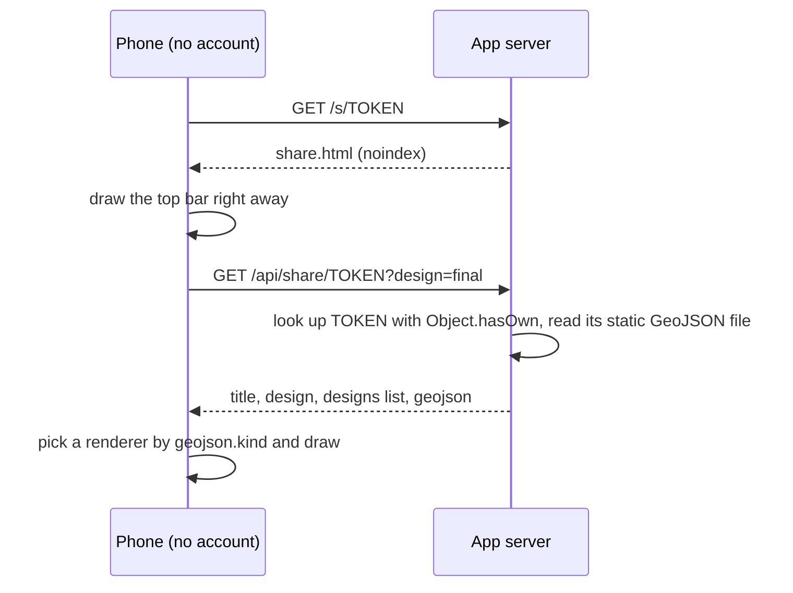
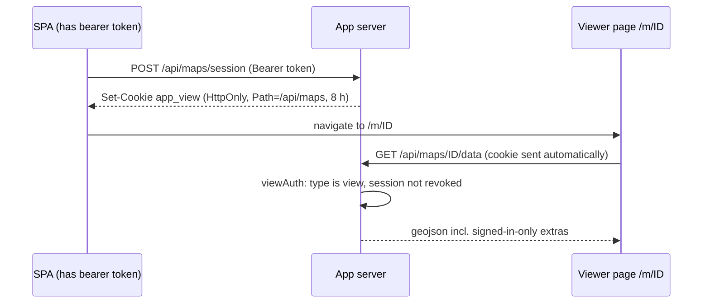

# 05 · Share links and internal maps

Not every map belongs in the main app. Sometimes you want to text one map to a contractor, a buyer or a neighbour, and they have no account. Sometimes staff need a special-purpose map (an irrigation plan, soil tests by property, application rates with totals) that doesn't fit the main map's layer model.

So a map can be opened three ways:

| Route | Who | Page | Auth |
|---|---|---|---|
| `/map?layers=…` | Signed-in staff | The React SPA | Access token in memory (docs/07) |
| `/m/<id>` | Signed-in staff | The lightweight viewer | Short-lived view cookie |
| `/s/<token>` | Anyone with the link | The lightweight viewer | The unguessable token is the key |

## The lightweight viewer page

`/s/<token>` and `/m/<id>` are served by one small page, `share.html`. It's plain TypeScript and Leaflet, with no React, no service worker, and no access to the main app's data. It loads fast on a weak phone signal, and many different kinds of map run in it.

**It's a second entry in the same Vite project:**

```ts
// vite.config.ts
import { defineConfig, type Plugin } from 'vite';
import react from '@vitejs/plugin-react';

// In dev, make /s/x and /m/x work like production: rewrite them to the share page.
const shareRoutes = (): Plugin => ({
  name: 'share-routes',
  configureServer(server) {
    server.middlewares.use((req, _res, next) => {
      const m = req.url?.match(/^\/(s|m)\/([^/?#]+)(?:\?(.*))?$/);
      if (m) req.url = `/share.html?${m[1] === 's' ? 't' : 'm'}=${m[2]}${m[3] ? `&${m[3]}` : ''}`;
      next();
    });
  },
});

export default defineConfig({
  plugins: [react(), shareRoutes()],
  build: { rollupOptions: { input: { main: 'index.html', share: 'share.html' } } },
  server: { proxy: { '/api': 'http://localhost:3000' } },
});
```

In production, Express sends `share.html` for both routes (docs/01), with `X-Robots-Tag: noindex, nofollow`. The page also carries `<meta name="robots" content="noindex">`, so search engines don't list your links.

The share viewer is deliberately **not** a PWA. It has no manifest and no service worker.

### How the viewer boots



1. **Draw the top bar before any data arrives,** so a slow or failed load still has a title and a Home button.
2. **Fetch the data.** A share uses `/api/share/<token>?design=…`. An internal map uses `/api/maps/<id>/data` with `credentials: 'same-origin'`, so the view cookie is sent.
3. **Turn errors into words people understand:**

```ts
async function load(url: string) {
  const r = await fetch(url, { credentials: 'same-origin' }).catch(() => null);
  if (!r) return fail('No connection. Check your signal.', { retry: true });
  if (r.status === 401) return location.replace(`/?next=${encodeURIComponent(location.pathname + location.search)}`);
  if (r.status === 403) return fail('This map is for admins only.');
  if (r.status === 404) return fail('This link is not valid or has expired.');
  if (!r.ok) return fail('Something went wrong. Check your signal and try again.', { retry: true });
  render(await r.json());
}
```

4. **Pick a renderer by the data's `kind`.** Each mode adds its own bar buttons, legend, list sheet and chips. It returns a readout and its screen insets, so the shared My location feature (docs/02) knows what to say and what to avoid.

```ts
const ctx = { map, bar, el, esc, topInset };
switch (fc.kind) {
  case 'plots': { const m = renderPlots(fc, ctx); setupLocate(m.readout, m.inset); break; }
  case 'rates': { const m = renderRates(fc, ctx); setupLocate(m.readout, m.inset); break; }
  case 'soil':  { const m = renderSoil(fc, ctx);  setupLocate(m.readout, m.inset); break; }
  default:      renderPlan(fc, ctx);           // generic: style comes from feature properties
}
```

The **default mode** is driven entirely by feature properties: `layer`, `stroke`, `stroke_width`, `dash`, `fill`, `fill_opacity`, `group`, `label`, `kind`, `name`, `note`. A new simple map is often just a new GeoJSON file, with no new code. The full format is in docs/06.

5. **Make it finger-friendly.** Use `L.canvas({ tolerance: 10 })` as the renderer, so thin lines (pipes, rows) can be tapped. Run every string you interpolate through `esc()`.

## Share tokens

A public link is an **unguessable random token** that points to a static GeoJSON file. The public routes only ever read static files. They never touch the database.

```ts
// server/src/shares.ts: the tokens below are PLACEHOLDERS. Real ones never go in a public repo.
type Design = { id: string; button?: string; aliases?: string[] } &
  ({ title: string; label: string; file: string } | { map: string });

type Share = {
  title: string;
  file?: string;                          // a single-file share…
  designs?: Design[];                     // …or several switchable versions
  assets?: Record<string, string>;        // whitelisted extra files (images) by public name
  geocode?: boolean;                      // enables the address-search proxy
};

export const SHARES: Record<string, Share> = {
  'irrigation-plan-xxxxxxxxxx': {
    title: 'Irrigation plan',
    designs: [
      { id: 'final',  button: 'Final',  title: 'Irrigation plan: final',    label: 'Final',    file: 'irrigation-final.geojson' },
      { id: 'plan-1', button: 'Plan 1', title: 'Irrigation plan: option 1', label: 'Option 1', file: 'irrigation-plan-1.geojson', aliases: ['a'] },
    ],
    assets: { 'profile.png': 'irrigation-profile.png' },
  },
};
```

**Making a token.** Use a readable slug plus random characters:

```sh
python3 -c "import secrets,string; a=string.digits+string.ascii_lowercase; print('irrigation-plan-' + ''.join(secrets.choice(a) for _ in range(10)))"
```

Ten base-36 characters is about 51 bits of randomness, which is plenty to stop guessing. Use 16 or more for anything sensitive.

**The route:**

```ts
router.get('/:token', (req, res) => {
  // Object.hasOwn, not SHARES[token]: a plain lookup also matches 'constructor', 'toString'…
  const share = Object.hasOwn(SHARES, req.params.token) ? SHARES[req.params.token] : undefined;
  if (!share) return res.status(404).json({ error: 'Share link not found' });

  const wanted = String(req.query.design ?? '');
  const design = share.designs?.find(d => d.id === wanted || d.aliases?.includes(wanted)) ?? share.designs?.[0];

  const geojson = design && 'map' in design
    ? loadInternalMap(design.map, { public: true })        // same loader as /m/, private extras left out
    : readShareFile(design && 'file' in design ? design.file : share.file!);

  res.set('Cache-Control', 'no-cache').set('X-Robots-Tag', 'noindex, nofollow');
  res.json({
    title: design && 'title' in design ? design.title : share.title,
    design: design?.id,
    designs: share.designs?.map(d => ({ id: d.id, button: d.button, label: 'label' in d ? d.label : undefined })),
    geojson,
  });
});

// Extra files: only names listed in this share's assets map. Never a path from the client.
router.get('/:token/asset/:name', (req, res) => {
  const share = Object.hasOwn(SHARES, req.params.token) ? SHARES[req.params.token] : undefined;
  const file = share?.assets && Object.hasOwn(share.assets, req.params.name) ? share.assets[req.params.name] : undefined;
  if (!file) return res.sendStatus(404);
  res.set('X-Robots-Tag', 'noindex, nofollow').sendFile(path.join(SHARES_DIR, file));
});
```

**Updating and revoking:**

| You want to | Do this | Result |
|---|---|---|
| Update a shared map | Rebuild its GeoJSON file and redeploy | Same link, new content |
| Revoke a link | Delete its entry and redeploy | The link returns 404, and Home drops its chip |
| Rotate a leaked link | Add a new token entry and delete the old one | Only people you send the new link to can open it |

### An address search for public pages (optional)

Some shares need "find an address". A public geocoder may not send CORS headers (the headers that let a browser page call another site), so the browser can't call it directly. A small proxy route on your server does it for shares that have `geocode: true`:

- About 20 lookups per minute per visitor. Key on the CDN's client-IP header, because every request reaches you from the reverse proxy.
- Cap the input at 200 characters.
- Set a 12 s timeout with `AbortSignal.timeout(12_000)`.
- Use small in-memory caches that are cleared when they pass a size.

## Designs: several versions behind one link

One link can carry several versions of a map, such as "Pipe | Final | Plan 1 | Plan 2" or "Plants | Cloth". Each version has its own `?design=ID` URL.

- **The first design is the default.** `aliases` keep old IDs working after a rename.
- **The client draws a segmented control only when there are two or more designs.**
- **Switching uses `location.replace()`,** so Back and the Home button go to Home rather than stepping back through every design you tried. The parameter is deleted for the default design.

```ts
button.onclick = () => {
  const u = new URL(location.href);
  if (d.id === designs[0].id) u.searchParams.delete('design'); else u.searchParams.set('design', d.id);
  location.replace(u.toString());
};
```

Use the hash for client-only state such as `#p=<property>&f=<item>` (the colour-by property and the open item). Write it with `history.replaceState` and read it on boot.

## Internal maps: signed-in, but in the light viewer

`/m/<id>` opens a staff-only map in the same light viewer. The viewer page has no access token, because tokens live in the SPA's memory (docs/07). So the SPA swaps its token for a **short-lived, HttpOnly view cookie** that only the map-data API can see.



```ts
export const viewCookie = (t: string, maxAge = 8 * 3600) =>
  `app_view=${t}; Path=/api/maps; Max-Age=${maxAge}; HttpOnly; SameSite=Strict${prod ? '; Secure' : ''}`;

// POST /api/maps/session: needs the bearer token
router.post('/session', authenticate, (req, res) => {
  const { sub, role, sid } = req.user;
  const maxAge = sid ? 8 * 3600 : 15 * 60;            // no session id = can't revoke it, so keep it short
  const t = jwt.sign({ sub, role, sid, type: 'view' }, JWT_SECRET, { expiresIn: maxAge });
  res.set('Set-Cookie', viewCookie(t, maxAge)).json({ ok: true });
});

// DELETE /api/maps/session: no auth needed, it only clears the cookie
router.delete('/session', (_req, res) => res.set('Set-Cookie', viewCookie('', 0)).json({ ok: true }));
```

- **`Path=/api/maps`:** the browser sends the cookie only to the map-data API, not to the rest of the app.
- **`HttpOnly`:** page JavaScript can't read it.
- **`SameSite=Strict`:** other sites can't make your browser send it.
- **`Secure`** in production: HTTPS only.
- **`viewAuth`** accepts either a bearer token or this cookie. It checks that a cookie token has `type === 'view'`, and that its session id (`sid`) hasn't been revoked by logout or by the identity provider (docs/07).
- **Every time the SPA starts signed out,** it calls `DELETE /api/maps/session` with `fetch(…, { keepalive: true })`, so a stale cookie can't outlive a logout.

**Coming back after sign-in.** A 401 in the viewer sends the user to `/?next=/m/<id>`. After sign-in, the SPA checks `next` against a strict pattern before going there. Never redirect to an arbitrary `next`:

```ts
const NEXT_OK = /^\/m\/[\w-]+(\?[^#]*)?$/;
if (next && NEXT_OK.test(next)) {
  await api('/api/maps/session', { method: 'POST' });
  location.replace(next);
}
```

## Public link, private extras

A public link can show a signed-in map's current season while leaving the private layers out.

- **In the share registry,** a design can name an internal map (`{ map: '<id>' }`) instead of a file. The share route reads that map through the same function the signed-in route uses, with `{ public: true }`.
- **Internal maps list two kinds of extra file:**
  - `extras` are appended to every design, public links included.
  - `signedIn` files are appended only on the `/m/` route, never for a public token.
- **An appended file's metadata** travels as `extra_meta[kind]`.
- **The viewer checks whether the signed-in data is present.** Only then does it turn on the extra UI (status marks, a wider popup). The public rendering stays exactly the same.

```ts
export const INTERNAL_MAPS = {
  'spray-2026': {
    title: 'Spray map',
    visibility: 'everyone' as const,              // or 'admins'
    designs: [{ id: 'season', title: 'Spray map', label: 'This season', file: 'spray-2026.geojson' }],
    extras: ['spray-2026-labels.geojson'],        // public too
    signedIn: ['spray-2026-status.geojson'],      // /m/ only
  },
};
```

A design whose file hasn't been built yet isn't offered.

## Share chips on Home

Admins and operators see the public link for each map as a chip on its Home tile. On a phone, tapping the chip opens the share sheet. Elsewhere it copies the link:

```ts
const viaSheet = typeof navigator.share === 'function' && matchMedia('(pointer: coarse)').matches;
if (viaSheet) await navigator.share({ title, url }).catch(() => {});
else await navigator.clipboard.writeText(url).catch(() => window.prompt('Copy this link', url));
```

## Rules

- **Never commit real tokens to a public repo.** The token is the only thing protecting the data. Use placeholders in examples.
- **Public routes read static files only.** No database queries, and no path ever comes from the client.
- **Look tokens up with `Object.hasOwn`.**
- **Send `Cache-Control: no-cache` and `X-Robots-Tag: noindex, nofollow`** on every share response.
- **Test the public page separately** from the signed-in one, at phone widths (docs/09), in a private window.
