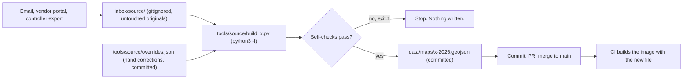

# 06 · The data pipeline: downloaded files → GeoJSON

A lot of what our maps show doesn't come from a live API. It comes from **files somebody downloaded**: a lab's results arriving as emailed PDFs and zips, a controller's export, a public dataset. Small Python tools turn those files into **static GeoJSON** that we commit to git and ship inside the Docker image. The viewer just draws it.

## Why static files

- **Fast.** The server reads a file. There's no query to plan and nothing to join.
- **Reviewable.** A data change is a git diff you can look at before it ships.
- **Safe to share.** Public share links (docs/05) only ever read static files, so a public route never touches the database.
- **Repeatable.** Run the same tool on the same inputs and you get the same bytes (see below).



## One folder per source

```
tools/<source>/
├── README.md          the steps: where the files come from, what to run, what "good" output looks like
├── FORMAT.md          the output schema: properties, kinds, units
├── build_<x>.py       the tool
└── overrides.json     small, hand-edited corrections (committed)

inbox/<source>/        the downloaded originals: never committed, never unzipped, never renamed
data/maps/             output for signed-in maps
data/shares/           output for public share links
```

- **Every build re-reads every file in the inbox,** so removing a zip removes its data. There's no hidden state.
- **Never commit the inbox.** Commit only the derived GeoJSON.
- **If a public copy is made,** the tool that makes it refuses to write when any private text remains in it (names, notes, internal IDs). It checks against a list and fails loudly.

## Read downloaded files safely

A downloaded file is **untrusted**. It could be broken, truncated, malicious, or just a format you didn't expect. The rules:

**1. Don't extract anything to disk.** Read zips, including zips inside zips, in memory:

```python
inner = zipfile.ZipFile(io.BytesIO(outer.read(member)))
```

Nothing extracted ever lands next to your code, where it could be run.

**2. Run the tool with `python3 -I`** (isolated mode). It keeps the current folder and your user site-packages off Python's import path, so a planted `json.py` in a downloaded folder can't be imported in place of the real one. The script then adds back only its own folder:

```python
sys.path.insert(0, str(Path(__file__).resolve().parent))
```

**3. Prefer the standard library.** When you do need a package, use a tool-local `.venv` (`tools/<source>/.venv`), not your system Python.

**4. One bad file never stops the build.** Wrap every read in a catch-all tuple of "this file is broken" errors. Print what was skipped and why, then carry on:

```python
UNREADABLE = (zipfile.BadZipFile, ValueError, KeyError, IndexError, struct.error, zlib.error,
              RuntimeError,   # encrypted zip members
              EOFError, OSError, OverflowError, MemoryError)
```

**5. Parse binary formats defensively.** Never trust a count in a header. For example, clamp a dBASE (`.dbf`) header's record count to what the file can actually hold:

```python
n_records, header_len, rec_len = struct.unpack('<IHH', dbf[4:12])
n_records = min(n_records, max(0, (len(dbf) - header_len) // max(rec_len, 1)))
```

## Clean the data, and say what you did

- **The same email downloaded twice:** skip it by hashing the file's contents.
- **Repeated exports** (the same records exported again next week): hash each record (blake2b over the raw record and shape bytes) and drop any export whose records all appear in a later one.
- **Impossible values:** drop them with explicit thresholds, such as more than 20× the target or above an absolute cap. Print a count per job.
- **Classify by explicit rules, and print each decision,** so a human can read the log and disagree.
- **Hand corrections** go in a small committed `overrides.json` that the tool reads. The output marks those items as set by hand (`"set_by_hand": true`), so nobody mistakes them for measured data.
- **Self-checks:** compare the output with the source's own totals (a report's summary line, a count in its header). The script ends with either `All checks OK.` or `!! N CHECKS FAILED` and exit code 1. A failed check blocks the deploy, because nothing is written.

## Byte-identical rebuilds

If you run the tool twice on the same inbox, the output files should match byte for byte. Then a git diff shows only real changes, never reshuffled noise.

- Process input files in **sorted order.**
- Sort features by a **stable ID.**
- **Round coordinates to 6 decimal places.** That's about 11 cm, finer than any farm GPS.
- **Sort dictionary keys** wherever the source order can vary. Sorting all of them is simplest.
- **Write compact JSON:** `json.dumps(obj, separators=(',', ':'), sort_keys=True)`.
- **Verify** by building twice and comparing hashes:

```sh
python3 -I tools/samples/build_samples.py 2026 && shasum data/maps/samples-2026.geojson
python3 -I tools/samples/build_samples.py 2026 && shasum data/maps/samples-2026.geojson   # must match
```

## A tool skeleton

This is a complete, generic tool. It reads CSVs from zips (including nested zips) in `inbox/samples/` and writes point features:

```python
#!/usr/bin/env python3
"""Build data/maps/samples-<season>.geojson from the zips in inbox/samples/.

Usage:  python3 -I tools/samples/build_samples.py 2026
"""
import csv
import hashlib
import io
import json
import struct
import sys
import zipfile
import zlib
from pathlib import Path

HERE = Path(__file__).resolve().parent
sys.path.insert(0, str(HERE))         # -I dropped the script's folder from sys.path; add back only ours
ROOT = HERE.parents[1]
INBOX = ROOT / 'inbox' / 'samples'
OUT = ROOT / 'data' / 'maps'
OVERRIDES = HERE / 'overrides.json'   # e.g. {"S-104": {"value": 42, "note": "re-sampled"}}

UNREADABLE = (zipfile.BadZipFile, ValueError, KeyError, IndexError, struct.error, zlib.error,
              RuntimeError, EOFError, OSError, OverflowError, MemoryError)
MAX_VALUE = 500.0                     # above this is a typo or a unit mix-up


def members(z, where):
    """Yield (path, bytes) for every file in a zip, opening nested zips in memory."""
    for name in sorted(z.namelist()):
        try:
            data = z.read(name)
        except UNREADABLE as e:
            print(f'  {where}/{name}: skipped ({type(e).__name__}: {e})')
            continue
        if name.lower().endswith('.zip'):
            try:
                inner = zipfile.ZipFile(io.BytesIO(data))
            except UNREADABLE as e:
                print(f'  {where}/{name}: unreadable inner zip ({e}), skipped')
                continue
            yield from members(inner, f'{where}/{name}')
        else:
            yield f'{where}/{name}', data


def read_rows(where, data):
    """Parse one CSV member. Returns [] (and says why) if it can't be read."""
    try:
        return list(csv.DictReader(io.StringIO(data.decode('utf-8-sig'))))
    except UNREADABLE + (csv.Error,) as e:
        print(f'  {where}: unreadable CSV ({type(e).__name__}: {e}), skipped')
        return []


def main(season):
    seen_files, seen_rows, rows, dropped = set(), set(), [], 0

    for zpath in sorted(INBOX.glob('*.zip')):
        digest = hashlib.sha1(zpath.read_bytes()).hexdigest()
        if digest in seen_files:
            print(f'  {zpath.name}: same contents as an earlier file, skipped')
            continue
        seen_files.add(digest)
        try:
            z = zipfile.ZipFile(zpath)
        except UNREADABLE as e:
            print(f'  {zpath.name}: unreadable ({type(e).__name__}: {e}), skipped')
            continue

        for where, data in members(z, zpath.name):
            if not where.lower().endswith('.csv'):
                continue
            for r in read_rows(where, data):
                key = hashlib.blake2b(repr(sorted(r.items())).encode(), digest_size=16).digest()
                if key in seen_rows:
                    continue                   # same record exported twice
                seen_rows.add(key)
                try:
                    sid = r['sample_id'].strip()
                    lat, lon, value = float(r['lat']), float(r['lon']), float(r['value'])
                except (KeyError, ValueError, AttributeError):
                    dropped += 1
                    continue
                if not (0 <= value <= MAX_VALUE) or (lat == 0 and lon == 0):
                    dropped += 1
                    continue
                rows.append({'id': sid, 'lat': lat, 'lon': lon, 'value': value})

    overrides = json.loads(OVERRIDES.read_text(encoding='utf-8')) if OVERRIDES.exists() else {}
    features = []
    for row in sorted(rows, key=lambda r: r['id']):
        props = {'layer': 'pin', 'id': row['id'], 'value': row['value']}
        if row['id'] in overrides:
            props.update(overrides[row['id']])
            props['set_by_hand'] = True
        features.append({
            'type': 'Feature',
            'properties': props,
            'geometry': {'type': 'Point', 'coordinates': [round(row['lon'], 6), round(row['lat'], 6)]},
        })

    fc = {'type': 'FeatureCollection', 'kind': 'samples',
          'meta': {'season': season, 'count': len(features)}, 'features': features}

    problems = []
    ids = [f['properties']['id'] for f in features]
    if len(ids) != len(set(ids)):
        problems.append('the same sample id appears twice with different values')
    if not features:
        problems.append('no features at all')
    print(f'  {len(features)} samples, {dropped} rows dropped as unreadable or impossible')
    if problems:
        for p in problems:
            print(f'  !! {p}')
        print(f'!! {len(problems)} CHECKS FAILED')
        return 1

    OUT.mkdir(parents=True, exist_ok=True)
    (OUT / f'samples-{season}.geojson').write_text(
        json.dumps(fc, separators=(',', ':'), sort_keys=True) + '\n', encoding='utf-8')
    print('All checks OK.')
    return 0


if __name__ == '__main__':
    sys.exit(main(sys.argv[1] if len(sys.argv) > 1 else '2026'))
```

## The GeoJSON contract the viewer reads

This is one small agreement between the Python tools and the viewer. With it in place, a new map is mostly a new file.

```json
{
  "type": "FeatureCollection",
  "kind": "rates",
  "meta": {
    "season": 2026,
    "as_of": "2026-06-01",
    "source": "lab results, spring sampling",
    "totals": { "planned": 120.5, "done": 80.0, "unit": "t" },
    "classes": [ { "key": "0", "min": 0, "max": 0 }, { "key": "low", "min": 0.1, "max": 1 }, { "key": "high", "min": 1, "max": 99 } ]
  },
  "groups":   [ { "name": "Pipes", "on": true }, { "name": "Valves", "on": false } ],
  "features": [
    { "type": "Feature", "geometry": { "type": "Polygon", "coordinates": [[[-98.500, 38.500], [-98.490, 38.500], [-98.490, 38.510], [-98.500, 38.500]]] },
      "properties": { "layer": "zone", "id": "z-1", "name": "Zone 1", "rate": 0.8, "stroke": "#ffffff", "fill": "#22c55e", "fill_opacity": 0.35 } },
    { "type": "Feature", "geometry": { "type": "Point", "coordinates": [-98.493, 38.503] },
      "properties": { "layer": "label", "label": "Zone 1", "for": "z-1" } }
  ]
}
```

(Everything above is made up. The demo app in `example/` uses invented shapes around the same arbitrary point.)

- **`kind`** picks the viewer's renderer (docs/05). If it's missing, the default "plan" renderer draws by properties.
- **`meta`** holds the season, the "as of" date, the source, totals, colour classes and anything else the legend or totals chip needs.
- **Every feature has `properties.layer`** (`zone`, `field`, `label`, `pin`, `pipe`, `poi`…), and the viewer filters on it.
- **Style hints live in the properties:** `stroke`, `stroke_width`, `dash`, `fill`, `fill_opacity`, `group`.
- **Label points are precomputed** as `label` Point features, so the viewer never guesses a centroid (docs/02).
- **Colour classes** come from `meta.classes` (`{ key, min, max }`) and are mapped onto a colour ramp in order, with a neutral colour for the zero class.
- **Files are named by season:** `<kind>-<year>.geojson`.
- **The server serves them as they are.** An internal-map registry lists a design's file plus extras (docs/05), and a design whose file hasn't been built yet isn't offered.

## Geometry gotchas

- **Coordinate order.** GeoJSON and KML are `[longitude, latitude]`, and Leaflet is `[latitude, longitude]`. Swap on read and swap back on save.
- **Close polygon rings.** In GeoJSON a ring's last point repeats its first.
- **Phantom lines inside merged outlines.** When we drew an outline around a group of field boundaries, it showed internal lines, because the shared edges didn't match exactly at the vertices. The fix: snap vertices within about 20 cm, split edges where one field's corner touches the middle of another field's edge (a T-junction), and only then cancel the shared edges.
- **Areas need a flat projection.** Compute areas in metres, in your local UTM zone (with PostGIS `ST_Transform`, or `pyproj` in Python), never in raw degrees.

## Deploying new data

Deploying new data means: commit the GeoJSON, open a PR, merge to main, and let CI build the image (docs/08). The share link or tile stays the same, and the content updates.

> **If your data is baked into the image, the image is as private as the data.** Keep the GHCR package private, or keep the data out of the image and mount it at runtime.
