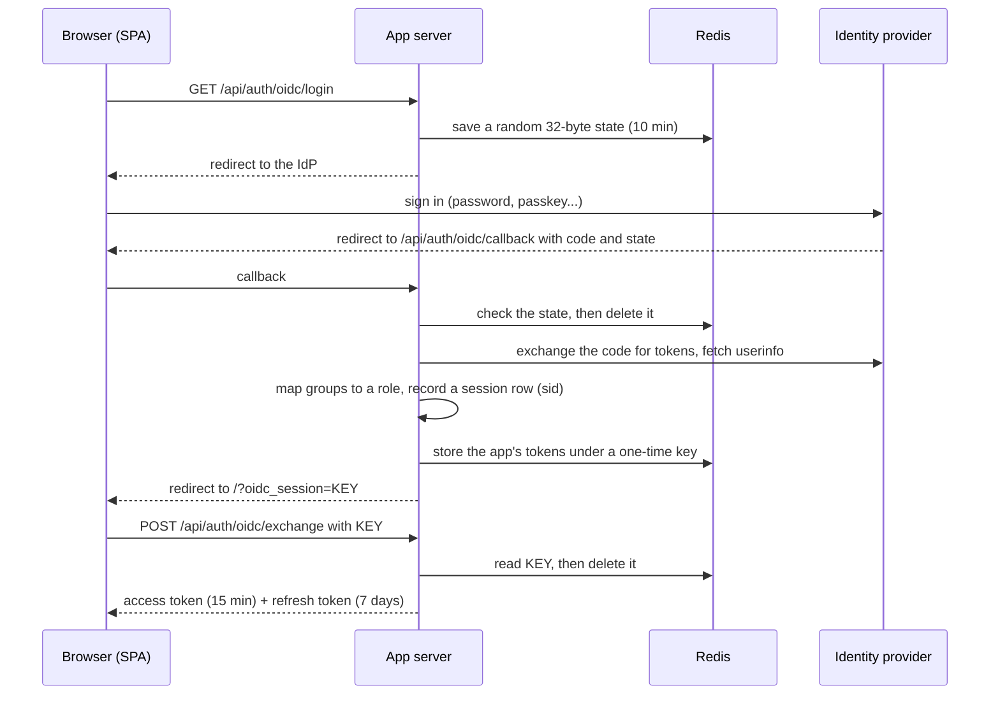

# 07 · Sign-in: OIDC, roles, refresh, logout, and failing closed

This doc goes deep on the app side of sign-in. For the identity-provider side (running Authentik, creating an app in it, passkeys) and the simplest working app, start with [docs/14](14-login-with-authentik.md). The demo app has that simplest version built in: [`example/server/`](../example/server/), with sign-in off by default.

## The words, in one line each

- **Authentication:** proving who you are.
- **Authorization:** deciding what you may do.
- **OIDC (OpenID Connect):** the standard behind "Sign in with…". The app sends you to a login server, and the login server sends you back with proof of who you are.
- **Identity provider (IdP):** that login server. We use Authentik, which is self-hosted and open source.
- **JWT:** a signed token ("this is user X, role Y, valid until Z") that the server can check without a database lookup.
- **Role:** admin (everything), operator (create and update), viewer (read only). Roles come from groups in the IdP.

## The model

- **Each app is its own OIDC client** in the IdP, a "confidential" client with its own secret, kept on the server.
- **The server runs the sign-in flow.** The browser never handles the IdP's own tokens.
- **Groups map to roles on the server,** and roles are **enforced on the server** (`requireRole`). The client hides buttons for convenience only, and never trusts a role sent by the client.
- **There's no sign-in button screen.** A signed-out visitor goes straight to the IdP and comes back to where they started.

We've used two variants. Both work.

| | Variant A: app-minted tokens | Variant B: server session cookie |
|---|---|---|
| Used in | Our field map (and its share viewer) | Our inventory app, the FastAPI apps, and the playbook's `example/server/` |
| After the callback | The server signs its own access JWT (15 min) and refresh JWT (7 days) | The user is kept in a server-side session |
| Browser holds | Tokens in memory only | An HttpOnly session cookie |
| Libraries | `openid-client`, `jsonwebtoken`, `jose`, Redis | `openid-client` v6 (Express) or Authlib + Starlette `SessionMiddleware` (FastAPI) |

**Starting fresh? Use variant B.** It's less code and harder to get wrong, and you can run it today: [`example/server/auth.js`](../example/server/auth.js) is a working copy, explained line by line in [docs/14](14-login-with-authentik.md#a-the-app-does-oidc-itself-how-these-maps-sign-in). Choose variant A when the SPA also opens the lightweight `/m/` viewer with a view cookie (docs/05), or when you want tokens that other services can check without a session store.

## Variant A, step by step



**On the server.** Every variant-A route lives under `/api/auth/oidc/`, and the client calls these exact paths:

| Route | What it does |
|---|---|
| `GET /api/auth/oidc/login` | Starts sign-in (step 1 below) |
| `GET /api/auth/oidc/callback` | The IdP sends the browser back here (step 2). This is the redirect URI you register in the IdP |
| `POST /api/auth/oidc/exchange` | Swaps the one-time key for the tokens (step 5) |
| `POST /api/auth/oidc/refresh` | New access and refresh tokens for a valid refresh token. 400/401 means "really signed out" |
| `POST /api/auth/oidc/logout` | Revokes the session and returns the IdP's logout URL |
| `GET /api/auth/oidc/enabled` | `true` or `false`, for the outside check after a deploy |
| `POST /api/auth/oidc/backchannel-logout` | The IdP's server-to-server logout (below) |

1. **`GET /api/auth/oidc/login`** stores a random 32-byte `state` in Redis with a 10-minute expiry, then redirects to the IdP. Use PKCE too (a one-time secret that proves the same server started and finished the login); `openid-client` does it for you.
2. **`GET /api/auth/oidc/callback`** checks the `state` and deletes it, exchanges the code, fetches userinfo, and maps groups to a role. It reads the IdP session id (`sid`) from the ID token. No role means no access: show a "you don't have access" page and issue no tokens.
3. It records a **session row** and signs the app's own **access JWT (15 min)** and **refresh JWT (7 days)**. Both carry `sid` and a `type`.
4. It stores those tokens in Redis under a **one-time key** and redirects to `/?oidc_session=<key>`. The tokens themselves never appear in a URL.
5. **`POST /api/auth/oidc/exchange`** swaps the key for the tokens and deletes the key.

**Groups to roles,** configured by environment variables:

```ts
// ROLE_MAP='{"maps-admins":"admin","maps-operators":"operator"}'   DEFAULT_ROLE=none (the default) or viewer
type Role = 'viewer' | 'operator' | 'admin';
const RANK: Record<Role, number> = { viewer: 0, operator: 1, admin: 2 };
const ROLE_MAP: Record<string, Role> = JSON.parse(process.env.ROLE_MAP ?? '{}');
// Unset or "none" means no default role: someone in no mapped group gets no access.
// (Check at startup that it's one of none/viewer/operator/admin, like ROLE_MAP.)
const DEFAULT_ROLE: Role | null =
  !process.env.DEFAULT_ROLE || process.env.DEFAULT_ROLE === 'none' ? null : (process.env.DEFAULT_ROLE as Role);

export function roleFor(groups: string[] = []): Role | null {     // null = "you don't have access"
  let best = DEFAULT_ROLE;
  for (const g of groups) {
    const r = Object.hasOwn(ROLE_MAP, g) ? ROLE_MAP[g] : null;      // not ROLE_MAP[g]: a group called "constructor" would match
    if (r && (best === null || RANK[r] > RANK[best])) best = r;
  }
  return best;
}

export const requireRole = (...allowed: Role[]) => (req: any, res: any, next: any) =>
  allowed.includes(req.user?.role) ? next() : res.status(403).json({ error: 'Not allowed' });
```

**In the browser:**

- **Tokens live in memory only.** They're never put in `localStorage`, where any injected script could read them.
- **Remember where they were going.** Before leaving for the IdP, save the return path in `sessionStorage` and restore it afterwards. Accept it only if it's a same-site path, so it can't become an open redirect (a link that bounces people to someone else's site):

```ts
const safeNext = (p: string | null) =>
  p && p.startsWith('/') && !p.startsWith('//') && !p.startsWith('/\\') ? p : '/';
```

- **Refresh one minute before expiry.** Phones sleep in pockets and lose signal, so be patient:

```ts
let access: string | null = null, refresh: string | null = null, timer: number | undefined;
const RETRY = [5_000, 15_000];                       // then every minute

function schedule(expiresAtMs: number) {
  clearTimeout(timer);
  timer = window.setTimeout(() => doRefresh(), Math.max(0, expiresAtMs - Date.now() - 60_000));
}

async function doRefresh(attempt = 0): Promise<void> {
  try {
    const r = await fetch('/api/auth/oidc/refresh', {
      method: 'POST', headers: { 'Content-Type': 'application/json' }, body: JSON.stringify({ refresh }),
    });
    if (r.status === 400 || r.status === 401) return signIn();   // ONLY these mean "really signed out"
    if (!r.ok) throw new Error(String(r.status));
    const t = await r.json();
    access = t.access; refresh = t.refresh; schedule(t.expiresAt);
  } catch {
    timer = window.setTimeout(() => doRefresh(attempt + 1), RETRY[attempt] ?? 60_000);   // offline or a blip: keep trying
  }
}

// Phones: check again the moment the app wakes up or the signal comes back
document.addEventListener('visibilitychange', () => { if (document.visibilityState === 'visible') refreshIfDue(); });
window.addEventListener('online', refreshIfDue);
```

- **The API wrapper refreshes once on a 401 and retries the request.** If it fails again, the user signs in again.
- **Move between pages with `pushState`** (docs/01). A full page load loses the in-memory tokens. For a separate page (the `/m/` viewer), trade the token for a short-lived view cookie first (docs/05).

## Variant B, briefly

- **`GET /api/auth/login`:** create a PKCE verifier and a state, store them in the session, **save the session**, then redirect. If you don't save before redirecting, the callback arrives with no PKCE state and fails.
- **`GET /api/auth/callback`:** exchange the code (checking the verifier and the state), read `sub`, `name`, `email` and `groups`, and store the user in the server-side session.
- **`GET /api/auth/me`:** returns the user and their resolved role.
- **`POST /api/auth/logout`:** see below.
- **On the client,** an `AuthContext` fetches `/me` and redirects to login on a 401. It checks again on window `focus` and `visibilitychange`, so a role change or a logout in another tab is picked up.
- **A runnable version:** the demo app's [`server/auth.js`](../example/server/auth.js) (login, callback, me, logout, groups → role, the sign-in gate) and [`src/lib/auth.ts`](../example/src/lib/auth.ts) (the browser side). [docs/14](14-login-with-authentik.md) section 7 shows how to run it against your own Authentik.

## Logout that actually signs you out

Clearing the app's own token isn't enough. The IdP still remembers you, and it would sign you straight back in.

1. **The client POSTs to the app's logout route** (`/api/auth/oidc/logout` in variant A, `/api/auth/logout` in variant B), sending the access and refresh tokens so the server can **revoke the session** (`sid`).
2. **The server returns the IdP's logout URL,** and the client goes there at once. With Authentik, the standard OIDC end-session endpoint didn't end the Authentik session on our setup, so we send people to its invalidation flow instead. The reason is a provider setting, explained (with the fix that makes end-session work too) in [docs/14](14-login-with-authentik.md#4-logout-that-really-logs-out):

```ts
// POST /api/auth/oidc/logout (this router is mounted at /api/auth/oidc)
router.post('/logout', async (req, res) => {
  await revokeSession(req.user?.sid);
  const origin = new URL(process.env.OIDC_ISSUER_URL!).origin;
  res.json({ logoutUrl: `${origin}/if/flow/default-invalidation-flow/` });
});

// client
const { logoutUrl } = await (await api('/api/auth/oidc/logout', { method: 'POST' })).json();
window.location.href = logoutUrl || '/';
```

**Don't clear React's auth state before navigating away.** If you do, the auth guard sees "no user" and starts a new sign-in before the browser has left the page.

### Back-channel logout (single logout across apps)

When someone signs out in one app or in the IdP, the IdP can tell every other app directly, server to server. Each app exposes an endpoint the IdP POSTs a signed `logout_token` to:

```ts
import { createRemoteJWKSet, jwtVerify } from 'jose';
// OIDC_JWKS_URL is the jwks_uri from the issuer's discovery document
// (<issuer>/.well-known/openid-configuration). Set it, or read jwks_uri from discovery at startup.
const JWKS = createRemoteJWKSet(new URL(process.env.OIDC_JWKS_URL!));

// POST /api/auth/oidc/backchannel-logout
router.post('/backchannel-logout', express.urlencoded({ extended: false }), async (req, res) => {
  try {
    const { payload } = await jwtVerify(String(req.body.logout_token), JWKS, {
      issuer: process.env.OIDC_ISSUER_URL, audience: process.env.OIDC_CLIENT_ID,
    });
    const events = payload.events as Record<string, unknown> | undefined;
    if (payload.nonce !== undefined) return res.status(400).end();               // logout tokens must not carry a nonce
    if (!events?.['http://schemas.openid.net/event/backchannel-logout']) return res.status(400).end();
    if (!payload.jti || await seenBefore(payload.jti)) return res.status(400).end();   // replay protection
    await revokeSession(String(payload.sid));
    res.set('Cache-Control', 'no-store').status(200).end();
  } catch {
    res.status(400).end();
  }
});
```

- **`authenticate` then refuses any token whose `sid` is revoked,** and so does the view-cookie check (docs/05).
- **Mount this endpoint outside the auth middleware.** It must never answer 401.
- **The IdP must sign with a key pair,** or there's no JWKS to check the logout token against. In Authentik, pick a certificate as the provider's signing key ([docs/14](14-login-with-authentik.md#2-create-the-app-in-authentik)).
- **Deploy the endpoint first,** then set the logout URL in the IdP's provider settings.
- **Cookie-only sessions can't be ended remotely** unless you can look them up by `sid`. Use a server-side session store.

## Fail closed in production

This is the most important section in this doc.

**What happened to us.** A scripted redeploy through the container platform's API replaced the stack's whole environment with an empty one (docs/08). With no variables, the "OIDC enabled" flag fell back to its development default of off. The auth middleware had a convenience for local development: "no OIDC means everyone is a local admin". So for a short while, the production app served everything to everyone as an admin. The JWT secret had fallen back to a known default as well.

The fix has **three layers**, and you want all three:

```ts
// 1. Refuse to start with a dangerous configuration
const KNOWN_DEFAULT_SECRETS = ['change-me', 'dev-secret', 'secret'];

export function assertAuthConfig() {
  if (process.env.NODE_ENV !== 'production') return;
  if (process.env.OIDC_ENABLED !== 'true') throw new Error('FATAL: OIDC must be enabled in production');
  const s = process.env.JWT_SECRET ?? '';
  if (!s || KNOWN_DEFAULT_SECRETS.includes(s)) throw new Error('FATAL: JWT_SECRET is unset or a known default');
}
assertAuthConfig();   // first line of start(): the container crash-loops where you'll notice it

// 2. Even if it does start, never grant the dev bypass in production
export function authenticate(req: any, res: any, next: any) {
  if (!config.oidcEnabled) {
    if (process.env.NODE_ENV === 'production') return res.status(503).json({ error: 'Authentication misconfigured' });
    req.user = { sub: 'local-dev', role: 'admin' };   // development only
    return next();
  }
  // …verify the bearer JWT, check sid isn't revoked…
}
```

```yaml
# 3. Compose refuses to deploy without the secrets, and defaults the flag to the SAFE value
environment:
  JWT_SECRET:         ${JWT_SECRET:?JWT_SECRET must be set in the stack env}
  OIDC_CLIENT_ID:     ${OIDC_CLIENT_ID:?OIDC_CLIENT_ID must be set}
  OIDC_CLIENT_SECRET: ${OIDC_CLIENT_SECRET:?OIDC_CLIENT_SECRET must be set}
  OIDC_ENABLED:       ${OIDC_ENABLED:-true}
```

**Check from outside after every deploy:**

```sh
curl -s https://maps.example.com/api/auth/oidc/enabled          # → true
curl -s -o /dev/null -w '%{http_code}\n' https://maps.example.com/api/fields   # → 401
curl -s https://maps.example.com/health                         # → 200, with a fresh started_at
```

After hardening, a redeploy against an empty environment **fails**, and that's what you want. Rotating `JWT_SECRET` signs everyone out once.

**For a session-cookie app (variant B),** the same three layers apply with `SESSION_SECRET` in place of `JWT_SECRET`. The demo's [`server/config.js`](../example/server/config.js) is layer 1 in full: it refuses seven kinds of unsafe setting before it opens a port, and a public deployment has to say so on purpose with `ALLOW_NO_AUTH=true`. The table of what it refuses, and why, is in [docs/14](14-login-with-authentik.md#6-fail-closed).

## Mount order and other details

```ts
app.set('trust proxy', 1);                   // behind Caddy/Cloudflare; without it, Secure cookies never get set
app.use('/api/auth', authRouter);            // /api/auth/oidc/{login,callback,exchange,refresh,logout,enabled,backchannel-logout}
app.use('/api/about', aboutRouter);          // no auth
app.use('/health', healthRouter);            // no auth
app.use('/api/share', shareRouter);          // public, static files only
app.use('/api/webhooks', webhookRouter);     // token-checked webhooks: an explicit carve-out before requireAuth
app.use('/api', authenticate, apiRouter);    // everything else
```

- **Missing `trust proxy`** behind a proxy that terminates HTTPS shows up as silent redirect loops, because the secure cookie is never set.
- **Groups only appear in tokens if the "groups" scope mapping is attached** to the provider in the IdP. Group membership changes need a fresh sign-in.
- **Bind the role groups to the application in the IdP.** Many IdPs, Authentik included, let every signed-in user into every application by default.
- **iPhone cookie limits.** Safari's tracking protection, and the 7-day cookie limit on installed iOS PWAs, are much less trouble when the IdP and the apps share a parent domain (`auth.example.com`, `maps.example.com`) and use `SameSite=Lax`.
- **The service worker must never cache `/api/*`.** One of our apps cached an OIDC 302 redirect and replayed it, and logout broke (docs/08).
- **Passkeys:** the user menu can show "Add a passkey" to people who haven't yet. It's a link to the IdP's passkey-enrollment flow. The Authentik settings, including sign-in from the browser's passkey autofill, are in [docs/14](14-login-with-authentik.md#5-passkeys).
- **Keep the IdP URL, client ID, client secret and group-to-role map in environment variables,** never in the repo. Write `example.com` placeholders in docs.
