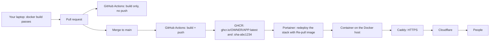

# 08 · Deploy: Docker, GitHub Actions → GHCR, Portainer, Caddy and Cloudflare

## The pipeline



The server that runs your app **never builds anything.** It pulls a finished image. CI builds the image, and you check the build on your own machine before you push.

This doc is about the pipeline. Where the Docker host itself lives (your laptop, your own server, or a DigitalOcean droplet) is [docs/11](11-where-to-run-it.md). The scripts that wait for CI and redeploy for you are in [`scripts/`](../scripts/README.md), and the keys they need stay out of your chats ([docs/12](12-keys-and-scripts.md)).

## 1. The Dockerfile (multi-stage)

A **multi-stage** Dockerfile builds in throwaway stages and copies only the results into a small final image.

**Shape A: one image, where Express serves the API and the built React app.**

```dockerfile
FROM node:22-alpine AS client-build
WORKDIR /app/client
COPY client/package*.json ./
RUN npm ci
COPY client/ ./
# vite build → client/dist
RUN npm run build

FROM node:22-alpine AS server-build
WORKDIR /app/server
COPY server/package*.json ./
RUN npm ci
COPY server/ ./
# tsc → server/dist
RUN npx tsc

FROM node:22-alpine
WORKDIR /app
COPY server/package*.json ./server/
RUN cd server && npm ci --omit=dev
COPY --from=server-build /app/server/dist ./server/dist
COPY --from=client-build /app/client/dist ./client/dist
COPY server/src/db/migrations ./server/migrations
# shares, maps, seed files: see the privacy note below
COPY data/ ./data/
ARG APP_VERSION=1.0.dev
ARG COMMIT_SHA=
ARG BUILT_AT=
ENV APP_VERSION=$APP_VERSION COMMIT_SHA=$COMMIT_SHA BUILT_AT=$BUILT_AT \
    NODE_ENV=production PORT=3000
EXPOSE 3000
CMD ["node", "server/dist/index.js"]
```

**Shape B: split images.** The frontend is built by Node and served by nginx. The backend is Python.

```dockerfile
# frontend/Dockerfile
FROM node:22-alpine AS build
WORKDIR /app
COPY package*.json ./
RUN npm ci
COPY . .
RUN npm run build
FROM nginx:1.30-alpine
COPY --from=build /app/dist /usr/share/nginx/html
COPY nginx.conf /etc/nginx/conf.d/default.conf

# backend/Dockerfile
FROM python:3.12-slim
WORKDIR /app
COPY requirements.txt .
# install deps before copying the code, so this layer stays cached
RUN pip install --no-cache-dir -r requirements.txt
COPY . .
CMD ["uvicorn", "app.main:app", "--host", "0.0.0.0", "--port", "8000"]
```

If you need a custom database image (`FROM postgres` or TimescaleDB), `COPY` the init SQL into `/docker-entrypoint-initdb.d` and the migrations into the image. Then nothing depends on files bind-mounted from the cloned repo, which don't always show up.

**`.dockerignore`** stops your secrets and junk from ever reaching the build. `secrets` matters as much as `*.env`: that folder also holds the scanner's denylist of private names and any key file that isn't called `*.env`, and a `COPY . .` (shape B's backend above) would bake them into the image.

```
node_modules
dist
.git
.env
.env.*
*.env
secrets
*.pem
*.key
*.log
inbox
outbox
```

**Gotchas:**

- **Anything you `COPY` into an image can be read by anyone who can pull it.** If the GHCR package is public, never bake real data, keys or `.env` files into it.
- **Vite inlines `VITE_*` variables at build time,** in CI. Changing them in Portainer later does nothing. Use a runtime `/api/config` endpoint, or build per environment.
- **A migration baked into a database image isn't in the *running* database** until you redeploy. Run a new migration against the running DB before redeploying the app, or have the app apply migrations on boot (docs/01).
- **Pin base images to a maintained line** (`node:22-alpine`, `nginx:1.30-alpine`, `caddy:2.11-alpine`), not `:latest` and not a branch that's past its end of life. Node 20 reached end of life in April 2026. Bump the pins on purpose, once or twice a year.
- **Apple Silicon Macs build ARM images by default.** Hand-built images for an x86 server need `docker buildx build --platform linux/amd64 --push`, or the container dies with `exec format error`. CI on `ubuntu-latest` builds amd64 already.

### Build it locally before you push

A host build (`npm run build`) doesn't catch Dockerfile or `.dockerignore` breakage. Build the image itself:

```sh
docker build -t your-app:local .
docker build --no-cache --target client-build .     # cached layers can hide TypeScript errors
docker build --no-cache --target server-build .
```

Then **open the app in a real browser** before deploying. A clean build only proves the syntax is valid. Once, stray JSX pasted above the imports compiled without complaint and would have shown a white screen on every phone.

## 2. GitHub Actions → GHCR

On every pull request, CI builds the image but doesn't push it, which catches breakage early. On every push to `main`, it builds and pushes.

```yaml
# .github/workflows/build.yml
name: Build and push image

on:
  push:
    branches: [main]
  pull_request:
    branches: [main]

jobs:
  build:
    runs-on: ubuntu-latest
    permissions:
      contents: read
      packages: write              # the most-missed line: without it, the push fails with 403
    steps:
      - uses: actions/checkout@v4
        with:
          fetch-depth: 0           # full history, so the commit count below is real (otherwise it's always 1)

      - id: version
        run: |
          echo "number=$(git rev-list --count HEAD)" >> "$GITHUB_OUTPUT"
          echo "built_at=$(date -u +%Y-%m-%dT%H:%M:%SZ)" >> "$GITHUB_OUTPUT"

      - uses: docker/setup-buildx-action@v3

      - if: github.event_name != 'pull_request'
        uses: docker/login-action@v3
        with:
          registry: ghcr.io
          username: ${{ github.actor }}
          password: ${{ secrets.GITHUB_TOKEN }}

      - id: meta
        uses: docker/metadata-action@v5
        with:
          images: ghcr.io/${{ github.repository }}
          tags: |
            type=raw,value=latest,enable={{is_default_branch}}
            type=ref,event=branch
            type=sha

      - uses: docker/build-push-action@v6
        with:
          context: .
          push: ${{ github.event_name != 'pull_request' }}
          tags: ${{ steps.meta.outputs.tags }}
          labels: ${{ steps.meta.outputs.labels }}
          build-args: |
            APP_VERSION=1.0.${{ steps.version.outputs.number }}
            COMMIT_SHA=${{ github.sha }}
            BUILT_AT=${{ steps.version.outputs.built_at }}
          cache-from: type=gha
          cache-to: type=gha,mode=max
```

- **Version numbers are `MAJOR.MINOR.<commit count>`,** for example `1.0.247`. Unlike a bare commit SHA, you can compare two of them at a glance. Keep the SHA as a separate field for debugging.
- **Multi-image stacks** get one job per image, named `ghcr.io/<owner>/<app>/<component>`.
- **New GHCR packages inherit the repo's visibility.** Check it after the first push.
- **GHCR never deletes old images.** Set up retention, or prune with `actions/delete-package-versions`.
- **Wait for CI before redeploying,** or you'll pull the previous `:latest`. `scripts/ci/wait-for-build.sh --sha origin/main` waits for the run on that commit and exits non-zero if it failed (it uses `gh` underneath). Alternatively, make the workflow's last step call a Portainer webhook, with the URL stored in repo secrets.

## 3. Portainer: a stack from a Git repository

Portainer (a web UI for Docker) clones your repo, reads `docker-compose.yml` and runs it. In Portainer: **Stacks → Add stack → Repository**, then enter the repo URL, `refs/heads/main` and the compose path.

**The compose file references images. It never uses `build:`.** The Portainer agent ships without the `docker buildx` plugin, so it can't build. If you try anyway, you get confusing errors like `http2: frame too large`. You can confirm with `docker exec portainer_agent docker buildx ls`.

```yaml
# docker-compose.yml: production
services:
  app:
    image: ghcr.io/<owner>/<app>:${IMAGE_TAG:-latest}      # roll back by pinning a sha-… tag in the stack env
    ports: ["<host-port>:3000"]
    environment:
      NODE_ENV: production
      DATABASE_URL: postgresql://${POSTGRES_USER:?}:${POSTGRES_PASSWORD:?}@db:5432/${POSTGRES_DB:-app}
      REDIS_URL: redis://redis:6379
      JWT_SECRET: ${JWT_SECRET:?JWT_SECRET must be set in the stack env}   # SESSION_SECRET for a session-cookie app (docs/14)
      OIDC_ENABLED: ${OIDC_ENABLED:-true}
      OIDC_ISSUER_URL: ${OIDC_ISSUER_URL:?}
      OIDC_CLIENT_ID: ${OIDC_CLIENT_ID:?}
      OIDC_CLIENT_SECRET: ${OIDC_CLIENT_SECRET:?}
    depends_on:
      db: { condition: service_healthy }
      redis: { condition: service_healthy }
    restart: unless-stopped

  db:
    image: postgis/postgis:16-3.4
    environment:
      POSTGRES_USER: ${POSTGRES_USER:?}
      POSTGRES_PASSWORD: ${POSTGRES_PASSWORD:?}
      POSTGRES_DB: ${POSTGRES_DB:-app}
    volumes: [pgdata:/var/lib/postgresql/data]
    healthcheck:
      test: ["CMD-SHELL", "pg_isready -U $${POSTGRES_USER}"]
      interval: 5s
      retries: 10
    restart: unless-stopped

  redis:
    image: redis:7-alpine
    healthcheck:
      test: ["CMD", "redis-cli", "ping"]
      interval: 5s
      retries: 10
    restart: unless-stopped

volumes:
  pgdata: {}
```

```yaml
# docker-compose.override.yml: local only. The docker compose CLI merges it automatically; Portainer ignores it.
services:
  app:
    build: .
    environment:
      NODE_ENV: development
      OIDC_ENABLED: "false"        # safe ONLY because production fails closed (docs/07)
```

```yaml
# docker-compose.dev.yml: for `npm run dev`, just the database and Redis
services:
  db:    { image: postgis/postgis:16-3.4, ports: ["127.0.0.1:5432:5432"], environment: { POSTGRES_PASSWORD: dev } }   # throwaway, local only
  redis: { image: redis:7-alpine, ports: ["127.0.0.1:6379:6379"] }
```

In development, `npm run dev` runs the server and the client together with `concurrently`, and Vite proxies `/api` to `localhost:3000`.

**Portainer settings that matter:**

- **Turn on "Re-pull image"** when you redeploy. Otherwise `:latest` reuses the cached old image and nothing changes.
- **Private repo:** store a read-only token or deploy key in Portainer. **Private GHCR package:** add a registry entry in Portainer with a token that has `read:packages`.
- Use **named volumes** for state, `restart: unless-stopped`, and **health checks** on `db` and `redis` with `depends_on: condition: service_healthy`.
- If a container must reach a service on the host, add `extra_hosts: ["host.docker.internal:host-gateway"]`.
- **Portainer hides real build and deploy errors** behind "exit code 1". To see the real error, clone the repo to a temp folder on the host and run the same compose command there.
- **A full disk** shows up as `mkdir /data/compose/N: no space left on device`. Prune old images and build cache, set Docker log rotation (`max-size`, `max-file`), and schedule a weekly prune.

## 4. Environment variables: `${VAR}`, not `env_file`

Portainer passes its stack environment variables into compose's `${VAR}` substitution. **It doesn't ship your `.env` file,** so `env_file: .env` quietly produces empty values in production.

- **List every variable explicitly** under `environment:` with `${VAR}` placeholders, and set the values in Portainer's stack "Environment variables" UI.
- **Required secrets use `${VAR:?message}`.** Compose then refuses to deploy, with a clear error, when one is missing.
- **Use `${VAR:-default}` only for values that are safe to default:** ports, public URLs, and flags whose default is the *secure* setting.
- **Never give a secret a fallback** (`${DB_PASSWORD:-app}`, `${JWT_SECRET:-change-me}`). When the environment is lost, the app would run with a guessable secret.
- **Commit `.env.example`** listing every variable, with empty values. The real `.env` is gitignored and only for local development.
- **Portainer doesn't notice new variables.** A `${VAR}` you add to compose shows up as an empty string until you add it in the UI. Add it in the same change, then "Update the stack" so the container is recreated. A plain restart doesn't re-read the environment.
- **To debug,** run `docker exec <container> printenv | grep APP_` to see what the container actually got.
- **In an nginx config written inline in compose,** escape nginx's own variables as `$$host`.

## 5. Redeploying from a script (and the env-wipe trap)

An agent or a script can press "Pull and redeploy" for you through the Portainer API. **The redeploy request body *replaces* the stack's environment.** Leave out `env`, and every secret is wiped. That's how our app briefly served everything to everyone (docs/07).

**Use the script:** `scripts/portainer/redeploy.py` does everything below. It reads the key from `secrets/portainer.env` or the Keychain, copies the stack's environment back unchanged, prints only the variable *names*, asks before it touches production, and then waits until `/health` reports the new commit:

```sh
python3 scripts/portainer/redeploy.py --stack maps --check           # read-only: what would happen
python3 scripts/portainer/redeploy.py --stack maps \
  --health-url https://maps.example.com/health --expect-commit origin/main
```

What it does, if you'd rather see it by hand. The key is loaded by the key-safe loader (it reads the file as data and never runs it, so you don't open `secrets/` yourself), and it goes to curl through a header file, not on the command line, where `ps` and your shell history would see it:

```sh
# secrets/portainer.env (gitignored, chmod 600) holds PORTAINER_URL and PORTAINER_API_KEY
. scripts/lib/load-env.sh && load_env --file secrets/portainer.env PORTAINER_URL PORTAINER_API_KEY
STACK=<stack-id>; EP=<endpoint-id>
HDR=$(mktemp); BODY=$(mktemp); chmod 600 "$HDR" "$BODY"; trap 'rm -f "$HDR" "$BODY"' EXIT
printf 'X-API-Key: %s\n' "$PORTAINER_API_KEY" > "$HDR"     # printf is a shell builtin: no process sees the key

# Build the body FROM the current stack, copying its Env back unchanged
curl -s -H @"$HDR" "$PORTAINER_URL/api/stacks/$STACK" | python3 -c '
import json, sys
s = json.load(sys.stdin); g = s.get("GitConfig") or {}; auth = g.get("Authentication") or {}
body = {
  "env": s.get("Env") or [],                 # MUST be echoed back, or every secret is wiped
  "pullImage": True,                         # the API name for "Re-pull image"
  "prune": False,
  "repositoryReferenceName": g.get("ReferenceName", "refs/heads/main"),
  "repositoryAuthentication": bool(auth),
}
if auth:                                     # private repo: send the saved username back too,
  body["repositoryUsername"] = auth.get("Username", "")   # or Portainer may blank it
print(json.dumps(body))' > "$BODY"

curl -s -X PUT -H @"$HDR" -H 'Content-Type: application/json' \
  -d @"$BODY" "$PORTAINER_URL/api/stacks/$STACK/git/redeploy?endpointId=$EP" > /dev/null
# the trap deletes both files: BODY contains real secrets, so never print it
```

- **An HTTP 200 doesn't prove the redeploy worked.** Poll `/api/about` until `commit_sha` matches the commit CI just built.
- **Keep the API key in a gitignored env file** in `secrets/`, or in the Keychain. Never put it on the command line, and never in an agent's settings file (docs/12).
- **For AI agents:** a production redeploy needs your explicit go-ahead, in that session, every time.

## 6. Caddy and Cloudflare: one wildcard certificate

This is the short version. [docs/13](13-https-with-caddy.md) has the whole story: one app start to finish, how renewal works, Cloudflare's SSL modes (always Full (strict)), and a table of common mistakes. The files are in [`infra/caddy/`](../infra/caddy/README.md).

A single Caddy container is the only thing on ports 80 and 443. It gets one **wildcard certificate** for `*.example.com` through Cloudflare's DNS (the "DNS-01" challenge: Caddy proves it owns the domain by creating a DNS record). Then it routes each hostname to an app.

```dockerfile
# Dockerfile.caddy: Caddy plus the Cloudflare DNS plugin, built in CI and pushed to GHCR
FROM caddy:2.11-builder AS builder
# pin the plugin version, like any other dependency
RUN xcaddy build --with github.com/caddy-dns/cloudflare@v0.2.4
FROM caddy:2.11-alpine
COPY --from=builder /usr/bin/caddy /usr/bin/caddy
COPY Caddyfile /etc/caddy/Caddyfile
```

```
# Caddyfile
*.example.com {
  tls {
    dns cloudflare {env.CLOUDFLARE_API_TOKEN}
  }

  @auth host auth.example.com
  handle @auth {
    reverse_proxy authentik-server:9000          # the IdP: no auth in front of it
  }

  @maps host maps.example.com
  handle @maps {
    reverse_proxy host.docker.internal:<host-port>
  }

  handle {
    respond "Not found" 404
  }
}
```

- **The Cloudflare token** is a scoped API token (DNS edit for this zone only), passed in as an environment variable. Never put it in the Caddyfile.
- Give the Caddy container `extra_hosts: ["host.docker.internal:host-gateway"]` and persistent `caddy_data` and `caddy_config` volumes.
- **Apps do OIDC themselves.** For apps that have no login code of their own, a reusable `forward_auth` snippet can put the IdP in front of them ([docs/14](14-login-with-authentik.md#b-caddy-forward_auth-to-an-authentik-outpost)). If you move an app from `forward_auth` to native OIDC, you must change both the proxy route and the IdP provider.
- **LAN-only apps** use a "DNS only" (grey cloud) record pointing at an internal address, not proxied through Cloudflare.
- **Cloudflare can cache API GET responses.** Send `Cache-Control: no-store` on reads that must be fresh, such as admin exports. Otherwise the CDN can hand back an export missing the row someone just added.
- **Cloudflare's Bot Fight Mode** can block scripted POSTs that use default user agents (Python's `urllib`, for example).
- **Express behind Caddy needs `app.set('trust proxy', 1)`,** or secure cookies are never set (docs/07).

## 7. nginx in front of a split app

```nginx
server {
  listen 80;
  root /usr/share/nginx/html;
  index index.html;

  location = /sw.js { add_header Cache-Control "no-cache, no-store, must-revalidate"; try_files $uri =404; }
  location / { try_files $uri $uri/ /index.html; }                       # SPA fallback

  location /api/ {
    proxy_pass http://backend:8000;
    proxy_set_header Host $host;
    proxy_set_header X-Forwarded-For $proxy_add_x_forwarded_for;
    proxy_set_header X-Public-Viewer "";                                  # see below
  }
  location = /health { proxy_pass http://backend:8000/health; }           # don't fall into the SPA fallback

  location /ws {
    proxy_pass http://backend:8000;
    proxy_http_version 1.1;
    proxy_set_header Upgrade $http_upgrade;
    proxy_set_header Connection "upgrade";
    proxy_read_timeout 86400;
  }
}
```

- **A read-only public mirror** can be a second, off-the-shelf `nginx:alpine` that adds a marker header (`X-Public-Viewer: true`), which the backend treats as the viewer role. The authenticated nginx **must clear that same header** on every proxied request. Otherwise anyone can add it in their browser's dev tools and skip login.
- **When testing a WebSocket upgrade with curl,** force `--http1.1`. HTTP/2 has no `Upgrade` mechanism, and the 404 you get looks like a broken route.

## 8. Health and version endpoints

Every app answers two routes without sign-in. Mount them **before** the auth middleware.

**`/health`** is for the uptime monitor. It always returns HTTP 200 when it's reachable, with the real state in the body. It should answer in under 100 ms and never throw.

```ts
// version.ts
export const APP_VERSION = process.env.APP_VERSION || '1.0.dev';
export const COMMIT_SHA  = process.env.COMMIT_SHA || null;
export const BUILT_AT    = process.env.BUILT_AT || null;
export const STARTED_AT  = new Date().toISOString();

// health.ts
router.get('/', async (_req, res) => {
  const checks: Record<string, { status: 'ok' | 'warn' | 'down'; latency_ms?: number; error?: string }> = {};
  try {
    const t = Date.now(); await pool.query('SELECT 1');
    checks.db = { status: 'ok', latency_ms: Date.now() - t };
  } catch (e: any) { checks.db = { status: 'down', error: e.message }; }
  const s = Object.values(checks).map(c => c.status);
  res.status(200).json({
    status: s.includes('down') ? 'down' : s.includes('warn') ? 'warn' : 'ok',
    version: APP_VERSION, commit_sha: COMMIT_SHA, built_at: BUILT_AT, started_at: STARTED_AT, checks,
  });
});
```

**`/api/about`** returns the name, version, commit SHA, build time and start time. The user menu's About dialog shows them. Don't put environment values or database status in it.

**Reading them after a redeploy:**

| `built_at` | `started_at` | Meaning |
|---|---|---|
| changed | changed | The new build is live |
| same | changed | The container restarted on the **old** image (was "Re-pull image" on?) |
| same | same | The redeploy did nothing |

When commits pile up on a moving `:latest` tag, a successful redeploy can still be one commit behind. Compare the running `commit_sha` with `main`.

An optional `schema` check, listing the tables the app needs, catches a migration that was never applied.

## 9. Cache gotchas (the service worker, mostly)

Our worst production failures (white screens, broken logout) came from service workers. **Choose a strategy based on connectivity:**

**Always-online dashboards** (staff on farm Wi-Fi, live data): never cache the HTML shell.

```js
// public/sw.js: hand-written
self.addEventListener('install', () => self.skipWaiting());
self.addEventListener('activate', e => e.waitUntil((async () => {
  for (const k of await caches.keys()) if (k !== CACHE) await caches.delete(k);
  await self.clients.claim();
})()));
self.addEventListener('fetch', e => {
  const r = e.request, u = new URL(r.url);
  if (r.method !== 'GET' || u.origin !== location.origin || u.pathname.startsWith('/api/')) return;  // never touch these
  if (r.mode === 'navigate') return e.respondWith(fetch(r).catch(() => caches.match('/index.html')));  // network first
  if (u.pathname.startsWith('/assets/'))                                                              // hashed: cache first
    e.respondWith(caches.match(r).then(hit => hit || fetch(r).then(res => {
      const copy = res.clone(); caches.open(CACHE).then(c => c.put(r, copy)); return res;
    })));
});
```

```ts
// or with vite-plugin-pwa
VitePWA({ registerType: 'autoUpdate', workbox: {
  globPatterns: ['**/*.{js,css,ico,png,svg,webmanifest}'], globIgnores: ['**/index.html'],
  navigateFallback: null, runtimeCaching: [] } })
```

**Offline-first field apps** (no signal expected): precache the shell and the map data, but never give navigations a runtime cache of their own.

```ts
VitePWA({ workbox: {
  globPatterns: ['**/*.{js,css,html,png,svg,webmanifest,json,geojson,bin}'],   // add geojson/bin or the data silently isn't cached
  cleanupOutdatedCaches: true, directoryIndex: null, navigateFallback: null,
  runtimeCaching: [{ urlPattern: ({ request }) => request.mode === 'navigate', handler: 'NetworkOnly',
                     options: { precacheFallback: { fallbackURL: 'index.html' } } }] } })
```

**What went wrong, and why these rules exist:**

- **A precached `index.html` in an online app** let phones serve a stale shell that pointed at JavaScript bundles that no longer existed. The result was a 404, React never mounted, and a white screen. Every in-app recovery button lives inside the bundle that failed to load.
- **A NetworkFirst runtime cache on navigations** beat the precache when offline and served an older deploy's shell. Use `NetworkOnly` and let the precache be the only copy.
- **A runtime cache on `/api/*`** cached an OIDC 302 redirect and replayed it, which broke logout. Never runtime-cache `/api`.
- **`selfDestroying: true`** fixes stale shells, but it also makes the app uninstallable.
- **Serve `/sw.js` with `Cache-Control: no-cache`.** Raise `maximumFileSizeToCacheInBytes` when the bundle grows, because newer Workbox versions fail the build instead of warning.

**Safety nets. Have all three:**

1. **"Clear cache & reload" in the user menu.** It unregisters service workers and deletes Cache Storage, IndexedDB, and local and session storage. It keeps cookies, so you stay signed in. Then it does a cache-busted reload, because `location.reload()` can serve the same shell from the HTTP cache.

```ts
export async function hardReset() {
  for (const r of (await navigator.serviceWorker?.getRegistrations?.()) ?? []) await r.unregister();
  for (const k of await caches.keys()) await caches.delete(k);
  try { for (const db of (await indexedDB.databases?.()) ?? []) if (db.name) indexedDB.deleteDatabase(db.name); } catch {}
  try { localStorage.clear(); sessionStorage.clear(); } catch {}
  await new Promise(r => setTimeout(r, 100));
  const u = new URL(location.href); u.searchParams.set('_hardReset', String(Date.now())); u.hash = '';
  location.replace(u.toString());
}
```

2. **A boot watchdog inlined in `index.html`,** in plain JavaScript outside the bundle. It fires on a script or stylesheet load error, on `vite:preloadError`, or when `#root` is still empty after about 12 seconds. It clears service workers and caches and does one cache-busted reload. A `sessionStorage` flag stops it looping, and after that one try it shows a plain message. `main.tsx` calls a `__booted()` hook to cancel it. It can't rescue a phone that's already stuck on an old shell, but it protects every future load.
3. **An error boundary** around the app, for crashes after the bundle has loaded (docs/01).

**Other caches to remember:**

- **Cloudflare may cache API GETs.** Send `no-store` where freshness matters.
- **iOS keeps old home-screen icons** (docs/04).
- **`:latest` can be one commit behind.** Compare SHAs.

## 10. Where secrets live

Real credentials exist in exactly three places:

1. **The Portainer stack environment** (production), or `/opt/app/.env` on a droplet (docs/11).
2. **A gitignored `.env`, or an env file in `secrets/`** (local development and scripts, docs/12).
3. **The macOS Keychain, or CI secrets** (`${{ secrets.X }}` and the built-in `GITHUB_TOKEN`).

```gitignore
.env
.env.*
*.env
!.env.example
!*.env.example
# anchored: a bare "secrets/" would also ignore scripts/secrets/, the scanner you want to commit
/secrets/
*.pem
*.key
*-secret*.txt
*-service-account.json
# what you drop for the agent, and what it makes for you: screenshots of the REAL app land in outbox/
inbox/*
!inbox/.gitkeep
outbox/*
!outbox/.gitkeep
screenshots/
```

- **Multi-line secrets** (service-account JSON, PEM certificates) are bind-mounted read-only from a fixed host path into a fixed container path. An environment variable holds the container path.
- **Scripts load env files with the key-safe loader** (`. scripts/lib/load-env.sh && load_env --file secrets/file.env KEY …`, or `load_env.py` in Python) instead of taking tokens on the command line. It reads the file as data. Don't `source` an env file (`set -a; . file; set +a`): that runs it as shell code, and it means opening `secrets/`, which the house rules forbid.
- **Temp files that contain secrets,** like a redeploy body, are deleted and never printed.
- **An agent's settings or permissions file never holds tokens.**
- **Before every push,** run `scripts/secrets/scan-before-push.sh` with your env files and a denylist of private names (docs/12).
- **Before a repo goes public,** scan its full history (`scan-before-push.sh --history`, plus gitleaks or trufflehog) for env files, keys and internal hostnames. Better still, start the public repo fresh.
