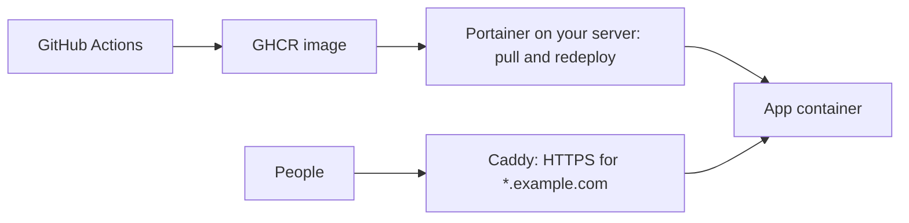

# 11 · Where to run it: your laptop, your own server, or DigitalOcean

The same Docker image runs in all three places. CI builds it, and the host only pulls and runs it (docs/08). What changes is who can reach the app, who looks after the machine, and what it costs.

| | Your laptop | Your own server | A DigitalOcean droplet |
|---|---|---|---|
| Who can reach it | You (and your phone on the same Wi-Fi) | Your network, or the internet if you open ports 80 and 443 | Anyone on the internet |
| Cost | Free | The hardware and power you already have | About $6–$24 a month for a small app |
| Looks after the hardware | You | You | DigitalOcean |
| Goes down when | You close the lid | The office internet or power drops | Rarely. It doesn't depend on your building |
| Good for | Building and testing | Internal apps for staff | Public share links, customer-facing maps, anything outsiders must reach |

A common split: internal apps on your own server behind your login (docs/14), and anything outsiders use on a droplet, so a power cut at the office can't take a customer's map offline.

Scripts for everything in this doc are in `scripts/` (see `scripts/README.md`). Keys and how scripts handle them are in docs/12.

## 1. On your laptop

### `npm run dev`

The fastest loop. Vite serves the app with hot reload, so a saved file shows up in the browser in under a second.

```sh
cd example
npm install
npm run dev            # http://localhost:5173
npm run dev -- --host  # also listen on your Wi-Fi address, to try it on your phone
```

With `--host`, Vite prints a second "Network" address. Open that on your phone while it's on the same Wi-Fi. It's the quickest real-phone test there is (docs/09).

### Docker on your laptop

Before you call a change done, run the **image**, not just the dev server. That catches a broken Dockerfile, a `.dockerignore` that drops a needed file, and build-time variables that only exist in CI (docs/08).

On a Mac you need a Docker runtime: Docker Desktop, OrbStack or Colima. Any of them gives you the `docker` command.

```sh
cd example
docker compose up --build       # docker-compose.override.yml adds the local build
curl -s localhost:8080/health   # {"status":"ok"}
docker compose down
```

- **Apple Silicon builds ARM images.** That's fine on your Mac, but an image you build by hand and push to an x86 server dies with `exec format error`. Let CI build what servers run, or use `docker buildx build --platform linux/amd64` (docs/08).
- **`localhost` inside a container is the container,** not your Mac. To reach something on the Mac from a container, use `host.docker.internal`.

## 2. On your own server: Docker + Portainer, behind Caddy

This is how we run internal apps. A Linux machine (a small PC, an old desktop or a virtual machine) runs Docker. **Portainer** manages the stacks from your Git repo (docs/08 section 3), and **Caddy** sits in front and handles HTTPS for every app (docs/13).



What you need:

1. **A Linux box with Docker.** Ubuntu LTS is a safe choice. Give it a fixed address on your network.
2. **Portainer** (one container), with your apps added as "stacks from a Git repository". The compose file uses `image:` only, never `build:` (docs/08).
3. **Caddy** in front, with one wildcard certificate for `*.example.com` (docs/13).
4. **DNS.** For staff-only apps, a "DNS only" record that points at the server's internal address. For apps outsiders must reach, either forward ports 80 and 443 from your router to Caddy, or put that app on a droplet instead (section 3).
5. **Login** for anything private (docs/14).

Deploying from a script instead of clicking "Pull and redeploy": `scripts/ci/wait-for-build.sh` waits for CI to finish, then `scripts/portainer/redeploy.py` redeploys the stack **with its environment kept** and waits until `/health` reports the new commit. The environment trap that script avoids is explained in docs/08 section 5.

```sh
scripts/ci/wait-for-build.sh --sha origin/main --workflow build.yml
python3 scripts/portainer/redeploy.py --stack maps --check          # read-only: what would happen
python3 scripts/portainer/redeploy.py --stack maps \
  --health-url https://maps.example.com/health --expect-commit origin/main
```

## 3. Hosted on DigitalOcean

### What a droplet is

A **droplet** is DigitalOcean's name for a virtual server. It's a Linux computer in one of their data centres that you rent by the hour, with its own public IP address. You log in with an SSH key and run Docker on it exactly as you would on your own server. DigitalOcean looks after the hardware, the power and the network.

DigitalOcean has other products too. For one small map app, a droplet is the simplest:

| Need | Use |
|---|---|
| One app, full control, cheap | **A droplet** running `docker compose` and Caddy. This doc. |
| An app you'd rather not run a server for | App Platform. It builds and runs your container for you, but steers you towards their build pipeline. |
| A Postgres you never want to patch | A managed database. It usually costs more than the droplet. |
| Off-server backups and big static files | Spaces (S3-compatible storage). |

### Picking a region and a size

- **Region:** pick the one closest to the people using the map. Slugs look like `nyc3`, `sfo3`, `tor1`, `lon1`, `ams3`, `fra1`, `sgp1`, `blr1` and `syd1`. Keep everything for one app in **one region**, because reserved IPs and volumes can't move between regions.
- **Size:** the slug says what you get. `s-1vcpu-1gb` is 1 virtual CPU and 1 GB of memory.

| Size | Memory | Rough price | Fits |
|---|---|---|---|
| `s-1vcpu-1gb` | 1 GB | $6/month | A static map app like `example/` behind Caddy |
| `s-1vcpu-2gb` | 2 GB | $12/month | App + API + a small Postgres |
| `s-2vcpu-4gb` | 4 GB | $24/month | Several apps, or heavier map data |

Prices change. `doctl compute size list` shows the current ones, and `provision-droplet.sh` asks the API for the real price before it asks you to confirm. You can resize up later, so start small.

### Rough costs

| Item | Cost |
|---|---|
| The droplet | Billed by the hour, capped at the monthly price. An afternoon of testing costs cents. |
| Backups | About +20% of the droplet price for weekly backups, +30% for daily |
| Reserved IP | Free while assigned to a droplet. **About $5 a month while unassigned.** |
| Cloud firewall, DNS, monitoring | Free |
| Snapshots | About $0.06 per GB per month, until you delete them |
| Bandwidth | Each droplet includes a monthly transfer allowance (1 TB or more on small sizes). Map tiles come from the tile server, not from you, so a map app rarely gets close. |

**A droplet that's switched off still bills.** Only destroying it stops the charge.

### Before your first droplet (once)

1. **An account with two-factor login turned on.**
2. **An API token.** In the control panel, go to API → Tokens → Generate New Token. Choose **custom scopes** (droplet, firewall, reserved IP, domain, SSH key, tag and actions) and an **expiry**, for example 90 days. Save it straight into `secrets/do.env` or the Keychain. Never paste it into a chat or a command (docs/12).
3. **An SSH key on your laptop, uploaded to the account:**

   ```sh
   ssh-keygen -t ed25519 -C "my-laptop"                    # skip if ~/.ssh/id_ed25519 exists
   brew install doctl
   doctl compute ssh-key import my-laptop --public-key-file ~/.ssh/id_ed25519.pub
   ```

   Only the **public** half (`.pub`) is uploaded. The private half never leaves your laptop. (`doctl` needs the token for this. Run the `import` from a shell where you've loaded it with `scripts/lib/load-env.sh`, or add the key in the control panel under Settings → Security.)

4. **Copy the example settings:**

   ```sh
   mkdir -p secrets && chmod 700 secrets
   cp scripts/do/do.env.example secrets/do.env && chmod 600 secrets/do.env
   # edit secrets/do.env: the token, SSH_KEY_NAME=my-laptop, APP_IMAGE, DOMAIN and RECORD
   ```

### Spinning one up in minutes

```sh
scripts/do/provision-droplet.sh --dry-run     # the plan, with no token and no API calls
scripts/do/provision-droplet.sh               # looks, shows the plan and the cost, asks, then does it
```

It prints two lines on stdout and nothing else:

```
droplet_id=123456789
ip=203.0.113.10
```

What it does, each step skipped when it's already right, so you can run it again safely:

1. **Checks the SSH key.** The key must be on the account, **and** its private half must be on this machine (in `~/.ssh` or your ssh-agent). See the trap below.
2. **Creates the droplet** with that key, a tag (`maps-demo` by default), monitoring, weekly backups and the cloud-init file `scripts/do/cloud-init.yaml`.
3. **Assigns a reserved IP,** reusing an unassigned one in the region before it creates a new one.
4. **Attaches the cloud firewall by tag** (22, 80 and 443 in), then checks that the droplet really is covered.
5. **Creates the DNS record** (optional, `MANAGE_DNS=yes`), or tells you exactly which A record to add where your DNS lives.

Then wait for first boot and check from outside:

```sh
ssh app@203.0.113.10 cloud-init status --wait      # 3–6 minutes on a small droplet
scripts/do/check-health.sh https://maps.example.com --wait 600
scripts/do/provision-droplet.sh --check            # read-only: droplet, IP, firewall, DNS all in place?
```

### cloud-init: setup that happens before you log in

**cloud-init** reads a YAML file on the droplet's first boot and sets the machine up before you ever SSH in. That's the work you'd otherwise do by hand late at night and forget one step of. Ours (`scripts/do/cloud-init.yaml`):

- installs security updates, and turns on automatic security updates from then on
- turns off password logins (SSH keys only), adds `ufw` and `fail2ban`
- installs Docker, caps container log sizes and adds a weekly prune, because full disks are the classic way a small server dies
- creates a non-root user `app` with your SSH keys, then turns off root SSH (log in as `app@<ip>` and use `sudo` when you need root)
- adds 1 GB of swap
- writes `/opt/app/docker-compose.yml` (your image behind Caddy) and starts it

Things to know:

- **User data is not secret.** Anything on the droplet can read it from the metadata service, and it shows in the control panel. Never put a token or password in it. `provision-droplet.sh` refuses to send it if your API token is somehow inside.
- **It runs once.** Editing `cloud-init.yaml` later changes nothing on an existing droplet. Re-create the droplet, or make the change over SSH.
- **"Connection refused" or "Permission denied (publickey)" for the first few minutes is normal.** Package updates run first, then the user `app` gets your keys and SSH restarts. Wait a minute and try again. Don't start "fixing" keys: if it still says that after cloud-init has finished, look in `/var/log/cloud-init-output.log` (log in as `root` while root login is still on).
- **The Caddyfile it writes says `reverse_proxy web:80`.** That fits the example's default nginx image. An image that listens on another port (the example's `--target server` image, or a shape-A Node app, both on 3000) needs `web:3000` there, or every request is a 502. Change it in `cloud-init.yaml` before you provision, or in `/opt/app/Caddyfile` on the droplet and restart Caddy.
- **When something didn't happen,** read `/var/log/cloud-init-output.log` on the droplet.

### SSH keys

- **There's no password.** The droplet trusts the SSH keys you chose when you created it.
- **Trap: `--ssh-keys` accepts any key on the account**, including one whose private half is on a laptop you gave away last year. The droplet comes up healthy, firewalled and in DNS, and you can't log in. The only fix is to destroy it and create it again. `provision-droplet.sh` compares the key's fingerprint with the keys in `~/.ssh` and your ssh-agent, and stops if you don't hold it.
- **Trap: the host key changes on a rebuild.** After you destroy and re-create a droplet on the same reserved IP (or use DigitalOcean's Rebuild button, which keeps the droplet and its IP but wipes the disk), SSH says `REMOTE HOST IDENTIFICATION HAS CHANGED`. If **you** just rebuilt it, clear the old entry with `ssh-keygen -R 203.0.113.10`. If you didn't, stop and find out why.

### Firewalls

There are two firewalls, and you want both:

1. **The DigitalOcean cloud firewall** sits outside the droplet, so nothing on the droplet can break it. It allows 22, 80 and 443 in, and all traffic out.
2. **`ufw` on the droplet** still protects the box if the cloud firewall is ever detached by mistake.

- **Never open a database port.** Postgres talks to the app over the compose network, and its service has no `ports:` line at all.
- **Trap: Docker's published ports go around `ufw`.** Docker writes its own firewall rules, so `ports: ["5432:5432"]` is open to the internet even when `ufw` says deny. The cloud firewall is what stops it. Better still, don't publish the port, or bind it to `127.0.0.1:5432:5432`.
- **Trap: a firewall attached by droplet ID doesn't follow a re-created droplet.** A rebuild by destroy-and-create gives the droplet a **new ID**. The old firewall still lists the dead droplet, and a script that checks "does the firewall exist?" says yes while the new droplet has no cloud firewall at all. Attach the firewall to a **tag** instead, and check the relationship, not just the object. `provision-droplet.sh` does both.
- **Tighter SSH:** `SSH_FROM=203.0.113.10/32` allows SSH only from your own address. If your address changes, you're locked out until you update the rule in the control panel.

### Domains and DNS

You need an **A record**: `maps.example.com → 203.0.113.10`. Two ways to get one:

- **Keep DNS where it is** (your registrar or Cloudflare) and add the A record there. The script prints exactly what to add. With Cloudflare, see docs/13 for proxied versus DNS-only and the SSL mode.
- **Let DigitalOcean host DNS.** Point the domain's nameservers at `ns1.digitalocean.com`, `ns2.digitalocean.com` and `ns3.digitalocean.com` at your registrar, then run the script with `MANAGE_DNS=yes`.

- **Use a short TTL (300 seconds) while you set things up,** so a mistake fixes itself in minutes rather than hours.
- **Caddy can't get a certificate until DNS points at the droplet** and ports 80 and 443 are open. Until then you'll see TLS errors, and that's expected. For a first test before DNS is ready, run the script without a domain and the app answers on plain `http://<ip>/`.
- **Trap: `doctl compute domain create --ip-address` also creates an apex A record.** Add your own record for `@` afterwards and you have two, and DNS round-robins between them. That's harmless while they agree and confusing once they don't. The script creates the domain without `--ip-address` and manages the record itself.
- **Check from outside your network.** Some office firewalls and DNS filters block domains registered in the last few weeks, so a healthy new site can look dead from your desk. Check from your phone on mobile data, or test the server directly with `check-health.sh --resolve 203.0.113.10`.

### Reserved IPs

A **reserved IP** is a public address that belongs to your account, not to one droplet. DNS points at it, and you move it from the old droplet to a new one, so a rebuild needs no DNS change.

- **Free while assigned. About $5 a month while it sits unassigned.**
- **Trap: destroying a droplet does NOT delete its reserved IP.** The address stays on your account, unassigned and billing. A rebuild script that only asks "is an IP assigned to this droplet?" finds nothing after the destroy, buys a second IP, and orphans the one DNS points at. `provision-droplet.sh` reuses an unassigned IP in the region first (or the exact one you name with `RESERVED_IP_ADDRESS`). `destroy-droplet.sh` releases it, unless you say `--keep-ip` because you're about to rebuild.
- **Outgoing traffic still uses the droplet's own IP,** not the reserved one. That matters if someone has to allowlist your server.

### Backups

- **Droplet backups** (weekly or daily) are whole-disk copies, made by DigitalOcean. They're good for "the server died".
- **A database needs its own backups too.** Run a nightly `pg_dump` and copy it **off the droplet** (to Spaces or anywhere else). A backup that lives on the same disk isn't a backup.
- **Restore one before you need it.** Until you've restored a backup and seen the data, you don't know that you have one.
- **Snapshots** are manual copies you take, for example before a risky change. They keep billing until you delete them, even after the droplet is gone.

### Secrets onto the box

The droplet needs the app's secrets (database password, OIDC client secret, session secret). They never go in cloud-init, the image or the repo.

```sh
# Generate secrets, don't invent them. Do this yourself, not the agent, and write them
# straight into the gitignored file, so they never show on screen or in a transcript
# (printf is a shell builtin: the value is never on a command line):
printf 'SESSION_SECRET=%s\n' "$(openssl rand -base64 48 | tr -dc 'A-Za-z0-9' | head -c 48)" >> secrets/app.prod.env
chmod 600 secrets/app.prod.env

# Append the app's secrets from that file on your laptop, over SSH, through stdin:
ssh app@203.0.113.10 'cat >> /opt/app/.env && chmod 600 /opt/app/.env' < secrets/app.prod.env
```

Then list each variable under the `web` service's `environment:` in `/opt/app/docker-compose.yml` as `${VAR}`, the same pattern as docs/08 section 4, and run `docker compose up -d` again.

**Private image?** Log the droplet in to GHCR with a token that can only read packages, passed through stdin:

```sh
ssh app@203.0.113.10 'docker login ghcr.io -u YOUR_GITHUB_USER --password-stdin' < secrets/ghcr-read.token
ssh app@203.0.113.10 'cd /opt/app && docker compose pull && docker compose up -d'
```

### Deploying an update

On a single droplet, plain `docker compose` is simpler than running Portainer there too. It uses less memory, and there's no extra admin page to secure.

```sh
scripts/ci/wait-for-build.sh --sha origin/main            # don't pull before CI has pushed
ssh app@203.0.113.10 'cd /opt/app && docker compose pull && docker compose up -d'
scripts/do/check-health.sh https://maps.example.com --expect-commit "$(git rev-parse origin/main)"
```

`--expect-commit` needs a `/health` that reports `commit_sha`, like the one in docs/08 section 8. The example's nginx image only answers `{"status":"ok"}`, so for the demo leave the flag off: check-health then says `HEALTHY … version -, commit -`.

### Long jobs: run them detached

A command you run over SSH dies when the SSH session does: when your laptop sleeps, the Wi-Fi blips, or an agent's command hits its time limit. A `docker compose pull` on a 1-CPU droplet can take longer than that. When the session dies partway through, the pull stops before `up`, and you're left with Caddy serving a 502 over a perfectly good certificate.

Run anything long **detached**, and watch the log:

```sh
scp deploy/bootstrap.sh app@203.0.113.10:/opt/app/
ssh app@203.0.113.10 'nohup bash /opt/app/bootstrap.sh > /opt/app/bootstrap.log 2>&1 < /dev/null & echo started'
ssh app@203.0.113.10 'tail -f /opt/app/bootstrap.log'      # Ctrl-C stops watching, not the job
```

Pass a secret to a remote job through stdin or a file you copied with `chmod 600`, never as an argument. An argument lands in the remote shell's history and in `ps`.

### Reading a 502 (and the other errors) correctly

`scripts/do/check-health.sh` turns these into a sentence for you. The short version:

| What you see | What it means | Next step |
|---|---|---|
| Could not resolve host | DNS has no record yet, or it hasn't spread | Check the A record. Test the server anyway with `--resolve <ip>`. |
| Connection refused | You reached the address, but nothing is listening | Is cloud-init done? Is Caddy running? Is port 80/443 allowed? |
| Timed out | Packets are being dropped | A firewall, or the wrong IP |
| TLS or certificate error | Caddy has no certificate yet | DNS must point here and ports 80/443 must be open. Check Caddy's logs. |
| **502 Bad Gateway** | **Good news, mostly.** DNS, the certificate and Caddy all work. The app behind Caddy isn't answering. | `docker compose ps` and `docker compose logs` on the droplet |
| 404 with JSON | You reached the app, and that path doesn't exist | Check the URL. Is health at `/health` or `/api/health`? |
| 200 but an old commit | The new image wasn't pulled | Did CI finish? Was the image re-pulled? |

**Trap: macOS has no `timeout` command.** A check like `timeout 5 nc -z host 22 && echo OPEN || echo BLOCKED` prints BLOCKED on a Mac every time. That isn't because the port is closed: `timeout` doesn't exist, so the `||` branch runs. That one mistake can convince you that a working server is unreachable. Use tools with their own time limits (`curl --max-time 10`, `nc -z -G 5 host 22`), or `brew install coreutils` and use `gtimeout`. More generally, **before you trust a "blocked" result, prove the test works** against something you know is up, such as `nc -z -G 5 github.com 22`.

### Tearing it down

```sh
scripts/do/destroy-droplet.sh --dry-run
scripts/do/destroy-droplet.sh --name maps-demo     # lists what it found, then asks you to type the name
```

It deletes the droplet, the firewall (unless another droplet uses it) and the reserved IP. It deletes the DNS record only with `MANAGE_DNS=yes` (DNS hosted at DigitalOcean), and only if the record points at this droplet. It also tells you about snapshots, which it leaves alone.

**With `MANAGE_DNS=no` (the default), delete the A record yourself, at your DNS host, as soon as the droplet is gone.** The script can't, and it prints a `WARN` line naming the record. A record left pointing at a released IP is a takeover risk: DigitalOcean hands the address to the next customer who asks for one, and they could serve pages, and get a valid certificate, for your hostname. Afterwards, look in the control panel for anything still billing: **Networking → Reserved IPs**, **Images → Snapshots and Backups**, and **Volumes**. If you're done with DigitalOcean for now, revoke the API token, or let it expire.

## 4. The traps, in one list

1. **A droplet you re-create gets a new ID,** so a firewall attached by ID protects the dead one. Attach by tag, and check the droplet is covered.
2. **Destroying a droplet doesn't delete its reserved IP,** which keeps billing at about $5 a month. Reuse it or release it.
3. **`--ssh-keys` accepts keys you don't hold the private half of.** Check the fingerprint against your own keys before you create anything.
4. **The host key changes on a rebuild.** Use `ssh-keygen -R <ip>`, but only when you did the rebuild yourself.
5. **Long jobs over SSH die with the session.** Run them detached with `nohup … &` and tail the log.
6. **A 502 from Caddy means the proxy works and the app doesn't.** Look at the containers, not at DNS or certificates.
7. **macOS has no `timeout`.** A probe that uses it always "fails". Use `curl --max-time` or `nc -G`.
8. **User data is readable by anything on the droplet** and in the control panel. No secrets in cloud-init.
9. **Docker-published ports go around `ufw`.** Rely on the cloud firewall, and don't publish database ports.
10. **A switched-off droplet still bills.** Destroy it.
11. **`domain create --ip-address` makes an apex record for you.** Don't add a second one.
12. **A new domain can look dead from inside an office network.** Check from outside before you start debugging.
13. **A DNS record pointing at a released IP can be taken over.** When DNS isn't at DigitalOcean, delete the record yourself when you destroy the droplet.
