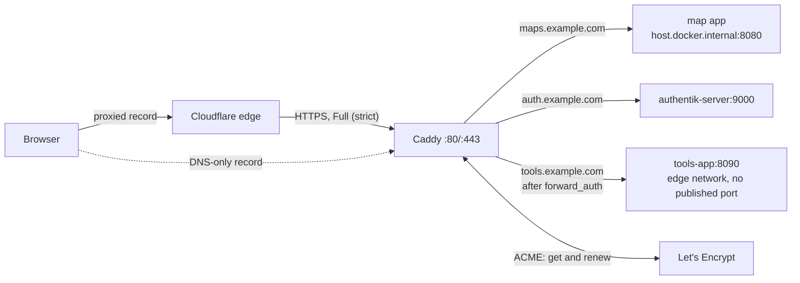

# 13 · HTTPS with Caddy, and Cloudflare in front

Every app in this playbook sits behind one front door: a single Caddy container that owns ports 80 and 443. Caddy gets the HTTPS certificates, renews them, and forwards each hostname to the right app. This doc covers setting it up, putting Cloudflare in front, and the mistakes that cost us time. The copy-paste files are in [`infra/caddy/`](../infra/caddy/).

## The words, in one line each

- **Reverse proxy:** a server that takes every request first and forwards it to the right app behind it. Apps never face the internet directly.
- **TLS certificate:** the file that lets a browser show the padlock. It proves the server really is `maps.example.com`.
- **Let's Encrypt:** a free certificate authority. It hands out certificates to anyone who can prove they control the domain.
- **ACME:** the protocol Caddy uses to ask Let's Encrypt for certificates.
- **Challenge:** how you prove control. **HTTP-01** answers on port 80, **TLS-ALPN-01** answers on port 443, and **DNS-01** writes a temporary DNS record.
- **Wildcard certificate:** one certificate for `*.example.com`, covering every app's subdomain. It needs DNS-01.
- **Caddyfile:** Caddy's config file. One block per hostname.
- **Proxied (orange cloud) / DNS only (grey cloud):** the two kinds of Cloudflare DNS record. Proxied traffic goes through Cloudflare's servers; DNS only goes straight to yours.

## The picture



**Why Caddy?** HTTPS is automatic. Name a hostname in the Caddyfile and Caddy gets a certificate for it, redirects HTTP to HTTPS, and renews it before it expires, with no cron job or certbot. The config for one app is three lines, and it reloads without dropping connections.

## 1. One app, start to finish

Say the map app runs on the server and publishes port 8080 (`ports: ["8080:80"]`).

1. **DNS.** Create an A record `maps.example.com` → the server's public IP (for example `203.0.113.10`). Check it from your laptop: `dig +short maps.example.com`.
2. **Ports.** Open TCP 80 and 443 to the internet, and UDP 443 too if you want HTTP/3. That means the host firewall (`ufw`), the cloud provider's firewall, and the port-forward on the router if the server is at home or on the farm network.
3. **The Caddyfile:**
   ```
   {
   	email admin@example.com
   }

   maps.example.com {
   	encode zstd gzip
   	reverse_proxy host.docker.internal:8080
   }
   ```
4. **Run Caddy** with the compose file from [`infra/caddy/README.md`](../infra/caddy/README.md). The parts that matter are ports 80 and 443, `extra_hosts: host.docker.internal:host-gateway` so Caddy can reach ports on the host, and a named volume on `/data`.
5. **Watch it work:** `docker compose logs -f caddy`. Within a few seconds you should see `certificate obtained successfully` for `maps.example.com`.
6. **Check:** `curl -sI https://maps.example.com` returns your app's headers. `curl -sI http://maps.example.com` returns a `308` redirect to https.

That's the whole setup. Everything else in this doc is about more apps, Cloudflare, and what goes wrong.

## 2. How certificates happen, and why renewal just works

- **When Caddy loads a config,** it starts getting a certificate for every hostname in it, in the background. It tries HTTP-01 (port 80) and TLS-ALPN-01 (port 443), or uses DNS-01 if you configured it.
- **Certificates are stored in `/data`** inside the container. That's the `caddy_data` volume. **Keep that volume.** If you delete it, or recreate the container without it, Caddy has to issue every certificate again, and that's how people hit Let's Encrypt's rate limits.
- **Renewal is automatic.** Let's Encrypt certificates are short-lived (90 days today, and getting shorter). Caddy checks them all the time and renews each one when about a third of its life is left. If renewal fails, it keeps retrying with backoff, and the `email` in the global options gets a warning from Let's Encrypt long before anything expires.
- **You never restart anything for a renewal.** The new certificate is picked up live.
- **Test against staging first** when you're setting up something new, especially DNS-01. Uncomment the `acme_ca` line in the global options and you get Let's Encrypt's staging server: real challenges, untrusted certificates, much higher limits. Remove the line once it works.

## 3. One block per app (or one file per app)

Each hostname gets its own site block. Shared settings go in a **snippet** that every block imports:

```
(common) {
	encode zstd gzip
	header {
		Strict-Transport-Security "max-age=31536000"
		X-Content-Type-Options "nosniff"
		Referrer-Policy "strict-origin-when-cross-origin"
		-Server
	}
	log
}

maps.example.com {
	import common
	reverse_proxy host.docker.internal:8080
}

auth.example.com {
	import common
	reverse_proxy authentik-server:9000
}
```

**One file per app** keeps changes small when you have a dozen apps. The main Caddyfile keeps the global options and snippets, then imports a folder:

```
# conf/Caddyfile
{
	email admin@example.com
}
(common) {
	encode zstd gzip
}
import sites/*.caddy
```

```
# conf/sites/maps.caddy
maps.example.com {
	import common
	reverse_proxy host.docker.internal:8080
}
```

Adding an app is then "add one file, validate, reload". Removing one is "delete one file".

**Every change goes through two commands:**

```sh
docker run --rm -v "$PWD/conf:/etc/caddy" caddy:2.11-alpine caddy validate --config /etc/caddy/Caddyfile --adapter caddyfile
docker compose exec -w /etc/caddy caddy caddy reload
```

`caddy reload` checks the new config before swapping it in. A broken file is refused, and the old config keeps serving.

## 4. Reverse proxy to containers

Caddy runs in its own container, so `localhost` means *Caddy's* container, not the host. Use one of these two ways to reach an app:

| Way | Caddyfile | The app's compose file | Use it when |
|---|---|---|---|
| **Through the host** | `reverse_proxy host.docker.internal:8080` | `ports: ["8080:80"]` | Each app is its own stack (the playbook default, docs/08) |
| **A shared Docker network** | `reverse_proxy fleet-web:80` | joins the external `edge` network | The app shouldn't publish a port on the host at all |

- **`host.docker.internal` only works** if Caddy's compose file has `extra_hosts: ["host.docker.internal:host-gateway"]`.
- **An app that publishes `127.0.0.1:8080:80` can't be reached** through `host.docker.internal`. That name points at the Docker bridge, not the loopback address. Publish on `0.0.0.0`, and firewall the port from the internet, or use the shared network.
- **Docker's published ports skip `ufw`.** Docker writes its own firewall rules, so `ports: ["8080:80"]` is reachable from outside even when `ufw` says deny. Block app ports at the cloud firewall or the router, or use the shared network so there's no published port at all. This matters most for forward_auth apps (docs/14): anyone who reaches the port directly skips the login. **A forward_auth tool always uses the shared network** and publishes no port at all (section 3 of `Caddyfile.example`).
- **Container names need the shared network.** Create it once with `docker network create edge`, and declare it `external: true` in every stack that joins.
- **WebSockets need nothing special.** `reverse_proxy` passes the upgrade through. For one hostname with several containers, route by path with `handle /api/*`, `handle /ws` and a final `handle` (section 2 of `Caddyfile.example`).
- **Caddy passes the original `Host` header** and adds `X-Forwarded-For`, `X-Forwarded-Proto` and `X-Forwarded-Host`. An Express app behind it needs `app.set('trust proxy', 1)`, or it thinks the request was plain HTTP and never sets its Secure cookies. You see that as a silent sign-in loop (docs/07).
- **Moving an app** to a new hostname: keep the old block as `redir https://new.example.com{uri}` for a while.

## 5. Headers and compression

What the `(common)` snippet does, and why:

- **`encode zstd gzip`** compresses text on the way out: HTML, JavaScript, CSS, JSON, **GeoJSON** (`application/geo+json` is on Caddy's default list) and vector tiles (`application/x-protobuf`). Images and raster tiles are already compressed, and Caddy leaves them alone. A response the app already compressed isn't compressed twice. A 2 MB field-boundary GeoJSON typically goes over the wire at a fraction of that, which matters on a phone with one bar of signal.
- **`Strict-Transport-Security`** tells browsers to use HTTPS for this host for a year, even if someone types `http://`. Add it only once HTTPS works. Leave `includeSubDomains` off unless every subdomain you'll ever use has HTTPS, because browsers enforce it for the whole year.
- **`X-Content-Type-Options: nosniff`** stops browsers guessing file types (a JSON file run as a script, for example).
- **`Referrer-Policy: strict-origin-when-cross-origin`** sends only `https://maps.example.com` when someone follows a link to another site, not the full URL. A full URL could contain a share token (docs/05).
- **`-Server`** removes the `Server: Caddy` header. It's cosmetic, and Cloudflare replaces it anyway (section 7).
- **`log`** prints one line per request to `docker logs`. It's the fastest way to answer "did the request even reach Caddy?"

**Cache headers come from the app,** not from Caddy. The example's `nginx.conf` and `server/index.js` mark hashed bundles immutable for a year and the HTML shell `no-cache`. Caddy passes them through unchanged.

**Content-Security-Policy** is worth adding per app once it's stable, but it has to list your tile servers and API hosts, so it doesn't belong in a shared snippet. Start with `Content-Security-Policy-Report-Only` and watch the browser console.

## 6. Behind Cloudflare

### Proxied or DNS only?

| | Proxied (orange cloud) | DNS only (grey cloud) |
|---|---|---|
| Browser connects to | Cloudflare, which connects to you | Your server |
| Your server's IP | Hidden | Public in DNS |
| Caching, DDoS protection, Bot Fight Mode | Yes | No |
| Certificate the browser sees | Cloudflare's edge certificate | Caddy's Let's Encrypt certificate |
| Limits | 100 MB per request body on the Free plan; requests longer than 100 s fail with a 524 | None from Cloudflare |
| Hostname depth | Free edge certificates cover `example.com` and `*.example.com` only, not `a.b.example.com` | Any |
| LAN-only apps | No | Yes: point the record at an internal address and get the certificate through DNS-01 |

Most apps work well proxied. Use DNS only for big uploads, long-running requests, and LAN-only tools.

### SSL/TLS mode: Full (strict). Never Flexible.

In the Cloudflare dashboard, under SSL/TLS → Overview, the mode decides how Cloudflare talks to Caddy:

| Mode | Cloudflare → your server | Verdict |
|---|---|---|
| Off | No HTTPS anywhere | No |
| **Flexible** | Plain HTTP | **Never.** Caddy redirects HTTP to HTTPS, Cloudflare asks again over HTTP, forever: `ERR_TOO_MANY_REDIRECTS`. And the last hop is unencrypted. |
| Full | HTTPS, but any certificate is accepted | Better, but anyone in the path can impersonate your server |
| **Full (strict)** | HTTPS with a valid certificate | **Use this.** Caddy's Let's Encrypt certificate is valid, so it just works |

### DNS-01: a wildcard certificate through the Cloudflare API

With DNS-01, Caddy proves it owns the domain by creating a temporary `_acme-challenge` TXT record through Cloudflare's API. Let's Encrypt never has to reach your server, so:

- you get **one wildcard certificate** for `*.example.com`, and adding an app needs no new certificate
- **port 80 doesn't have to be open** at all
- **LAN-only apps** behind a grey-cloud record pointing at an internal address still get real certificates
- it works the same whether records are proxied or not

**What you need:**

1. **Caddy built with the Cloudflare plugin.** The stock image fails with `module not registered: dns.providers.cloudflare`. Build it with `xcaddy` in a two-stage Dockerfile ([`infra/caddy/README.md`](../infra/caddy/README.md)), in CI, like any app image.
2. **A scoped API token.** In Cloudflare, go to My Profile → API Tokens → Create Token → *Edit zone DNS*. Give it **Zone · Zone · Read** and **Zone · DNS · Edit**, for **this one zone** only. Never use the Global API Key.
3. **The token in an env file, never in the Caddyfile.** Put `CLOUDFLARE_API_TOKEN=...` in the edge stack's gitignored `.env`, or in the Portainer stack environment. Mark it required in compose: `CLOUDFLARE_API_TOKEN: ${CLOUDFLARE_API_TOKEN:?set it}`. Read it in the Caddyfile as `{env.CLOUDFLARE_API_TOKEN}`.
4. **The wildcard block,** with one `@matcher` per app and a 404 for everything else:
   ```
   *.example.com {
   	import common
   	tls {
   		dns cloudflare {env.CLOUDFLARE_API_TOKEN}
   		resolvers 1.1.1.1
   	}

   	@maps host maps.example.com
   	handle @maps {
   		reverse_proxy host.docker.internal:8080
   	}

   	handle {
   		respond "Not found" 404
   	}
   }
   ```
   `resolvers 1.1.1.1` makes Caddy check for the TXT record with Cloudflare's own resolver. A local or split-horizon DNS server often has an old "no such record" cached, and the challenge times out.
5. **The wildcard doesn't cover the bare domain.** `example.com` without a subdomain needs its own site block.

**If the token doesn't reach the container,** the plugin refuses to load: `API token '' appears invalid`. That's the behaviour you want, and `${VAR:?}` in compose catches it even earlier. To check that the token is present without printing it: `docker compose exec caddy sh -c 'test -n "$CLOUDFLARE_API_TOKEN" && echo set'`.

### Real visitor IPs

Behind a proxied record, every request reaches Caddy from a Cloudflare address, so your logs and your app see Cloudflare's IPs. Cloudflare puts the visitor's address in the `CF-Connecting-IP` header. If you need it (rate limits, audit logs), tell Caddy to trust Cloudflare's ranges in the global options (`servers { trusted_proxies static <ranges>; client_ip_headers CF-Connecting-IP }`, with the ranges from cloudflare.com/ips, or the `caddy-cloudflare-ip` plugin to keep them current). Only trust those ranges, or anyone can claim any IP by sending the header.

## 7. Common mistakes

| What you see | What's wrong | Fix |
|---|---|---|
| Caddy logs `NXDOMAIN` / `no valid A records`, or the challenge fails right away | **DNS doesn't point at the server yet,** or the change hasn't spread | `dig +short app.example.com` must show the server's IP. Wait, then `caddy reload`. Use staging while you wait. |
| The challenge times out: `connection refused` or `timeout during connect` | **Ports 80/443 are closed** at the firewall, cloud firewall or router | Open them, or switch to DNS-01, which needs neither |
| `too many certificates already issued` or `too many failed authorizations` | **Rate limits:** repeated failed attempts, or certificates issued again because the volume was lost | Use the staging `acme_ca` while debugging. Keep `caddy_data`. The limits reset on their own (failures within the hour, issuance within the week). |
| `ERR_TOO_MANY_REDIRECTS` behind Cloudflare | **Cloudflare SSL mode is Flexible** | Switch to **Full (strict)** |
| Cloudflare error 526 (invalid SSL certificate) | Full (strict) is on, but Caddy has no valid certificate yet | Fix the certificate first (DNS-01 is easiest), or briefly make the record DNS only so HTTP-01 can reach you |
| Cloudflare error 521 or 522 | Cloudflare can't reach Caddy | Caddy not running, or 443 closed to Cloudflare's addresses |
| Cloudflare error 524 | The app took more than 100 s | Make the request faster or asynchronous, or make that hostname DNS only |
| `502 Bad Gateway` from Caddy | The app isn't reachable from Caddy's container: stopped, wrong port, wrong network, or bound to 127.0.0.1 | `docker compose exec caddy wget -qO- http://host.docker.internal:8080/health` |
| `module not registered: dns.providers.cloudflare` | The stock Caddy image, with `dns cloudflare` in the config | Build Caddy with the plugin |
| `API token '' appears invalid` | `CLOUDFLARE_API_TOKEN` never reached the container | Set it in `.env` / the stack env. Use `${VAR:?}` in compose |
| `timed out waiting for record to fully propagate` or `expected 1 zone, got 0` | Local or split-horizon DNS answers instead of Cloudflare | `resolvers 1.1.1.1` in the `tls` block |
| You edited the Caddyfile and nothing changed | Not reloaded; single-file bind mount showing the old file; or the Caddyfile is baked into an image that wasn't rebuilt and re-pulled | `caddy reload`; mount the folder; `docker compose exec caddy cat /etc/caddy/Caddyfile` shows what's really loaded |
| Sign-in loops or Secure cookies never appear | The app doesn't trust the proxy | `app.set('trust proxy', 1)` (docs/07) |
| A new subdomain shows a plain `Not found` (9 bytes) | It reached Caddy, but no `@matcher` caught it, usually because the new config isn't deployed yet | Deploy the config. It isn't a DNS problem. Cloudflare rewrites the `Server` header to `cloudflare` on every response, so that header can't tell you where an answer came from. The body can. |

## 8. Check it from outside

```sh
# Headers, redirect and HSTS
curl -sI https://maps.example.com | head -20
curl -sI http://maps.example.com | head -3            # 308 → https (or Cloudflare's own redirect)

# Who issued the certificate, and when it expires
echo | openssl s_client -connect maps.example.com:443 -servername maps.example.com 2>/dev/null \
  | openssl x509 -noout -issuer -enddate

# Behind a proxied record you'll see Cloudflare's certificate above. To check Caddy's own,
# go straight to the server's IP (from somewhere that can reach it):
curl -sI --resolve maps.example.com:443:203.0.113.10 https://maps.example.com | head -5

# An unknown name under the wildcard
curl -s -o /dev/null -w '%{http_code}\n' https://nope.example.com     # 404
```

## What's in this repo

- [`infra/caddy/Caddyfile.example`](../infra/caddy/Caddyfile.example): global options and snippets, one app, several apps, forward_auth, and a commented Cloudflare DNS-01 wildcard variant. Every variant passes `caddy validate`.
- [`infra/caddy/docker-compose.yml`](../infra/caddy/docker-compose.yml) and [`.env.example`](../infra/caddy/.env.example): the Caddy service, ready to run, with the Cloudflare lines commented.
- [`infra/caddy/README.md`](../infra/caddy/README.md): the compose file explained, the Cloudflare plugin build, the token steps, and checklists.
- [docs/14](14-login-with-authentik.md): putting Authentik behind this Caddy, and the forward_auth snippet in detail.
- [`prompts/15-https-with-caddy.md`](../prompts/15-https-with-caddy.md): the prompt for your agent.
