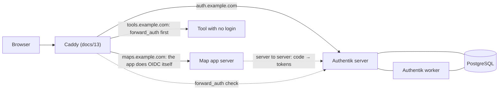

# 14 · Optional login with Authentik

Some maps should be open to anyone: a visitor map, a TV kiosk, a share link someone opens on their phone. Others show real data and should only open for the right people. This doc covers the second kind: running your own identity provider (Authentik), connecting each app to it, two ways to protect a map app, sign-out that really signs you out, passkeys, and the rule that matters most: **in production, an app with missing login settings must refuse to start, not start open.**

[docs/07](07-auth.md) goes deep on the app side (tokens, refresh, back-channel logout). This doc is the identity-provider side plus the simplest app side, which is what [`example/server`](../example/server/) does. The files to run are in [`infra/authentik/`](../infra/authentik/).

## Do you need it?

| The map is... | Login? |
|---|---|
| A public demo, a visitor map, a kiosk | No. Run it with sign-in off. The example's server needs `ALLOW_NO_AUTH=true` to do that in production. |
| A share link for someone outside the company | No account needed. The token in the link is the lock (docs/05). Share pages stay public even when the rest of the app needs a login. |
| Staff maps with real fields, equipment or customers | Yes |
| An off-the-shelf tool with no login of its own | Yes, with forward_auth at Caddy (section 3b) |

## The words, in one line each

- **Identity provider (IdP):** the one server that knows your users and their passwords and passkeys. Apps send people to it to sign in. We use Authentik: self-hosted, open source, free.
- **OIDC (OpenID Connect):** the standard the IdP and the apps use to talk. It's what's behind every "Sign in with..." button.
- **Client ID and client secret:** the app's username and password *at the IdP*. The secret lives only on the app's server.
- **Issuer:** the IdP's address for one app, e.g. `https://auth.example.com/application/o/fieldmap/`. The app finds everything else from it.
- **Redirect URI (callback):** where the IdP sends the browser back after sign-in, e.g. `https://maps.example.com/api/auth/callback`. It must match the IdP's setting exactly.
- **Claims:** facts about the user that the IdP vouches for: `sub` (a permanent user id), `name`, `email`, `groups`.
- **Groups → roles:** you put people in groups in the IdP (`fieldmap-operators`). The app turns groups into its own roles: admin, operator, viewer.
- **Authentik words:** a **provider** is one app's OIDC settings. An **application** is the app's entry, and that's where you choose who may use it (bindings). A **flow** is a series of screens (sign in, sign out, enroll a passkey). An **outpost** is the part of Authentik that does forward_auth; one is built in.

## The picture



## 1. Run Authentik with Docker Compose

[`infra/authentik/docker-compose.yml`](../infra/authentik/docker-compose.yml) runs three containers:

- **authentik-db:** PostgreSQL. All users, groups, apps, flows and passkeys live here.
- **authentik-server:** the web UI and the OIDC endpoints, on port 9000 inside Docker. Caddy reaches it over the shared `edge` network; no port is published on the host.
- **authentik-worker:** background jobs such as email and cleanup.

**There's no Redis.** Authentik dropped it in release 2025.10, and caching, background tasks and WebSockets all run on PostgreSQL now. Guides written before that show a `redis` service; leave it out. The image tag is pinned (`AUTHENTIK_TAG`). You upgrade on purpose, one release at a time, after reading that release's *Breaking changes* and taking a backup.

**Two secrets,** both generated, both kept in your password manager: `PG_PASS` (the database password) and `AUTHENTIK_SECRET_KEY` (set it once; never change it). Generate them yourself, not the agent, and write them straight into the file so they never appear on screen or in a transcript:

```sh
cd infra/authentik && cp .env.example .env && chmod 600 .env
sed -i.bak -e '/^PG_PASS=$/d' -e '/^AUTHENTIK_SECRET_KEY=$/d' .env && rm .env.bak
printf 'PG_PASS=%s\n' "$(openssl rand -base64 48 | tr -dc 'A-Za-z0-9' | head -c 40)" >> .env
printf 'AUTHENTIK_SECRET_KEY=%s\n' "$(openssl rand -base64 60 | tr -dc 'A-Za-z0-9')" >> .env
```

`printf` is a shell builtin, so the values never land on a command line or in the output. They go in `infra/authentik/.env` (gitignored) or in the Portainer stack environment (copy them across from your editor yourself). The compose file uses `${PG_PASS:?...}`, so a missing secret stops the deploy with a message instead of starting a database with an empty password.

**First start**, step by step in [`infra/authentik/README.md`](../infra/authentik/README.md):

1. `docker network create edge` (once per host), add the `auth.example.com` block to Caddy, `docker compose up -d`.
2. **Straight away,** open `https://auth.example.com/if/flow/initial-setup/` and set the admin's password. Until you do, *whoever opens that page first becomes the admin.* If the server is already public, do it the minute it's up, or do it through an SSH tunnel before DNS points at it.
3. Create your own user, add it to **authentik Admins**, enroll a passkey, and retire the built-in `akadmin` account.
4. Set up a nightly `pg_dump`. The dump plus the secret key is a complete backup.

**Don't mount `/etc/localtime` or `/etc/timezone`** into the Authentik containers. Authentik works in UTC internally, and Authentik's own docs warn that changing the container's time zone breaks OAuth sign-in. The web UI shows times in each user's local zone anyway.

## 2. Create the app in Authentik

The full checklist is in [`infra/authentik/README.md`](../infra/authentik/README.md). The parts people get wrong:

- **Pick the slug once.** It's part of the issuer URL (`/application/o/<slug>/`), so renaming it breaks every app config that uses it.
- **Create three groups per app:** `<app>-admins`, `<app>-operators`, `<app>-viewers`.
- **Provider: OAuth2/OpenID, Confidential,** authorization flow `default-provider-authorization-implicit-consent` (no "Allow this app?" screen for your own apps).
- **Redirect URI, Strict:** `https://<app>.example.com/api/auth/callback`. It's an exact match: `http` vs `https`, `www`, a trailing slash, a different port all fail with "redirect URI mismatch".
- **Signing key: pick a certificate** (the built-in self-signed one is fine). Tokens are then signed with a private key, and anyone can check them against Authentik's published public keys (its JWKS). Without one, Authentik signs with the client secret (HS256) and publishes no public key. Some libraries refuse that, and anything that checks tokens against the JWKS breaks, including the back-channel logout code in docs/07.
- **Scopes `openid email profile`.** Authentik's default `profile` mapping already includes a `groups` claim, so nothing extra is needed. Note that its `email` mapping reports `email_verified: false` (since 2025.10). Don't make your app require it.
- **Invalidation flow: `default-invalidation-flow`** (section 4).
- **Bind the three groups to the application.** **By default, every Authentik user can sign in to every application.** With bindings, someone outside the groups gets Authentik's "permission denied" and never reaches your app.
- **Copy the issuer exactly as Authentik shows it,** trailing slash included. openid-client compares it character by character. Leave the slash off and sign-in fails with `discovered metadata issuer does not match the expected issuer`. We hit exactly that while testing the example server.

Then hand the settings to the app through its environment (the Portainer stack env in production, a gitignored `.env` locally):

```sh
OIDC_ENABLED=true
OIDC_ISSUER_URL=https://auth.example.com/application/o/fieldmap/
OIDC_CLIENT_ID=<from the provider page>
OIDC_CLIENT_SECRET=<from the provider page>
OIDC_REDIRECT_URI=https://maps.example.com/api/auth/callback
SESSION_SECRET=<openssl rand -hex 32>
ROLE_MAP={"fieldmap-admins":"admin","fieldmap-operators":"operator","fieldmap-viewers":"viewer"}
DEFAULT_ROLE=none
OIDC_LOGOUT_URL=https://auth.example.com/if/flow/default-invalidation-flow/
OIDC_PASSKEY_URL=https://auth.example.com/if/flow/default-authenticator-webauthn-setup/
```

## 3. Two ways to protect a map app

| | (a) The app does OIDC itself | (b) Caddy forward_auth |
|---|---|---|
| Who checks the login | The app's server | Caddy asks Authentik's outpost before every request |
| Code in the app | Login, callback, me and logout routes (about 200 lines with comments) | None. The app can read `X-Authentik-*` headers if it wants |
| Roles, per-user data, audit trail | Yes | Only "in the group or not", unless the app reads the headers |
| Public pages in the same app (share links) | Easy: the app chooses | Needs extra Caddy rules |
| API calls from the map after the session ends | A clean 401 the app can handle | A redirect to the login page, which `fetch` reports as a CORS error |
| Use it for | **Your own map apps** | Off-the-shelf tools with no login |

**One app, one mechanism.** Never put forward_auth in front of an app that also does its own OIDC (section 3b explains what breaks).

### (a) The app does OIDC itself: how these maps sign in

```mermaid
sequenceDiagram
  participant B as Browser
  participant A as Map app server
  participant I as Authentik
  B->>A: GET /fields?color=status (no session)
  A-->>B: 302 /api/auth/login?next=/fields?color=status
  B->>A: GET /api/auth/login
  A->>A: make a PKCE verifier and a state, save them in the session
  A-->>B: 302 to Authentik's authorize URL
  B->>I: sign in (password or passkey)
  I-->>B: 302 /api/auth/callback?code=...&state=...
  B->>A: GET /api/auth/callback
  A->>I: code + verifier + client secret → tokens (server to server)
  A->>A: check state, read sub, name, email, groups → role
  A->>A: new session id; store the user server-side
  A-->>B: Set-Cookie (HttpOnly, Secure, SameSite=Lax), 302 /fields?color=status
```

The example implements this in [`example/server/auth.js`](../example/server/auth.js) with `express`, `express-session` and `openid-client` v6. The heart of it:

```js
// GET /api/auth/login: start
const verifier = client.randomPKCECodeVerifier();
const state = client.randomState();
req.session.login = { verifier, state, next: safeNext(req.query.next) };
const url = client.buildAuthorizationUrl(config, {
  redirect_uri: oidc.redirectUri.href, scope: 'openid profile email',
  code_challenge: await client.calculatePKCECodeChallenge(verifier), code_challenge_method: 'S256', state,
});
req.session.save(() => res.redirect(url.href));          // save BEFORE redirecting

// GET /api/auth/callback: finish
const current = new URL(oidc.redirectUri);                 // never build this from Host headers
current.search = new URL(req.originalUrl, 'http://placeholder').search;
const tokens = await client.authorizationCodeGrant(config, current, {
  pkceCodeVerifier: pending.verifier, expectedState: pending.state,
});
const claims = tokens.claims();
const role = roleFor(oidc, claims.groups);                 // null → "you don't have access"
req.session.regenerate(() => {                             // new session id: no session fixation
  req.session.user = { sub: claims.sub, name: claims.name, email: claims.email, role, idToken: tokens.id_token };
  req.session.save(() => res.redirect(pending.next));
});
```

**Roles from groups.** `ROLE_MAP` maps IdP group names to roles, and the highest one wins:

```js
// ROLE_MAP={"fieldmap-admins":"admin","fieldmap-operators":"operator"}   DEFAULT_ROLE=none|viewer
export function roleFor(oidc, groups) {
  const rank = (r) => (r ? ROLES.indexOf(r) : -1);        // viewer < operator < admin
  let best = oidc.defaultRole;                             // null when DEFAULT_ROLE=none
  for (const g of Array.isArray(groups) ? groups : []) {
    const r = typeof g === 'string' && Object.hasOwn(oidc.roleMap, g) ? oidc.roleMap[g] : null;
    if (rank(r) > rank(best)) best = r;
  }
  return best;
}
```

- **`Object.hasOwn`, not `roleMap[g]`.** A group called `constructor` would otherwise match something.
- **`DEFAULT_ROLE=none`** refuses anyone who isn't in a mapped group, even if the Authentik binding was forgotten. It's also what you get when `DEFAULT_ROLE` isn't set at all: fail closed. `viewer` lets anyone who can sign in look around, so set it only on purpose.
- **Roles are enforced on the server,** on every write and delete. The browser's copy of the role is for hiding buttons only (docs/07).
- **Group changes apply at the next sign-in.** The role is read once, at the callback.

**The session cookie.** The browser holds one HttpOnly cookie with a random id; the user lives on the server.

- `httpOnly: true`: page JavaScript can't read it, so an injected script can't steal it.
- `secure: true` in production: sent only over HTTPS. Behind Caddy this needs `app.set('trust proxy', 1)`, or Express thinks the request was HTTP and the sign-in loops silently.
- `sameSite: 'lax'`: sent on the top-level redirect back from Authentik, but **not** on cross-site POSTs, which is what protects `POST /api/auth/logout` from other sites.
- `rolling: true` with `maxAge` of 8 hours: the session ends after a shift without activity.
- **The store.** The example uses express-session's in-memory store (it warns about that in production, rightly). A real app uses Redis or PostgreSQL (`connect-redis`, `connect-pg-simple`), so a restart doesn't sign everyone out and back-channel logout can find a session by its `sid`.

**What's public.** With sign-in on, the example's server lets `/health`, `/api/auth/*`, built files, share pages (`/s/<token>`) and share data (`/shares/*`) through. Everything else needs a session. A page load with no session goes straight to Authentik, with no "please sign in" screen, and comes back to the same page. An API call gets a plain 401.

**The browser side** ([`example/src/lib/auth.ts`](../example/src/lib/auth.ts)) asks `GET /api/auth/me`. A 200 gives the user for the menu, and a 401 sends the browser to `/api/auth/login?next=<this page>`. It asks again when the tab becomes visible or gets focus, so signing out in another tab, or a session that expired while the phone was in a pocket, is noticed straight away. With no server at all (`npm run dev`, the nginx image) it falls back to the demo user.

**Want tokens in memory instead of a cookie?** That's variant A in docs/07, which our field map uses. Start with the cookie version; it's less code and harder to get wrong.

### (b) Caddy forward_auth to an Authentik outpost

For a tool that has no login of its own: Caddy sends each request to Authentik's built-in outpost first, and only signed-in people get through.

**In Authentik:** Applications → Create with provider → **Proxy Provider** → **Forward auth (single application)**, external host `https://tools.example.com`. Bind the groups that may use it. Then Applications → **Outposts** → *authentik Embedded Outpost* → Edit → add the application.

**In Caddy** (section 3 of [`Caddyfile.example`](../infra/caddy/Caddyfile.example)):

```
(authentik_forward_auth) {
	request_header -X-Authentik-*
	reverse_proxy /outpost.goauthentik.io/* authentik-server:9000
	forward_auth authentik-server:9000 {
		uri /outpost.goauthentik.io/auth/caddy
		copy_headers X-Authentik-Username X-Authentik-Groups X-Authentik-Email X-Authentik-Name X-Authentik-Uid
		trusted_proxies private_ranges
	}
}

tools.example.com {
	import common
	route {
		import authentik_forward_auth
		reverse_proxy tools-app:8090        # the tool's container name on the "edge" network
	}
}
```

- **`request_header -X-Authentik-*` comes first.** It deletes any identity header the browser sent, so the only `X-Authentik-Username` the tool ever sees is the one Authentik set. Without it, a user could type the header in themselves.
- **`route { }`** keeps the lines in the order written. Outside a `route`, Caddy reorders directives by its own rules.
- **The tool's port must not be reachable except through Caddy.** Anyone who reaches `:8090` directly skips the login. So the tool joins the shared `edge` network, publishes **no** port (no `ports:` line at all), and Caddy proxies to its container name. Don't use `host.docker.internal` for a forward_auth tool: that only works with a published port, and Docker's published ports go around `ufw` (docs/13).
- **Sign-out** for a forward_auth app is `https://tools.example.com/outpost.goauthentik.io/sign_out`.
- **Never put forward_auth on `auth.example.com` itself.** Authentik would try to sign you in to its own sign-in page, forever.

**Moving an app from (b) to (a)** needs changes in two places: remove the `import` from the Caddyfile **and** remove the application from the embedded outpost (or delete its proxy provider). If you only do the first, the outpost keeps intercepting that hostname. Pages load, but the map's `fetch` calls get redirected to Authentik and fail as CORS errors. The giveaway in the browser's network tab is a redirect whose URL contains `scope=ak_proxy` and a `client_id` that isn't your app's.

## 4. Logout that really logs out

There are three sessions to think about: the **app's** session, the **Authentik** session, and the user's sessions in **other apps**. Clearing only the app's cookie isn't a logout. The next visit goes to Authentik, Authentik still knows the user, and they're signed straight back in without a password. To the user it looks like the button doesn't work.

**The trap.** The standard OIDC way to sign out is to send the browser to the IdP's *end-session* endpoint. In Authentik, that runs the provider's **invalidation flow**, and the default for new providers, `default-provider-invalidation-flow`, has no logout step. It shows "You've logged out of *app*" and **leaves the Authentik session alive.** That's exactly the "logout doesn't really log out" report we chased across several apps.

**Two fixes. Use either one:**

1. **Send the browser to Authentik's own logout flow:** `https://auth.example.com/if/flow/default-invalidation-flow/`. It always ends the Authentik session. It's what our apps do, and what `OIDC_LOGOUT_URL` does in the example.
2. **Use the standard end-session endpoint, and fix the provider:** set the provider's *Advanced flow settings → Invalidation flow* to `default-invalidation-flow`. Then end-session really ends the Authentik session, and Authentik also tells other apps that have single logout set up. Send `id_token_hint` (the example keeps the ID token in the session for this) and a `post_logout_redirect_uri`, and add that address to the provider's redirect URIs. The example does this when `OIDC_LOGOUT_URL` isn't set.

**The order on the client matters:**

```ts
// POST first: the server destroys its session and says where to go next
const { logoutUrl } = await (await fetch('/api/auth/logout', { method: 'POST' })).json();
window.location.assign(logoutUrl || '/');
// Do NOT set "signed out" in React state before this. The app would see "no user",
// start a fresh sign-in, and Authentik would sign you straight back in.
```

**Every other app at once:** back-channel logout, where Authentik POSTs a signed logout token to each app, is in docs/07. It needs a session store the app can search by `sid`.

**The test that proves it:** sign out, then open the app again. Authentik must ask for a password or passkey. If you go straight back in, the Authentik session survived.

## 5. Passkeys

A **passkey** is a key pair kept by the phone or laptop (Face ID, Touch ID, Windows Hello, a password manager) or by a hardware security key. Signing in is a fingerprint or a glance, there's nothing to type, and it can't be phished: the passkey only answers to the real `auth.example.com`.

- **Enrolling.** People go to `https://auth.example.com/if/flow/default-authenticator-webauthn-setup/`, or to their Authentik user settings → MFA devices. The example's user menu shows **Add a passkey** when the server has `OIDC_PASSKEY_URL` set, and opens that page in a new tab so the map stays put. Ask everyone to enroll two: their phone and their laptop, or a hardware key as a spare.
- **Signing in with one.** Since Authentik 2025.12, the identification stage can offer passkeys straight from the browser's autofill. Edit the stage `default-authentication-identification`, set *WebAuthn Authenticator Validation Stage* to `default-authentication-mfa-validation`, and check that WebAuthn is ticked in that stage. For passkeys to work without typing a username, the enrollment stage's *Resident key requirement* must be *Preferred* or *Required*.
- **Passkeys belong to a hostname.** They're created for `auth.example.com`. Because every app sends people there to sign in, one passkey works for all of them. Move Authentik to a new hostname and everyone enrolls again. Passkeys also need HTTPS (`localhost` is the only exception).
- **Recovery.** An admin can remove a lost device from the user's account in Authentik's admin UI. Keep at least two admins, each with two passkeys.

## 6. Fail closed

This is the section not to skip.

**What happened to us** (the full story is in docs/07): a scripted redeploy replaced a production app's whole environment with an empty one. The "sign-in enabled" flag fell back to its development default of *off*, and the app's development convenience ("no sign-in configured means everyone is a local admin") switched on. For a while, the production map served everything to everyone, as admin. Nothing crashed, so nothing told us.

**The rule:** a missing or unsafe login configuration must stop the app from starting. A container that restart-loops gets noticed in minutes; an app that quietly runs open can go unnoticed for weeks.

What [`example/server/config.js`](../example/server/config.js) refuses, before it opens a port:

| Situation | Why it's refused |
|---|---|
| `NODE_ENV=production` and `OIDC_ENABLED` isn't `true` | The env-wipe case. Starting open needs `ALLOW_NO_AUTH=true`, set on purpose |
| `OIDC_ENABLED=True`, `1`, `yes` | A flag that's almost right is a mistake, not a guess |
| Sign-in on, but the issuer, client ID, client secret or redirect URI is missing | It lists each one |
| Production, and `SESSION_SECRET` missing, under 32 characters, or a known default (`change-me`, `secret` ...) | Anyone who knows the secret can forge a session cookie |
| Production, and an `http://` issuer or redirect URI | The cookie is Secure-only, and the code exchange must be encrypted |
| `ROLE_MAP` that isn't valid JSON, or names an unknown role | A typo would otherwise drop everyone to the default role |
| OIDC settings present but the flag missing | Refused too, with a hint that the flag itself was probably lost |

```js
if (oidcOn) {
  // ...every OIDC_* setting required, https in production...
  const weak = secret.length < 32 || KNOWN_DEFAULT_SECRETS.has(secret.toLowerCase());
  if (weak && production) problems.push('SESSION_SECRET must be a random value of at least 32 characters');
} else if (production && !allowNoAuth) {
  problems.push('Sign-in is off and NODE_ENV=production. Refusing to start an open server. ' +
    'Set OIDC_ENABLED=true and its settings, or ALLOW_NO_AUTH=true if this deployment is meant to be public.');
}
if (problems.length) throw new ConfigError(problems);   // index.js prints each as FATAL and exits(1)
```

What it looks like when it does its job:

```
$ docker run --rm react-maps-example:server
FATAL: Sign-in is off (OIDC_ENABLED is not "true") and NODE_ENV=production. Refusing to start an open server. ...
FATAL: refusing to start. See example/README.md, "Optional sign-in".
```

**Three layers, and you want all three:**

1. **The app refuses to start** (above).
2. **No development bypass in production.** If your app has a "no sign-in in development" shortcut, it must check `NODE_ENV` itself and never run in production, even if the startup check is somehow skipped. The example has no bypass at all: with sign-in off, everyone is a viewer-role demo user.
3. **Compose refuses to deploy without the secrets:** `${OIDC_CLIENT_SECRET:?must be set}` and `${SESSION_SECRET:?must be set}`, and `OIDC_ENABLED: ${OIDC_ENABLED:-true}`, so a lost flag defaults to the *safe* value (docs/08).

**Check from outside after every deploy:**

```sh
curl -s https://maps.example.com/health                                    # {"status":"ok","auth":"oidc"}
curl -s -o /dev/null -w '%{http_code}\n' https://maps.example.com/api/x     # 401
curl -s -o /dev/null -w '%{redirect_url}\n' https://maps.example.com/       # https://maps.example.com/api/auth/login?next=%2F
```

## 7. Try it with the example app

```sh
cd example
npm install && npm run build
npm start                                          # sign-in off, Demo User, http://localhost:3000

docker build --target server -t react-maps-example:server .
docker run --rm -p 3000:3000 react-maps-example:server                         # refuses: production, sign-in off
docker run --rm -p 3000:3000 -e ALLOW_NO_AUTH=true react-maps-example:server   # a public demo, with a warning
docker run --rm -p 3000:3000 -e OIDC_ENABLED=true react-maps-example:server    # refuses: lists the missing settings
```

To sign in for real, create the app in Authentik with the redirect URI `http://localhost:3000/api/auth/callback`, put the settings in `example/.env`, and run `node --env-file=.env server/index.js` (development mode allows `http://localhost`). [`example/README.md`](../example/README.md) has the details.

## 8. Gotchas we hit

- **`redirect_uri` mismatch** means the callback in the app's env doesn't exactly match the provider's list. Compare them character by character.
- **"Missing session state" or "That sign-in link has expired"** usually means the session wasn't saved before the redirect, the cookie never came back (`trust proxy`, or HTTP vs HTTPS), or the user took longer than the session lifetime at the login page.
- **iPhone cookie trouble** is far less likely when Authentik and the apps share a parent domain (`auth.example.com`, `maps.example.com`) and cookies are `SameSite=Lax`. Installed iOS web apps also drop cookies after about 7 days unused, so expect a fresh sign-in on Monday morning.
- **Cloudflare's Bot Fight Mode** can block scripted POSTs to Authentik's admin API that use Python's default user agent. Send a normal `User-Agent`.
- **Authentik admin API tokens** you create for scripts can expire sooner than expected. When a script suddenly gets a 403, try a fresh token before you debug permissions.
- **The service worker must never cache `/api/*`,** or it can replay an old sign-in redirect and break logout (docs/08).
- **Keep every IdP value in environment variables:** the issuer, client ID, client secret, `ROLE_MAP`. Docs and examples use `example.com`.

## What's in this repo

- [`infra/authentik/docker-compose.yml`](../infra/authentik/docker-compose.yml), [`.env.example`](../infra/authentik/.env.example) and [`README.md`](../infra/authentik/README.md): run Authentik, the first-run steps, and per-app checklists.
- [`example/server/`](../example/server/): the optional sign-in server (config.js, auth.js, index.js), off by default.
- [`example/src/lib/auth.ts`](../example/src/lib/auth.ts) and [`example/src/ui/UserMenu.tsx`](../example/src/ui/UserMenu.tsx): the browser side, plus "Add a passkey" and a real "Sign out".
- [`prompts/16-authentik-login.md`](../prompts/16-authentik-login.md): the prompt for your agent.
