# Demo Farm Map: a runnable example

A small React + Leaflet map that puts the playbook's patterns in one place you
can run, read and copy. **Everything on the map is invented.** The fields,
machines, names and numbers are made-up shapes drawn from metre offsets around
an arbitrary point in open farmland. When you run it, the basemap is
OpenStreetMap. The screenshots in `docs/img/` use a blank, made-up basemap
instead (a plain road grid served on `VITE_TILE_URL`), so no real place, road
or name appears in them.

| Phone (390×844) | Phone, list open | Desktop (1280×800) |
|---|---|---|
| 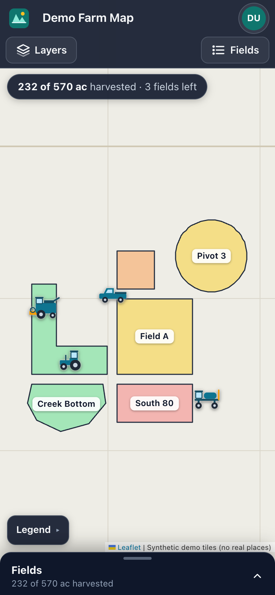 | 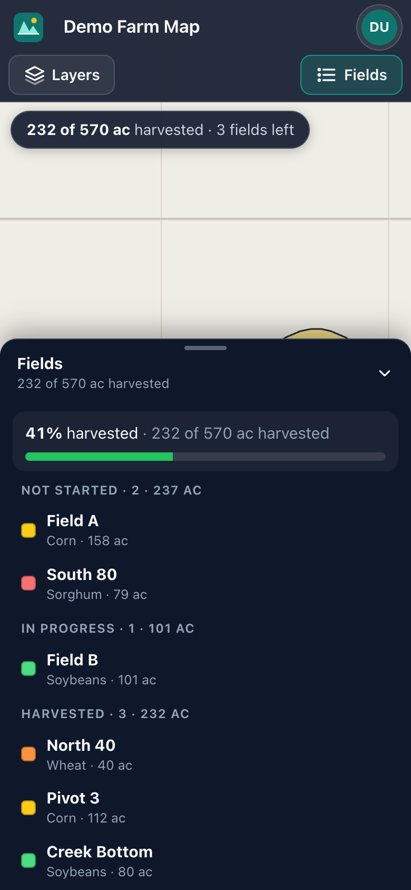 | 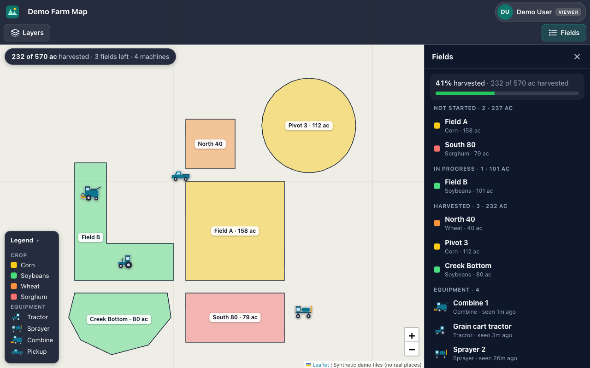 |

Stack: Vite 7, React 19, TypeScript, Leaflet 1.9 and react-leaflet 5. Styling
is plain CSS with custom properties, so you can see every rule. There's no
Tailwind, no router library and no state library. An optional small Express
server (`server/`) adds sign-in through an identity provider. It's off by
default; see [Optional sign-in](#optional-sign-in-oidc).

> **How the demo differs from the house stack.** The demo is kept small, so a
> few things here are deliberately simpler than what the playbook (and its
> prompts) tell you to build. Copy the patterns, not these shortcuts:
>
> | The house stack (docs, prompts) | This demo | So when you copy from here |
> |---|---|---|
> | Tailwind CSS | Plain CSS in `src/styles.css` | Translate the rules into Tailwind classes |
> | Esri World Imagery (satellite) | OpenStreetMap tiles | Keep your satellite layer; only the tile URL differs |
> | Share viewer: a separate `share.html`, plain TypeScript + Leaflet, **no React** | A React route in the main bundle (`src/share/ShareViewer.tsx`) | **Don't bring React into `share.html`.** Copy the logic (token lookup, styling from properties, error words), not the component |
> | Share tokens looked up on the server (`GET /api/share/:token`) | A public `public/shares/registry.json` | Keep the registry on the server: a public file lists every token |
> | Data from the API and PostGIS | Invented data in `src/data/demoFarm.ts` | Fetch from `/api/*` behind sign-in |
> | Layers and list + detail in slide-out drawers | A Layers drawer, plus a *list sheet* for the Fields list (bottom sheet on a phone, side panel when wider) | Drawers stay drawers at every size. A list sheet is for list-first views (docs/02 sections 7 and 10) |
> | Express + TypeScript server | `server/` in plain JavaScript, checked by TypeScript | Same structure; write it in TypeScript |
>
> Telling an agent "copy it from example/"? Add: "but follow the house rules:
> Tailwind, satellite basemap, and a React-free share.html".

## Run it

You need Node 22.12 or newer. (Vite 7 also runs on Node 20.19+, but Node 20
reached end of life in April 2026, and the Docker image uses `node:22-alpine`.)

```bash
npm install
npm run dev        # http://localhost:5173 (hot reload)
npm run build      # type-check (tsc) + production build into dist/
npm run preview    # serve dist/ at http://localhost:4173
npm start          # serve dist/ from the optional Node server at http://localhost:3000
```

Try these URLs:

| URL | What you get |
|---|---|
| `/` | The farm map |
| `/?color=status` | Fields coloured by harvest status instead of crop |
| `/?layers=fields,labels,equipment,grid` | All four layers, including the outline-only grid |
| `/s/demo-7k2m9q4x8p` | The share viewer, showing a GeoJSON plan picked by its token |
| `/s/not-a-token` | The share viewer's "link isn't valid" screen |

The layer toggles write themselves into the URL, so Back, refresh and a copied
link all reopen the same view.

## Run it in Docker

```bash
docker build -t react-maps-example .
docker run --rm -p 8080:80 react-maps-example
# open http://localhost:8080
```

Or with compose, which reads `${VAR}` values from your shell or a `.env` file:

```bash
cp .env.example .env      # dummy values; edit HOST_PORT if 8080 is taken
docker compose up --build # docker-compose.override.yml adds the local build
```

The image is two stages. `node:22-alpine` runs `npm ci && npm run build`, then
`nginx:1.30-alpine` (the current stable line) serves `dist/` using
`nginx.conf`, which does the following:

- falls back to `index.html` so client routes like `/s/<token>` work
- caches the hashed `/assets/*` files for a year and never caches the HTML
  shell, so a deploy always wins on the next load
- sends `X-Robots-Tag: noindex` on share pages and share data
- answers `/health` with JSON for Docker's healthcheck or an uptime monitor

Build info such as the version, commit and build time goes in with
`--build-arg` and shows up in the user menu under **About this demo**. Vite
bakes `VITE_*` values in at build time, so changing them on a running
container does nothing.

## Optional sign-in (OIDC)

`server/` is a small Express server (three files, plain JavaScript checked by
TypeScript) that serves the built app and can sign people in through an OIDC
identity provider such as Authentik. **Sign-in is off by default**, and then
everyone is the made-up Demo User, just like the static demo. The full story
is in [docs/14-login-with-authentik.md](../docs/14-login-with-authentik.md).

| File | What it does |
|---|---|
| `server/config.js` | Reads the environment and **refuses to start** when it's unsafe (the fail-closed rules below) |
| `server/auth.js` | `/api/auth/login`, `/callback`, `/me`, `/logout`; groups → role; the sign-in gate |
| `server/index.js` | Health, static files with nginx's cache rules, public share pages, sessions, then the gate |
| `src/lib/auth.ts` | The browser side: asks `/api/auth/me`, sends a signed-out visitor to the IdP, signs out |

**Run it without sign-in** (development, so no extra flags):

```bash
npm run build && npm start              # http://localhost:3000, Demo User
```

**Run it with your identity provider.** Create the app in your IdP first
([infra/authentik/README.md](../infra/authentik/README.md) has a checklist).
Add `http://localhost:3000/api/auth/callback` as a redirect URI, then put the
settings in `.env` (gitignored) and start the server with it:

```bash
# .env: OIDC_ENABLED=true, OIDC_ISSUER_URL, OIDC_CLIENT_ID, OIDC_CLIENT_SECRET,
#       OIDC_REDIRECT_URI=http://localhost:3000/api/auth/callback, ROLE_MAP, ...
npm run build && node --env-file=.env server/index.js
```

**In Docker** the server is a separate target of the same Dockerfile. A plain
`docker build .` still makes the nginx image.

```bash
docker build --target server -t react-maps-example:server .

docker run --rm -p 3000:3000 react-maps-example:server
# FATAL: Sign-in is off (OIDC_ENABLED is not "true") and NODE_ENV=production. Refusing to start ...

docker run --rm -p 3000:3000 -e ALLOW_NO_AUTH=true react-maps-example:server
# WARNING: ALLOW_NO_AUTH=true: running in production WITHOUT sign-in ...   (a public demo)

docker run --rm -p 3000:3000 --env-file .env react-maps-example:server
# [server] production, sign-in ON via https://auth.example.com, port 3000
```

The image sets `NODE_ENV=production`, so the OIDC settings must use https.
Put it behind Caddy (docs/13); the server trusts one proxy hop for
`X-Forwarded-Proto`, which is what makes the Secure session cookie work.

**What it refuses** (it prints `FATAL:` lines and exits, so the container
restart-loops where you'll notice it, instead of quietly running open):

| Situation | Result |
|---|---|
| `NODE_ENV=production`, `OIDC_ENABLED` unset or `false` | Refuses, unless `ALLOW_NO_AUTH=true` is set on purpose |
| `OIDC_ENABLED=True`, `1`, `yes` | Refuses: only exactly `true` or `false` |
| OIDC on, any of issuer, client ID, client secret or redirect URI missing | Refuses and lists each one |
| Production, `SESSION_SECRET` missing, shorter than 32 characters, or a known default | Refuses |
| Production, an `http://` issuer or redirect URI | Refuses |
| `ROLE_MAP` not valid JSON, or a role other than viewer / operator / admin | Refuses |
| `DEFAULT_ROLE` not set | Treated as `none`: someone in no mapped group gets "no access", not a role. Set `viewer` only on purpose |
| OIDC settings present but `OIDC_ENABLED` missing | Refuses, and says the flag was probably lost |

**With sign-in on, what's public and what isn't:**

- Public: `/health`, `/api/auth/*`, built files (`/assets/*`, `/icon.svg`), share pages `/s/<token>` and their data `/shares/*`.
- Needs a session: the app shell (`/` and every other page) and every other `/api/*` route. A page load goes straight to the IdP and comes back to the same page. An API call gets a 401.
- In this demo the field data is inside the JavaScript bundle, so the gate is a demonstration. In a real app the data comes from `/api/*`, and that's what the session protects.

**Check from outside after a deploy:**

```bash
curl -s https://maps.example.com/health                                   # {"status":"ok","auth":"oidc"}
curl -s -o /dev/null -w '%{http_code}\n' https://maps.example.com/api/x    # 401
curl -s -o /dev/null -w '%{redirect_url}\n' https://maps.example.com/      # .../api/auth/login?next=%2F
```

**Good to know:**

- Sessions live in memory (express-session's MemoryStore), so a restart signs
  everyone out, and the server logs a warning about it in production. That's
  fine for one demo container. A real app uses a Redis or Postgres session
  store (`connect-redis`, `connect-pg-simple`).
- "Sign out" ends the IdP session too: with `OIDC_LOGOUT_URL` set to
  Authentik's invalidation flow, or through the standard end-session endpoint
  when it isn't set (docs/14 explains the Authentik setting that makes that work).
- Set `OIDC_PASSKEY_URL` and the user menu shows **Add a passkey**.
- `npm run dev` (Vite) has no server, so it always shows the Demo User.
  To try real sign-in, build and run the server.

## How it's deployed (the pattern, with placeholders)

1. Push to `main`. `.github/workflows/build.yml` builds the image and pushes it
   to GitHub Container Registry as `ghcr.io/<owner>/<repo>:latest` (plus a
   branch tag and a `sha-…` tag). It logs in with the built-in `GITHUB_TOKEN`,
   so there's no secret to set up. Pull requests build without pushing.
2. On the server, `docker-compose.yml` only says `image:`. It never builds.
   A Portainer "stack from Git repository" (or plain `docker compose pull && up -d`)
   pulls the new image. In Portainer, turn on **Re-pull image**, or `:latest`
   won't update.
3. A reverse proxy such as Caddy terminates TLS for `maps.example.com` and
   forwards to the container's host port.
4. Compose gets its settings through `${VAR}` substitution. Hosts like Portainer
   don't ship your `.env` file. Give safe values defaults (`${HOST_PORT:-8080}`),
   and mark every secret in a real app as required (`${JWT_SECRET:?must be set}`)
   so a deploy with a lost environment fails loudly instead of starting
   insecure.

> GitHub only runs workflows from `.github/workflows` at the **root** of a
> repository. If `example/` becomes its own repo, the workflow runs as-is.
> Inside the playbook repo, copy it to the root, set `APP_DIR: example`, and
> set `IMAGE_NAME: ${{ github.repository_owner }}/react-maps-example`.
> Otherwise the image is named after the playbook repo, not the
> `react-maps-example` name that `scripts/do/do.env.example` and
> `scripts/do/cloud-init.yaml` expect.

## Where each pattern lives

| Pattern | File |
|---|---|
| z-index ladder (Leaflet's numbers + the app's), mobile-first CSS | `src/styles.css` (top of file) |
| Full-bleed map, chrome floating over it, map "caged" with `isolation: isolate` | `src/MapPage.tsx`, `.map-wrap` in CSS |
| Two-line top bar, one line on a landscape phone (`display: contents`) | `src/ui/TopBar.tsx` |
| `--bar-h` measured by ResizeObserver instead of hard-coded offsets | `src/lib/chrome.ts` (`useMeasuredVar`) |
| Slide-out **Layers** drawer (backdrop 1390 / panel 1400) | `src/ui/LayersDrawer.tsx` |
| Layer switches whose accent colour matches the map | `LayerToggle` in `src/ui/LayersDrawer.tsx` |
| A *list sheet* (docs/02 section 10): **beside** the map on desktop and landscape, a **bottom sheet** on a portrait phone, one shared media query. Drawers, by contrast, slide out the same way at every size | `src/ui/ListPanel.tsx`, `PANEL_QUERY` in `src/lib/router.ts` |
| Leaflet's attribution and zoom buttons move clear of the panel or sheet | `.leaflet-bottom` / `.leaflet-right` in CSS |
| Legend (`<details>`, open on wide screens, folded on phones) | `src/ui/Legend.tsx` |
| Totals chip that drops words to fit (`data-fit`) | `src/ui/TotalsChip.tsx` |
| Popups that autopan clear of the bar, chip, legend and list | `popupOptions()` in `src/lib/chrome.ts`, `src/map/popups.ts` |
| Fits that leave room for the chrome | `fitPadding()` in `src/lib/chrome.ts`, `src/map/helpers.tsx` |
| Labels that never overlap each other, a machine or any UI | `src/map/LabelsLayer.tsx` |
| A label point that's inside an L-shaped field | `labelPoint()` in `src/data/geo.ts` |
| Custom SVG equipment icons as `L.divIcon` (no PNG pins) | `src/map/equipmentIcons.ts`, `src/map/EquipmentLayer.tsx` |
| One component per overlay; restyle in place with `setStyle` | `src/map/FieldsLayer.tsx` |
| Outline-only, non-interactive reference layer | `OutlineLayer` in `src/map/FieldsLayer.tsx` |
| `invalidateSize()` on every resize (phones settle late) | `InvalidateOnResize` in `src/map/helpers.tsx` |
| User menu rendered with `createPortal` at z 9998 / 9999 | `src/ui/UserMenu.tsx` |
| Modal (z 2000), toast (z 3000), crash screen | `src/ui/AboutDialog.tsx`, `src/ui/Toast.tsx`, `src/ui/ErrorBoundary.tsx` |
| "Clear cache & reload" that really busts the cache | `src/lib/hardReset.ts` |
| A router you can read in a minute; the map stays mounted under other pages | `src/lib/router.ts`, `src/App.tsx` |
| Layer state in the query string (`?layers=…&color=…`) | `src/lib/layersUrl.ts` |
| Share viewer: token → registry → static GeoJSON, styled from feature properties | `src/share/ShareViewer.tsx`, `public/shares/` |
| `esc()` on everything that goes into divIcon or popup HTML | `src/lib/esc.ts` |
| Optional sign-in: OIDC with PKCE, groups → role, session cookie, real logout | `server/auth.js`, `src/lib/auth.ts` |
| Refuse to start in production with sign-in off or a default secret | `server/config.js` |
| Same cache rules from Node as from nginx; share pages stay public | `server/index.js` |
| A tiny data tool that writes byte-identical GeoJSON | `scripts/make-demo-share.mjs` (`npm run make-share`) |

### The three rules that save the most time

1. **Write the z-index ladder down.** Leaflet uses tiles 200, vectors 400,
   markers 600, popups 700 and controls 1000. Everything the app puts over the
   map must be at least 1000.
2. **Portal every dropdown to `<body>`.** The top bar uses `backdrop-filter`,
   which creates a stacking context, so a menu inside it can never rise above
   the map, however high its z-index. `createPortal(…, document.body)` plus a
   click-trap backdrop is the only fix that holds.
3. **Ask the chrome, don't hard-code it.** Every floating element carries
   `data-chrome="top|bottom|right|corner"`. Popups, fits and labels measure
   those elements when they need to, so rotating a phone or opening the list
   just works.

## Share links

`/s/<token>` looks the token up in `public/shares/registry.json` with
`Object.hasOwn`, not `registry[token]`, which would also match `constructor`.
It then loads the GeoJSON file named there. The file name comes from the
registry, never from the URL. The token in this repo is a dummy.

In a real deployment, keep the registry **on the server**
(`GET /api/share/:token`), because a public registry file lists every token,
and the token is the only thing protecting the data. Generate tokens like
`<slug>-<10 random base36 chars>`. To revoke a link, delete its entry and
redeploy. Never commit real tokens to a public repo.

## Mobile checks

Every screen was checked at **320×568, 390×844, 844×390 (landscape phone) and
1280×800**. Headless Chrome's `--window-size` doesn't give exact phone
viewports, so the screenshots in `docs/img/` were taken over the DevTools
protocol with `Emulation.setDeviceMetricsOverride`, which sets exact width,
height, pixel ratio and "mobile" mode. Playwright's `viewport` option does the
same. They were built with `VITE_TILE_URL` pointing at a small local server
that draws a synthetic road grid, and `VITE_TILE_ATTRIBUTION` saying so, which
is why the corner credit and the drawer's small print read "Synthetic demo
tiles". Those two lines come from the tile settings, so they always name the
basemap you actually configured.

| 320×568 | 844×390 | Layers drawer | User menu (portaled) |
|---|---|---|---|
| 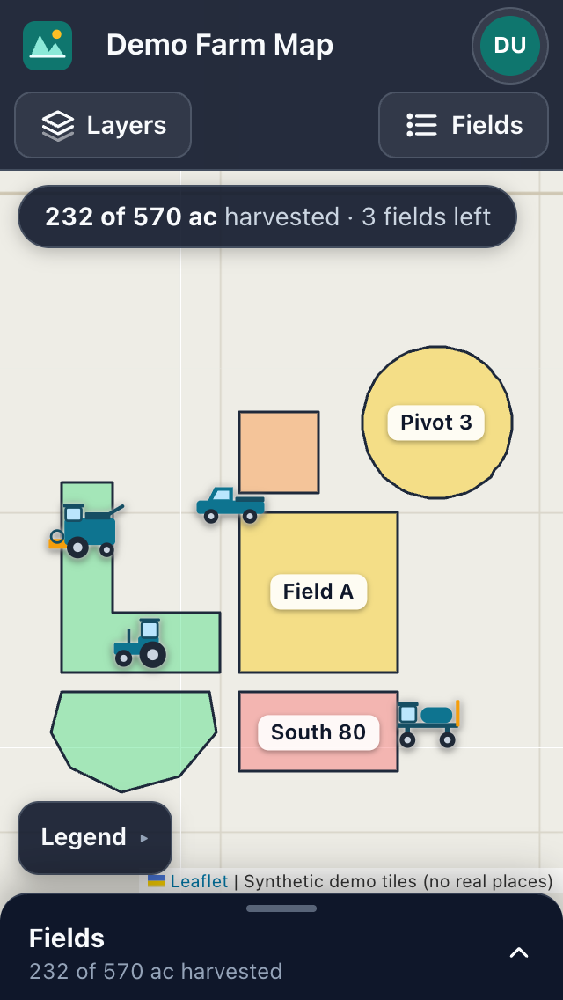 | 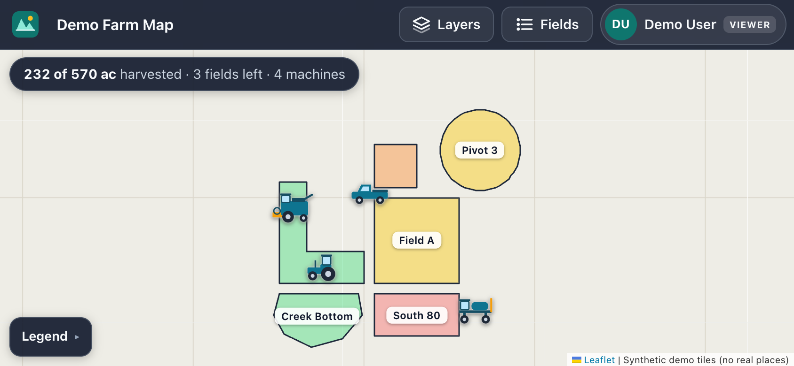 | 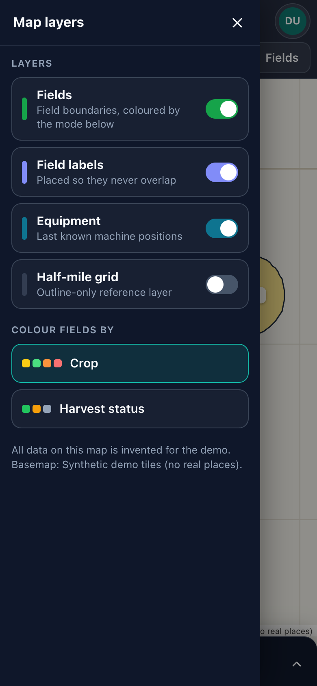 | 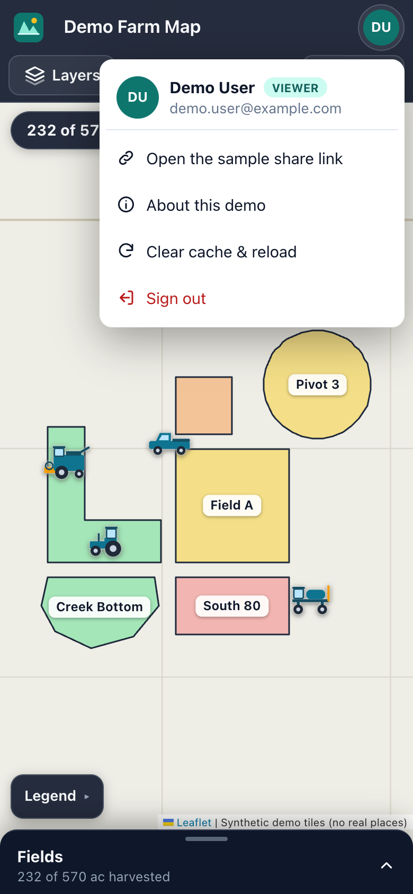 |

| Popup clear of the bar and sheet | Popup beside the side panel | Equipment popup | Share viewer |
|---|---|---|---|
| 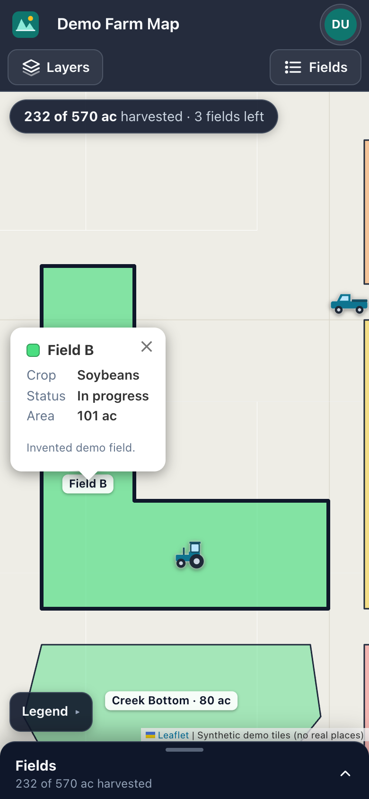 | 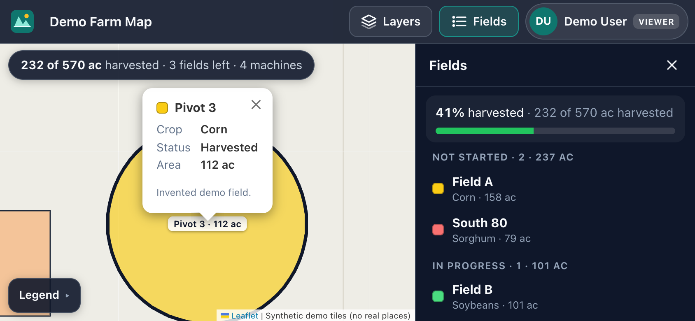 | 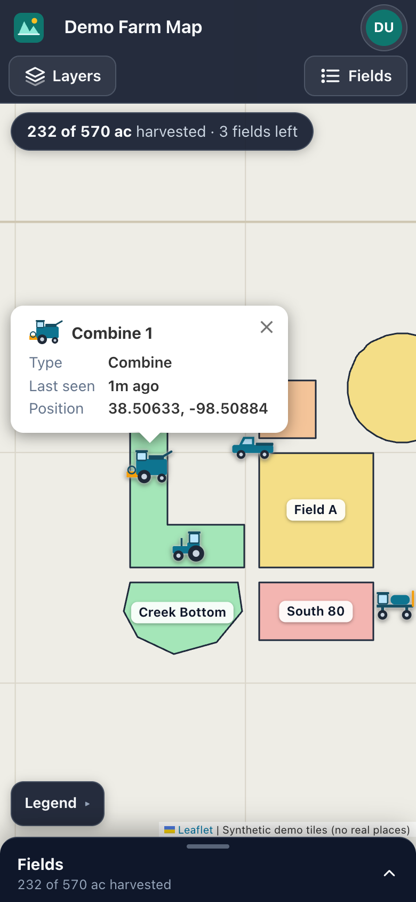 | 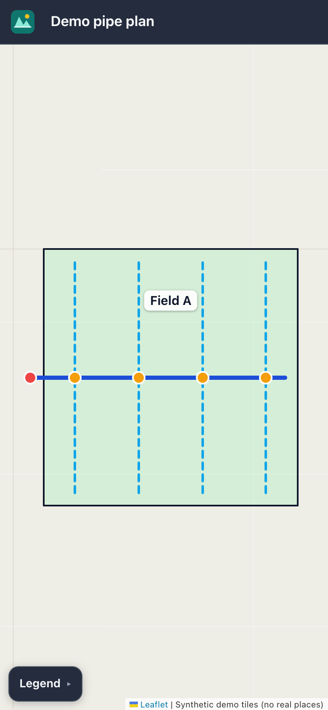 |

## What a real app adds

This demo is front-end only. A production version of the same map usually
adds the following. The playbook covers each one.

- **Sign-in** through an identity provider (OIDC, e.g. Authentik) handled by the
  server, with roles mapped from IdP groups. The optional `server/` here shows
  the shape (session cookie, groups → role, real logout); a real app adds a
  persistent session store and role checks on every write.
- **An API and a database** (e.g. Express or FastAPI on PostgreSQL/PostGIS).
  The fields would come from `GET /api/fields` instead of `src/data/demoFarm.ts`.
- **Fail-closed auth in production.** If auth is off or the secret is a
  default, the app refuses to start. `server/config.js` does exactly this.
- **`/health` and `/api/about`** endpoints, so "did my redeploy take?" is a
  commit-SHA comparison.
- **A service worker**, if you want it installable. Never cache `index.html`
  in an always-online app.

## Basemap and attribution

The tiles come from `tile.openstreetmap.org`, which is fine for a demo and
light use. OpenStreetMap's tile usage policy requires visible attribution
(Leaflet shows it bottom-right, and this app keeps it clear of the list panel)
and doesn't allow heavy use. For production, point `VITE_TILE_URL` at your own
tile server or a provider and update `VITE_TILE_ATTRIBUTION`.

## Files

```
example/
├── src/
│   ├── App.tsx              two routes; keeps the map mounted
│   ├── MapPage.tsx          the farm map page
│   ├── styles.css           all styles + the z-index ladder
│   ├── data/                invented fields/machines + flat-earth geometry helpers
│   ├── lib/                 router, chrome measuring, URL state, esc, hardReset, tiles, auth
│   ├── map/                 Leaflet layers (fields, labels, equipment), popups, helpers
│   ├── share/               the /s/<token> viewer (a React route here; React-free share.html in a real app)
│   └── ui/                  top bar, drawer, list panel, legend, chip, user menu, dialogs
├── server/                  optional Node server: sign-in (OIDC) + fail-closed config
├── public/shares/           registry.json (dummy token) + demo-plan.geojson
├── scripts/                 make-demo-share.mjs
├── Dockerfile, nginx.conf   build + serve (nginx by default, `--target server` for Node)
├── docker-compose.yml       image-only (production shape)
├── docker-compose.override.yml   adds `build:` for local use
├── .github/workflows/build.yml   build + push to GHCR
└── .env.example             dummy values only
```
